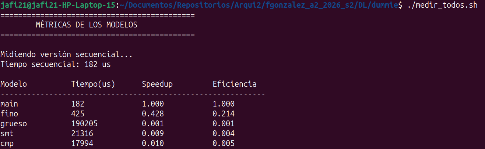

# Deep Learning + ThreadLevel Parallelism

## Índice del markdown

1. [Estructura del proyecto](#estructura-del-proyecto)
2. [Instalación](#instalación)
3. [¿Qué busca Deep Learning?](#qué-busca-deep-learning)
4. Forward pass - p1
5. Forward pass - p2
6. Backpropagation
7. Descenso de Gradiente
8. Repetir entrenamiento
9. Problemas más complejos -> Modelos más completos
10. Paralelización en el modelo simple
11. Propuesta de paralelización dummie para el modelo simple
12. [Reporte de resultados para el modelo $\textit{dummie}$](#12-reporte-de-resultados-para-el-modelo)
13. [Deep Learning para modelo complejo MNIST](#13-deep-learning-para-modelo-complejo-mnist)

## Estructura del proyecto

```
DL/
├── dummie/
│   └── ...
├── src/
│   └── ...
├── data/
│   └── mnist/
│       ├── train-images-idx3-ubyte
│       ├── train-labels-idx1-ubyte
│       ├── t10k-images-idx3-ubyte
│       └── t10k-labels-idx1-ubyte
├── docs/
└── ...
```

En `dummie/` encontrará el modelo simple secuencial y su paralelización multihilo simple. La idea es mostrar una de las etapas esenciales donde se realizará el multihilo para el modelo a gran escala (que sigue en desarrollo en `src/`).

## Instalación

```bash
# MacOS
clang++ --version

brew install eigen
brew info eigen

# Linux
sudo apt install libeigen3-dev

# Instalar MNIST
# Estando en la cabeza del proyecto

mkdir datasets
cd datasets
mkdir mnist
cd ..
cd ..

curl -fL "https://storage.googleapis.com/cvdf-datasets/mnist/train-images-idx3-ubyte.gz" \
  -o data/mnist/train-images-idx3-ubyte.gz

curl -fL "https://storage.googleapis.com/cvdf-datasets/mnist/train-labels-idx1-ubyte.gz" \
  -o data/mnist/train-labels-idx1-ubyte.gz

curl -fL "https://storage.googleapis.com/cvdf-datasets/mnist/t10k-images-idx3-ubyte.gz" \
  -o data/mnist/t10k-images-idx3-ubyte.gz

curl -fL "https://storage.googleapis.com/cvdf-datasets/mnist/t10k-labels-idx1-ubyte.gz" \
  -o data/mnist/t10k-labels-idx1-ubyte.gz

# Para descomprimir las img
gunzip data/mnist/*.gz

# Para comprimir las img
gzip data/mnist/*
```

## ¿Qué busca Deep Learning?

El objetivo: tomar un batch de entradas $x$, pasarlas por una serie de capas ocultas y obtener una salida $\hat{y}$ lo más cercana posible a una predicción $y$

Podemos ver un ejemplo para un vector $x$ de 2 elementos, en este caso, el proceso de una etapa de entrenamiento consiste en:

```
x -> forward pass 1 -> capa(s) oculta(s) -> forward pass 2 -> salida
```

Se utilizarán matrices de pesos y vectores de sesgo. Al principio se definen como valores aleatorios cualquiera.

## Forward pass - p1

Forward pass es el proceso de transformar la entrada y aplicarle una función de activación.

Llamemos al vector de entrada transformado (pero sin aplicarle la función de activación) $z_1$, y se le llama $a_1$ (en la literatura se le llama también $\phi$) cuando se le aplica la función de activación.

```math
x \rightarrow z_1 = xW_1 + b_1
```

Note que la operación hecha es producto punto, la cuál es la multiplicación de `Eigen`.

```math
z_1 \rightarrow a_1 = \sigma(z_1)
```

Con $\sigma$ la función `sigmoid` o `RELU`. Para `sigmoid` se tiene que es:

```math
\sigma(z)=\frac{1}{1+e^{−z}}
```

Así, $a_1$ es el valor del `hidden layer` que se le pasará a la salida.

## Forward pass - p2

Ahora debe aplicarse el mismo proceso para pasar el valor de hidden layer como entrada al nodo de salida. 

Se hace lo mismo: transformar la entrada y aplicarle una función de activación.

```math
a_1 \rightarrow z_2 = a_1W_2 + b_2
```

```math
z_2 \rightarrow a_2 = \sigma(z_2)
```

Así, se tiene listo el nodo de salida:

```math
a_2 = \hat{y}
```

## 6. Backpropagation

Teniendo la salida del modelo, hay que verificar que tan alejado es de la predicción establecida. Se puede utilizar el `Mean Squared Error (MSE)`, que simplemente calcula el cuadrado de la diferencia.

```math
MSE = \frac{1}{N} \sum_{​i=1}^N​(y_i​ − \hat{y_i}​)^2
```

Para una sola muestra, $N=1$

Teniendo el error, es posible trabajar desde la salida hacia atrás para averiguar cuanto cambia cada peso y sesgo el `MSE`. Esto es lo que significa la función $L$, la `Loss Function` (función de cambio).

Computacionalmente hablando, podemos usar los resultados conocidos de las derivadas para aproximar la `Loss Function`. Recuerde que en cálculo, la derivada representa el cambio ante un cambio muy pequeño. 

Así, podemos aplicar derivadas para descubrir que tanto cambia el error si se varían los pesos ($W_1$, $W_2$) y sesgos ($b_1$, $b_2$) que se definen al principio. De esta forma podemos saber que tan significativo es un parámetro en cuánto a la influencia sobre el cambio se refiere.


### Variación del error MSE respecto a $W_2$

Observemos cuanto cambia la pérdida $L$ (dada por el MSE)

```math
\frac{\partial L }{\partial W_2}
```

Note que es una derivada parcial que se puede representar (usando regla de la cadena) como:

```math
\frac{\partial L}{\partial W_2} = \frac{\partial L}{\partial z_2} a_1^T
```

A su vez, la derivada parcial de la derecha se puede representar como: 

```math
\frac{\partial L}{\partial z_2} = \frac{\partial L}{\partial \hat{y}} \frac{\partial \hat{y}}{\partial z_2}
```

Ahora bien, estas derivadas se pueden calcular por fuera. Se tiene que:

1. Error respecto a la salida

```math
L=(y−\hat{y})^2
```

La derivada es sencilla:

```math
\frac{\partial L}{\partial \hat{y}} = 2(y−\hat{y})
```


2. Salida respecto a $z_2$

```math
\hat{y} = a_2 = \sigma(z_2)
```

Se conoce que la derivada de sigmoid es:

```math
\sigma'(z)= \sigma(z)(1−\sigma(z))
````

Por lo tanto:

```math
\frac{\partial \hat{y}}{\partial z_2} = \hat{y}(1-\hat{y})
```

3. Juntar resultados

Entonces, llegamos a una expresión simplificada:

```math
\frac{\partial L}{\partial W_2} = 2(y−\hat{y}) (\hat{y}(1-\hat{y})) (a_1^T)
```

### Variación del error MSE respecto a $b_2$

Se tiene la ecuación:

```math
z_2 = a_1W_2 + b_2
```

Note que, si se deriva respecto a $b_2$, $a_1W_2$ queda como constante. Por lo tanto:

```math
\frac{\partial L}{\partial b_2} = \frac{\partial L}{\partial z_2} = \hat{y}(1-\hat{y})
```

### Variación del error MSE respecto a $W_1$

```math
\frac{\partial L }{\partial W_1}
```

Note que es una derivada parcial que se puede representar (usando regla de la cadena) como:

```math
\frac{\partial L}{\partial W_1} = \frac{\partial L}{\partial z_1} x^T
```

Es posible expandir la derivada parcial del lado derecho ($z_1$) con regla de la cadena:

```math
\frac{\partial L}{\partial z_1} = \frac{\partial L}{\partial a_1} \odot \frac{\partial a_1}{\partial z_1}
```

Con $\odot$ la multiplicación `element wise`.

Es posible definir las nuevas derivadas parciales del lado derecho:

1. Derivada de $a_1$ respecto a $z_1$

Se sabe que:

```math
a_1 = \sigma(z_1)
```

Por lo que la derivada es

```math
\frac{\partial a_1}{\partial z_1} = a_1(1-a_1)
```

2. Derivada de $L$ respecto a $a_1$

Se sabe que: 

```math
z_2 = a_1W_2 + b_2
```

Entonces, para saber cuanto afecta $a_1$ al error, reacomodando la ecuación:

```math
\frac{\partial L}{\partial a_1} = W_2^T\frac{\partial L}{\partial z_2}
```

(b es constante entonces desaparece)

3. Así, puede reescribirse la ecuación como:

```math
\frac{\partial L}{\partial W_1} = (W_2^T\frac{\partial L}{\partial z_2}) \odot (a_1(1-a_1))x^T 
```

Y a su vez:

```math
\frac{\partial L}{\partial W_1} = (W_2^T(\hat{y}(1-\hat{y}))) \odot (a_1(1-a_1))x^T
```

### Variación del error MSE respecto a $b_1$

Se tiene la ecuación:

```math
z_1 = W_1x + b_1
```

Note que, si se deriva respecto a $b_1$, $W_1x$ queda como constante. Por lo tanto:

```math
\frac{\partial L}{\partial b_1} = \frac{\partial L}{\partial z_1} = (W_2^T(\hat{y}(1-\hat{y}))) \odot (a_1(1-a_1))
```

## 7. Descenso de Gradiente

Ahora que se tienen las derivadas se conoce computacionalmente cuánto ha variado la salida obtenida del resultado deseado y cuánto ha influenciado cada parámetro en esa diferencia.

Estas derivadas de la `Loss` function respecto a:

`dW1
db1
dW2
db2`

Se les llaman `gradientes` e indican en qué dirección cambia el error si modificamos cada parámetro.

Así, es posible utilizar la función llamada: `descenso de gradiente`.

Esta función, de forma simple: indica en que dirección debe moverse la función para llegar a un mínimo local (o sea, reducir la función, en este caso `Loss`, lo más posible).

De esa forma, lo que se obtiene es reducir el error respecto a la predicción deseada actualizando los parámetros mediante el descenso de gradiente. Para los parámetros `\theta` (peso o bias), el descenso de gradiente consiste en:

```math
\theta_{nuevo} = \theta_{actual} - \eta \frac{\partial L}{\partial \theta}
```

donde $\eta$ es llamado el Learning Rate, y es (por ilustrarlo meramente) que tanto o que tan rápido nos movemos (descendemos) en la dirección (dada por el gradiente $\frac{\partial L}{\partial \theta}$)

Note que es llamado descenso porque hay un $-$ (o sea, nos estamos moviendo negativamente en la dirección dada por el gradiente). Normalmente, $\eta$ no debe ser muy grande para que al acercarse al mínimo local no se sobre pase por accidente (irse acercando poco a poco con precisión).

Un $\eta = 0.1$ es aceptable

## 8. Repetir entrenamiento

Todo este proceso previo consiste en 1 sola etapa de entrenamiento de un modleo. Los modelos profesionales/modernos de `Deep Learning` generan miles de iteraciones de entrenamiento para que el propio modelo `aprenda` a optimizar sus pesos y sesgos.

Computacionalmente hablando, esto puede hacerse con un bucle for sencillo:

```C
for (int epoch = 0; epoch < 1000; epoch++) {
    // 1. Forward-pass
    // 2. MSE
    // 3. Backpropagation
    // 4. Actualizar pesos
}
```

## 9. Problemas más complejos -> Modelos más completos

El modelo presentado actualmente es meramente un ejemplo para comprender el funcionamiento de un modelo de Deep Learning. Ciertamente es un modelo demasiado simple pues tiene únicamente 5 neuronas:

- 2 neuronas de Input
- 2 neuronas de Hidden Layer
- 1 neurona de Output

Sin embargo, la matemática y conceptos aplicados en este modelo simple es equivalente a la aplicada en modelos más grandes. 

Para avanzar un poco la complejidad, puede considerarse el famoso problema de reconocer dígitos del 0-9. Para un ser humano esto es una tarea sencilla, pero para una máquina no tanto.

Se utilizará la base de datos `MNIST` (https://www.kaggle.com/datasets/hojjatk/mnist-dataset), la cuál contiene imágenes de 28x28 píxeles.

Por tanto, resolver este problema requiere de un modelo mucho más complejo. Primero, se necesitan 10 salidas, una por dígito. Luego, son 28x28 entradas, o sea, 784 entradas. Además, puede plantearse utilizar dos capas ocultas en vez de una (debido a la complejidad): una de 128 y otra de 64. En resumen:

- 28x28 = 784 neuronas de Input
- 128 neuronas de Hidden Layer 1
- 64 neuronas de Hidden Layer 2
- 10 neuronas de Output

Esto se traduce en un cambio de dimensiones y agregar una capa extra. Los cambios serían:

```
x   = 2 × 1 -> 784 x 1

W1  = 2 × 2 -> 128 x 784
b1  = 2 × 1 -> 128 x 1

W2  = 1 × 2 -> 64 x 128
b2  = 1 × 1 -> 64 x 1

W3  = N/A -> 10 x 64
b3  = N/A -> 10 x 1
```

Esencialmente, ya no son solamente 4 multiplicaciones sino:

```math
128\times784=100\,352
```

multiplicaciones por muestra. Esto sin tomar en cuenta las demás capas. Este modelo será el modelo final a realizar en este proyecto. 

## 10. Paralelización en el modelo simple

Este modelo simple de ejemplo, si bien pequeño sigue siendo bastante útil para entender los principios de la paralelización.

Actualmente el flujo del programa es:
1. `Forward-pass` (calcula neuronas de Hidden Layer y Salida)
2. `MSE`
3. `Backpropagation`
4. `Actualizar pesos`
5. `Repetir`

De esto hay varios aspectos que pueden paralelizarse.

### Paralelizar una neurona de forward-pass

Actualmente se realiza:

```math
z_1 = W_1 * x + b_1
```

Matemáticamente esto corresponde a:

```math
z_{1,0} = W_{1,00} * x_0 + W_{0,1} * x_1 + b_{1,0}
```
```math
z_{1,1} = W_{1,10} * x_0 + W_{1,1} * x_1 + b_{1,1}
```

pues es una multiplicación de matriz con vector.

Note que las dos neuronas producidas $z_{1,0}$ y $z_{1,1}$ no dependen entre sí, sino que ambas dependen de resultados ya producidos previamente. Esto implica que es posible repartirlas entre hilos. A su vez, si la cantidad de neuronas de la capa oculta aumenta, también podría aumentar el paralelismo pues `ninguna neurona del mismo nivel depende entre sí`.

Realmente la operación de `Eigen` con matriz realiza dos operaciones, de forma similar a:

```C
Eigen::Vector2d z1;
int n = 2;

for (int i = 0; i < n; i++) {

    z1(i) = b1(i);

    for (int j = 0; j < n; j++) {
        z1(i) += W1(i, j) * x(j);
    }
}
```

dónde $n$ es el número de neuronas que hay en el nivel (en este caso, la capa oculta tiene 2 neuronas). Entonces, es posible en vez de utilizar el `for` conceptual que hace Eigen, separar la operación en $n$ hilos para este caso (luego $n$ podría ser tan grande que separarlo en tantos hilos quizá no sea beneficioso). 

Algo similar puede aplicarse para la neurona de salida. En resumen, $\textit{La unidad de trabajo a paralelizar es una neurona}$.

### Paralelizar la función de activación ($\sigma$)

Actualmente se tiene: 

```math
a_1 = \sigma(z_1)
```

Lo cuál, matemáticamente corresponde a:

```math
a_{1,0} = \sigma(z_{1,0})
```
```math
a_{1,1} = \sigma(z_{1,1})
```

Note que, nuevamente, $a_{1,0}$ y $a_{1,1}$ no dependen entre sí. Por lo tanto, esto también puede ser paralelizado. Ocurre lo mismo que el `for` conceptual de forward-pass. Note que, conforme crezca la cantidad de neuronas de la capa oculta, mayor es la cantidad de $\sigma(z)$ no dependientes entre sí que deben calcularse, por lo que se logra paralelizar bastante.

En resumen, $\textit{La unidad de trabajo a paralelizar es la activación de una neurona}$.

### Paralelización del backpropagation

El cálculo de los gradientes es otro aspecto bastante paralelizable. Veáse por ejemplo, para la capa oculta:

```C
// Derivada del error respecto al peso W1
        Vector2d dL_da1 =
            W2.transpose() * dL_dz2;

        Vector2d sigmoid_derivative =
            a1.array() * (1.0 - a1.array());

        Vector2d dL_dz1 =
            dL_da1.array() * sigmoid_derivative.array();
```

Note que, al estar involucrada una matriz y un escalar, $\frac{\partial L}{\partial a_1}$ puede representarse computacionalmente como:

```C
dL_da1[0] = W2[0] * dL_dz2
dL_da1[1] = W2[1] * dL_dz2
```

Lo mismo para $a_1$, el cuál se representa como `array`, puede verse como:

```C
sigmoid_derivative(0) = a1(0) * (1.0 - a1(0))
sigmoid_derivative(1) = a1(1) * (1.0 - a1(1))
```

Lo mismo aplica para $z_1$, el cuál es el producto `element-wise` de los resultados previos. Como ambos resultados tienen indexación $(0,1)$, puede paralelizarse su producto.

Luego, el resultado obtenido de la derivada del error respecto a $z_1$ se utiliza para obtener la generada respecto a la matriz de pesos $W_1$. Esto también es paralelizable.

```C
Matrix2d dW1 = dL_dz1 * x.transpose();
```

Recuerde que esto es una operación:
```
2x1 x 1x2 = 2x2
```

Por lo tanto:

```C
dW1(0,0) = dL_dz1(0) * x(0);
dW1(0,1) = dL_dz1(0) * x(1);

dW1(1,0) = dL_dz1(1) * x(0);
dW1(1,1) = dL_dz1(1) * x(1);
```

Note que no dependen entre sí, entonces, intuitivamente, podría pensarse en que cada hilo calcule cada elemento de la matriz producida. Otra opción sería tener un hilo por fila, de forma que cada hilo se encarga de dos operaciones.

La segunda opción es más escalable por tener $\textbf{granularidad más gruesa}$. En este caso, 4 operaciones es muy poco, sin embargo, si se escala al modelo de dígitos de 0-9 por ejemplo, se tendría:

```math
W_1 = 128 \times 784
```

Por lo que la paralelización se vuelve poderosa en este caso al repartir bastante carga de trabajo por fila.

### Paralelización de la actualización de parámetros

Es posible paralelizar las actualizaciones de los pesos y sesgos. El paralelismo de $W_1$ por ejemplo, puede verse como un for conceptual:

```C
for (int i = 0; i < 2; i++) {
    for (int j = 0; j < 2; j++) {
        W1(i, j) -= learning_rate * dW1(i, j);
    }
}
```

### Resumen del paralelismo propuesto

En general, las operaciones de mayor paralelización para el modelo son:

```
FORWARD
──────────────────────────────
W1*x+b1          → paralelizable
sigmoid(z1)      → paralelizable
W2*a1            → poco trabajo, pues se limita a (0)


BACKPROPAGATION
──────────────────────────────
dL/da1           → paralelizable
sigmoid'         → paralelizable
dL/dz1           → paralelizable
dW1              → paralelizable
db1              → paralelizable


ACTUALIZACIÓN
──────────────────────────────
W1               → paralelizable
b1               → paralelizable
W2               → paralelizable
b2               → trivial
```

Cuando se pase al modelo MLP realista, se agrega otra etapa de forward así como de backward y actualización, por lo que hay más espacio para paralelizar.

En general, lo prometedor a paralelizar en hilos son las operaciones que incluyan matrices completas. Aquellas que solo incluyan una fila de ellas o no incluyan matrices también pueden paralelizarse pero no tienen tanta carga de trabajo. Por ejemplo, `db1 = dL_dz1` o `z2 = (W2 * a1)(0) + b2;`. Este tipo de operaciones, si bien es independiente por neurona, sus dimensiones crecen según $n$ neuronas en ese nivel.

## 11. Propuesta de paralelización dummie para el modelo simple

Inicialmente , para los modelos $\textit{dummies}$ se implementara unicamente paralelismo en el primer forward pass del modelo simple. Esto aplica para los 4 tipos de multihilo.

### Propuesta Intercalado (Fine-Grained) dummie:

El multihilo intercalado es el paralelismo a nivel de hilo dónde se implementa un modelo de planificación por ciclos o quantums (unidad de tiempo). Se llama justamente intercalado porque los hilos se intercalan entre sí, haciendo obligatoriamente un cambio de hilo en cada quantum o ciclo en forma de $\textit{round-robin}$, independientemente de si el hilo actual ha sufrido un stall.

Por lo tanto, para implementar esta propuesta es necesario definir que es un quantum en nuestro contexto. El quantum es una unidad mínima de trabajo con la que se puede contar.

Inicialmente, se va a tomar un `quantum = 1ms`. Cada que pase un quantum, se cambia de hilo. Así:

```
                 tiempo →
─────────────────────────────────────────

T0    ████          ████          ████
T1        ████          ████          ████
        Q    Q          Q    Q          Q
```

Esto puede hacerse utilizando un cronómetro como parámetro que represente el quantum:

```C
const auto quantum = std::chrono::microseconds(1);
```

Entonces, en cada quantum, el hilo avanza con el trabajo que debe realizar. Cuando termina su quantum, debe registrar su progreso para que cuando vuelva su turno, empiece desde donde quedó. Hay entonces dos condiciones para abandonar el scheduler

1. Se terminó el trabajo
2. Se terminó el quantum 

La idea del planificador simulado es que el `scheduler` tome control (`while`) mientras haya trabajo. 

```
             Scheduler
                 │
       ┌─────────┴─────────┐
       ↓                   ↓
      T0                   T1
       │                   │
works while quantum  works while quantum
       │                   │
       └─────────┬─────────┘
                 ↓
             Scheduler
                 │
                 ↓
```

### Propuesta Bloqueado (Coarse-Grained) dummie:

Es importante entender que el bloqueado no necesariamente mejora el rendimiento. Este paralelismo depende mucho de cuánto trabajo independiente exista y cuánto tiempo pasen los hilos bloqueados. En algunos casos, el programa seguirá lo que pareciera su flujo secuencial. Se propone la siguiente secuencia:

```
T0    ███████████████████
                       ↓
                    BLOQUEO
                       ↓
T1                       █████████████████
                                      ↓
                                   BLOQUEO
                                      ↓
T0
```

```
std::thread
     ↓
hilos tradicionales
     ↓
un único hilo ejecutándose
     ↓
continúa hasta terminar/bloquearse
     ↓
cambio de contexto ante bloqueo
```

```
        FORWARD
           │
           ▼
     ┌─────────────┐
     │   W1 · x    │
     │             │
     │ T0     T1   │
     └──────┬──────┘
            │
       sincronización
            │
            ▼
         sigmoid
            │
            ▼
          W2 · a1
            │
            ▼
        BACKWARD
            │
        Gradientes
            │
            ▼
       actualización
            │
            ▼
       siguiente epoch
```

Ahora bien, esto puede hacerse asignando los hilos al mismo recurso (CPU). Esto puede hacerse usando `pthread_setaffinity_np()` en Linux, que permite definir la afinidad del CPU. Asi, para bloqueado, se define la afinidad de forma que los dos hilos corran sobre el mismo CPU logico, lo cual hace que no pueden correr a la vez.

### Propuesta SMT dummie (Simultaneous Multithreading):

Consiste en un mismo núcleo físico que ejecuta instrucciones de más de un hilo lógico simultáneamente, compartiendo recursos internos del núcleo.

Para esto es necesario revisar la computadora:

```
jafi21@jafi21-HP-Laptop-15:~$ lscpu -e=CPU,CORE,SOCKET,NODE
CPU CORE SOCKET NODE
  0    0      0    0
  1    0      0    0
  2    1      0    0
  3    1      0    0
  4    2      0    0
  5    2      0    0
  6    3      0    0
  7    3      0    0
  8    4      0    0
  9    4      0    0
 10    5      0    0
 11    5      0    0
 12    6      0    0
 13    6      0    0
 14    7      0    0
 15    7      0    0
```

Note que se tiene:

```
Núcleo físico 0 → CPU 0, 1
Núcleo físico 1 → CPU 2, 3
Núcleo físico 2 → CPU 4, 5
Núcleo físico 3 → CPU 6, 7
Núcleo físico 4 → CPU 8, 9
Núcleo físico 5 → CPU 10, 11
Núcleo físico 6 → CPU 12, 13
Núcleo físico 7 → CPU 14, 15
```

Esto es importante pues despues se buscara que los hilos esten en el mismo CPU fisico.

Tambien es importante revisar el estado de SMT de la computadora:

```
jafi21@jafi21-HP-Laptop-15:~$ lscpu | grep -E 'CPU\(s\)|Core|Thread|Socket'
CPU(s):                                   16
Lista de la(s) CPU(s) en línea:           0-15
«Socket(s)»:                              1
CPU(s) factor de escala MHz:              35%
CPU(s) del nodo NUMA 0:                   0-15
```

Por lo tanto, para este caso, como en la version dummie solo se está usando paralelismo en el primer $\textit{forward-pass}$, entonces se utilizan dos hilos pero, a diferencia de en el coarse grained que, para hacer que solo un hilo corra a la vez, se definió la afinidad a un mismo CPU físico y lógico, aquí se asigna la afinidad a un mismo Núcleo físico pero CPU lógicos diferentes, generando que compartan recursos del mismo CPU:

```
Núcleo físico 0
├── CPU 0 ──→ Hilo 0 → neurona 0
└── CPU 1 ──→ Hilo 1 → neurona 1
```

### Propuesta CMP dummie (Chip Multiprocessing):

Se realiza una implementacion directa usando paralelismo real sobre multiples nucleos reales mediante procesos o hilos del sistema operativo. La implementación es muy similar a la de SMT, con la diferencia de que son núcleos físicos diferentes por hilo.


## 12. Reporte de resultados para el modelo $\textit{dummie}$

Para generar los resultados dummie por su cuenta realizar:

```bash
cd dummie
make
#si es la primera vez
chmod +x medir.sh
chmod +x medir_todos.sh

# Ejecutar metricas
./medir_todos.sh
```

Cabe aclarar que estos resultados no son un reflejo fiel del rendimiento con el modelo de Deep Learning que aprenderá de imágenes `MNIST`. 

Note que en el modelo simple, es poco lo que se está paralelizando (pues el modelo simple es muy simple), por lo que el costo de crear y destruir los hilos es mucho mayor que la recompensa que estos generan, causando un overhead en vez de un SpeedUp.

Al avanzar al modelo realista, habrán miles de esas operaciones en una sola iteración del entrenamiento, generando que el overhead causado por crear los hilos se vuelva despreciable ante el speedup obtenido. Dicho eso, estas son las mediciones obtenidas con los dummies (secuencial y multihilo):



En el modelo dummy, las métricas permiten cuantificar el costo del paralelismo frente a la versión secuencial:

- Tiempo total: mide cuánto tarda cada implementación en completar el mismo trabajo.
- Speedup: compara ese tiempo con la versión secuencial. Un valor de 1 significa el mismo tiempo; valores menores que 1 indican que la versión paralela tardó más que la secuencial.
- Eficiencia paralela: relaciona el speedup con los 2 hilos utilizados en los 4 modelos, indicando qué tan bien se aprovechan los recursos paralelos.

En las pruebas actuales, por ejemplo, la versión secuencial tarda aproximadamente $185 µs$, mientras que Fine-Grained tarda $442 µs$. Por tanto, su speedup es menor que $1$. Esto es perfectamente posible en el dummy: el trabajo es demasiado pequeño y el costo de crear, sincronizar y coordinar hilos puede superar el beneficio del paralelismo.

### Aspectos que se dejan por fuera en estos resultados dummie.

1. SMT desactivado en Hardware:

Esta opcion no se incluye porque no es la idea de este reporte de resultados. Desactivarlo solamente inducira un peor rendimiento. Por tanto, como el objetivo de esta version dummie es mostrar el algoritmo secuencial y donde/como se paraleliza esencialmente para los 4 algoritmos, entonces se decide no incluirlo por ser poco relevante para este aspecto. Esto se incluira en las metricas finales del MLP grande.

2. Escalabilidad:

La escalabilidad requiere repetir el experimento variando el número de hilos o procesos, por ejemplo:

1 → 2 → 4 → 8 hilos

Las versiones dummy fueron diseñadas principalmente para demostrar esencialmente donde y como se quiere hacer el paralelismo. Por tanto, se implementaron los cuatro modelos de paralelismo, no para representar una carga computacional suficientemente grande como para estudiar su comportamiento al aumentar los recursos, sino para mostrar el algoritmo.

Por eso, en esta etapa podemos reportar:

$$ T,\quad Speedup,\quad Eficiencia $$

y dejar la escalabilidad para el `MLP` grande, pues el MLP para MNIST realizará una cantidad mucho mayor de operaciones:

$$ 784\times128 + 128\times64 + 64\times10 $$

por cada pasada, además de las operaciones de activación, error y backpropagation que tambien se pueden paralelizar.

Esto aumenta considerablemente el trabajo útil por hilo respecto al costo de crear/sincronizar los hilos. Por tanto, el paralelismo puede tener un efecto más visible en los tiempos y permitir analizar también cómo cambia el rendimiento al aumentar el número de hilos.

Ahora bien, no debe asumirse asumir de antemano que necesariamente habrá speedup para todos los modelos. Eso será precisamente algo que comprobaremos experimentalmente con el `MLP` grande.

## 13. Deep Learning para modelo complejo MNIST

Todo lo definido hasta el momento, en cuánto a matemática y paralelismo se refiere, sigue siendo aplicable, sin embargo, el modelo es más grande.

### Entradas y salidas

Inicialmente, la muestra de entrada de MNIST se establece como:

```C
Eigen::VectorXd X;  // 784 × 1
int label;          // 0–9
```

Al juntar un data set o batch de entradas:

```C
std::vector<Eigen::VectorXd> X_train;
std::vector<int> y_train;
```

dónde:
```C
X_train[i]   // imagen i, 784 valores
y_train[i]   // etiqueta de imagen i
```

Lo siguiente a escalar es la salida. Pasamos de una única salida a 10 neuronas de salida, la cuál representa un dígito cada una. Esto nos deja con un vector `one-hot`, el cuál será un vector donde, idealmente, solamente uno de sus valores (neuronas) se activa y el resto no, identificando claramente el número. Es decir, `y` tiene la posibilidad de ser:

```
dígito 0 → [1,0,0,0,0,0,0,0,0,0]
dígito 1 → [0,1,0,0,0,0,0,0,0,0]
...
dígito 9 → [0,0,0,0,0,0,0,0,0,1]
```

Así, se define el vector de salida como:

```C
Eigen::VectorXd Y(10);
Y.setZero();
Y(label) = 1.0;
```

En cuanto a las imágenes de entrada, el mismo programa es el que recibe las rutas, por ejemplo:

```
data/mnist/train-images-idx3-ubyte
data/mnist/train-labels-idx1-ubyte
```

De allí, se lee el archivo binario de la imágen 28x28, se le pasa al vector y se normaliza [0,1].

### Lector de formato IDX para C++

Para las imágenes, el archivo tiene el siguiente encabezado:

```
4 bytes → magic number = 2051
4 bytes → cantidad de imágenes = 60000
4 bytes → filas = 28
4 bytes → columnas = 28
```

Después del encabezado vienen los píxeles:

```
imagen 0 → 784 bytes
imagen 1 → 784 bytes
imagen 2 → 784 bytes
...
```

Por lo tanto, para obtener la imagen `i` se utiliza un offset:

```C
offset = 16 + i × 784
double pixel = byte / 255.0; // así los valores quedan normalizados entre 0 y 1
```

Y para las etiquetas, se tiene la siguiente estructura de encabezado:

```
4 bytes → magic number
4 bytes → cantidad de etiquetas
1 byte → etiqueta 0
1 byte → etiqueta 1
...
```

### Forward propagation y Loss Function
Anteriormente se realizaba solo 1 $\textit{forward-pass}$, el cuál devolvía una `y_pred` a la cuál se le aplicaba MSE para evaluar cuanto se estaba distanciando del valor objetivo.

Ahora, es necesario hacer 3 $\textit{forward-pass}$ y el MSE cambia un poco, pues ahora son 10 elementos que componen a `y`, no 1:

```math
MSE = \frac{1}{10}\sum_{i=1}^{10}(A_{3,i} - Y_i)^2
```

dónde `A3` es la salida antes llamada `y_pred`, pero ahora resultante de los 3 $\textit{forward-pass}$ por las 2 capas ocultas y la capa de salida.

### Backpropagation

Al agregar más capas también incrementa la cantidad de derivadas que hay que obtener para poder devolverse: 
```
MSE -> A3 -> Z3 -> W3 -> A2 -> Z2 -> W2 -> A1 -> Z1 -> W1
```

Iniciando con la primera derivada:

```math
dA_3 = \frac{\partial L}{\partial A_3} = \frac{2}{10} * (A_3 - y)
```

Recordando que la derivada de Sigmoid es: 

```math
\sigma′(Z_i​)=A_i​(1−A_i​)
```

Para `Z_3`, por regla de la cadena: 

```math
dZ_3​=dA_3  \odot A_3​(1 − A_3​)
```

Luego, recordando que:

```math
z_i = a_{i-1} * W_i + b_i 
```

para `W_3` y `b_3`, por regla de la cadena:

```math
dW_3=dZ_3A_2^T
```
```math
db_3 = dZ_3
```

Se puede continuar propagando hacia `A_2` despejando:

```math
dA_2=dZ_3W_2^T
```

Teniendo esa derivada, se puede calcular `Z_2`, `W_2` y `b_2` igual que como se hizo con la capa 3:

```math
dZ_2​=dA_2  \odot A_2​(1 − A_2)
```
```math
dW_2=dZ_2A_1^T
```
```math
db_2 = dZ_2
```

De la misma forma que antes, se puede obtener la derivada de `A_1` despejando:

```math
dA_1=dZ_2W_2^T
```

Se repite lo mismo con la capa 1, calculando las derivadas de `Z_1`, `W_1` y `b_1`

```math
dZ_1​= dA_1 \odot A_1​(1 − A_1)
```
```math
dW_1=dZ_1 X^T
```
```math
db_1 = dZ_1
```

Con esto se obtiene las derivadas para todas las capas y todos los pesos, podiendo así entonces usar el $\textbf{descenso de gradiente}$:

```math
W_{new_i} = W_i - \eta dW_i
```
```math
b_{new_i} = b_i - \eta db_i
```

donde $\eta$ es el learning rate.


	
