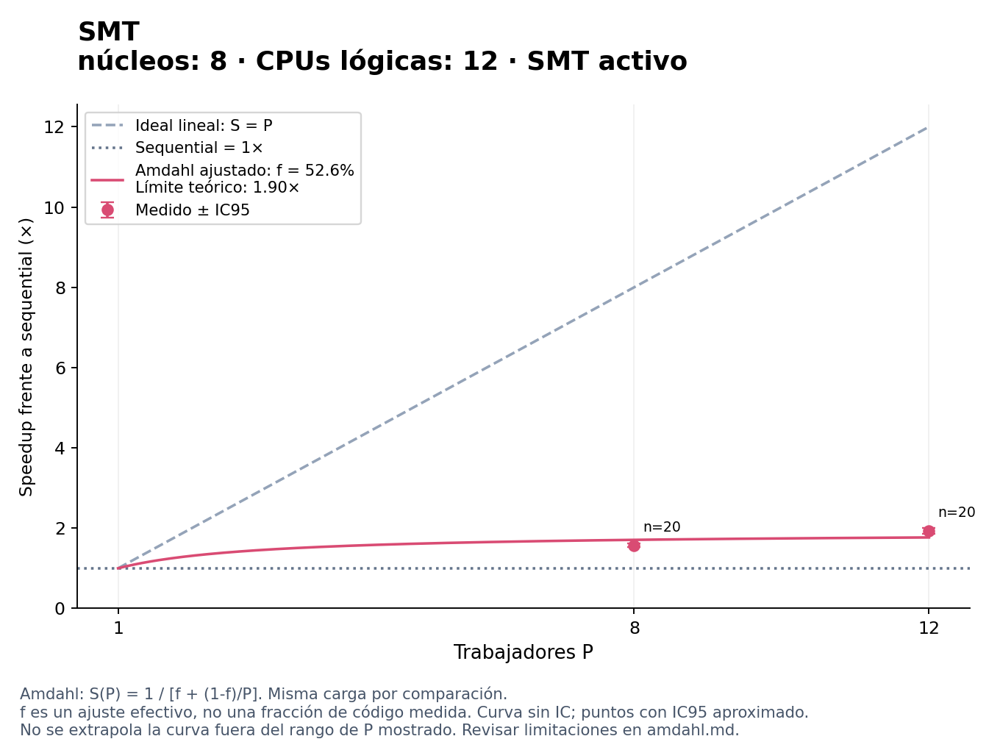

# Ley de Amdahl

Carga: epocas=1000, muestras=100, learning_rate=0.1, semilla=1, dataset_hash=02def62d38696cddf2715e05122f741fafee2c190e42772b91f7c0c2f6604c7e.

S(P) = 1 / [f + (1-f)/P]. P es el número de trabajadores; f es una fracción secuencial efectiva.
El ajuste minimiza la suma de errores cuadrados de 1/S(P) = f + (1-f)/P, con igual peso por configuración y f restringida a [0,1]. No impone que el modelo con P=1 tenga speedup 1.
No mide directamente código secuencial: puede absorber creación de hilos, esperas, contención, carga desigual y efectos de hardware. SMT comparte recursos y coarse añade bloqueos; Amdahl es una referencia idealizada, no una validación de esos modelos ni una predicción garantizada.
Las barras negras son IC95 del speedup medido; la curva ajustada no incluye un intervalo de confianza. El límite 1/f es teórico y no implica que el equipo disponga de suficientes núcleos.

| Política | P medidos | f efectiva | Límite teórico 1/f | RMSE en tiempo relativo | Nota |
| --- | --- | ---: | ---: | ---: | --- |
| SMT · núcleos: 8 · CPUs lógicas: 12 · SMT activo | [8, 12] | 52.6081% | 1.90× | 0.05086 | Ajuste descriptivo |

