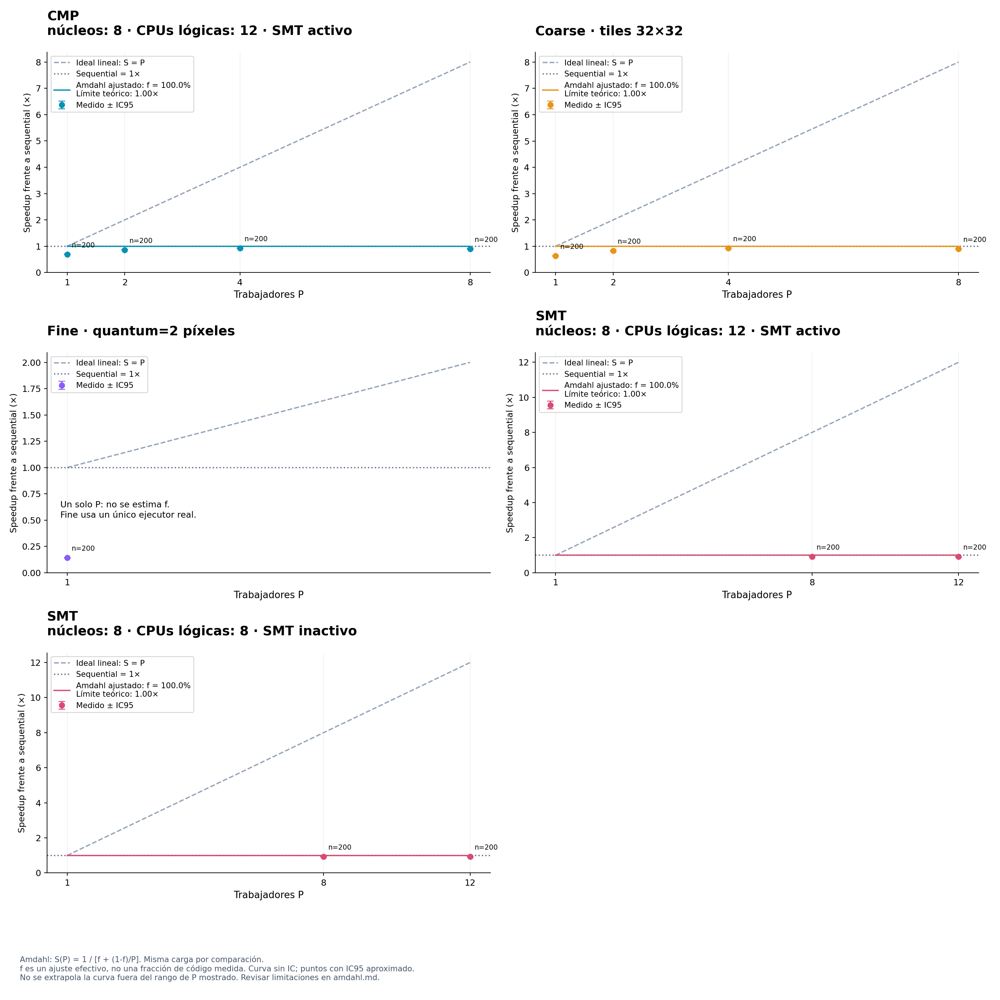

# Ley de Amdahl

Carga: ancho=24444, alto=1499, origen_x=0, origen_y=0, slc_a_hash=d1e69c7ee86c24b7bca70e2c13d6cb32cfc8e229ef1ec1ab7402734543315fe9, slc_b_hash=895fa59bc9b4ee11c2dc6c8371a2d17e8aa24354fa2901705dc49b4dfdaa3432, allow_nodata=1.

S(P) = 1 / [f + (1-f)/P]. P es el número de trabajadores; f es una fracción secuencial efectiva.
El ajuste minimiza la suma de errores cuadrados de 1/S(P) = f + (1-f)/P, con igual peso por configuración y f restringida a [0,1]. No impone que el modelo con P=1 tenga speedup 1.
No mide directamente código secuencial: puede absorber creación de hilos, esperas, contención, carga desigual y efectos de hardware. SMT puede compartir recursos y los modelos añaden sincronización; Amdahl es una referencia idealizada, no una validación de esos modelos ni una predicción garantizada.
Las barras negras son IC95 del speedup medido; la curva ajustada no incluye un intervalo de confianza. El límite 1/f es teórico y no implica que el equipo disponga de suficientes núcleos.

| Política | P medidos | f efectiva | Límite teórico 1/f | RMSE en tiempo relativo | Nota |
| --- | --- | ---: | ---: | ---: | --- |
| CMP · núcleos: 8 · CPUs lógicas: 12 · SMT activo | [1, 2, 4, 8] | 100.0000% | 1.00× | 0.24742 | Ajuste restringido; f sin restringir fuera de [0,1] |
| Coarse · tiles 32×32 | [1, 2, 4, 8] | 100.0000% | 1.00× | 0.31837 | Ajuste restringido; f sin restringir fuera de [0,1] |
| Fine · quantum=2 píxeles | [1] | — | — | — | Falta barrido de P |
| SMT · núcleos: 8 · CPUs lógicas: 12 · SMT activo | [8, 12] | 100.0000% | 1.00× | 0.08926 | Ajuste restringido; f sin restringir fuera de [0,1] |
| SMT · núcleos: 8 · CPUs lógicas: 8 · SMT inactivo | [8, 12] | 100.0000% | 1.00× | 0.07835 | Ajuste restringido; f sin restringir fuera de [0,1] |

