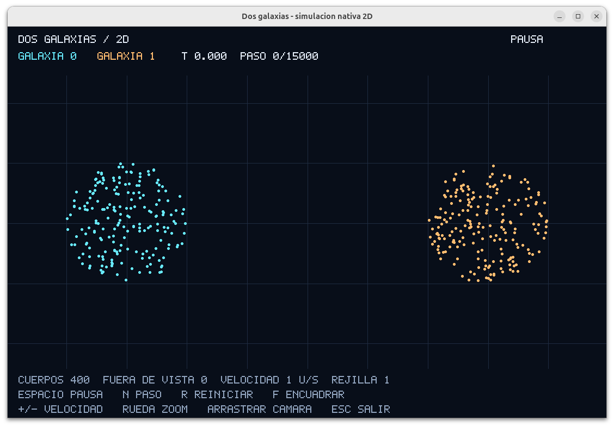
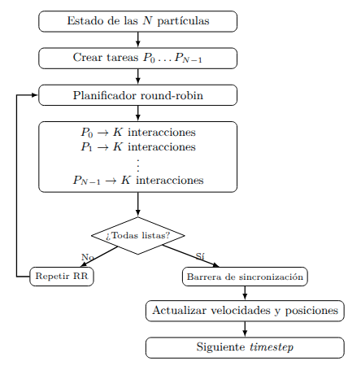
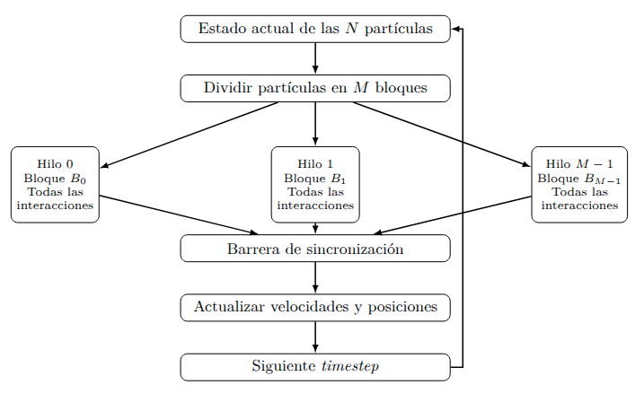
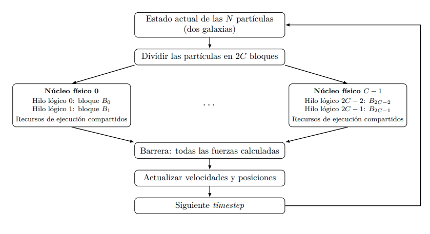
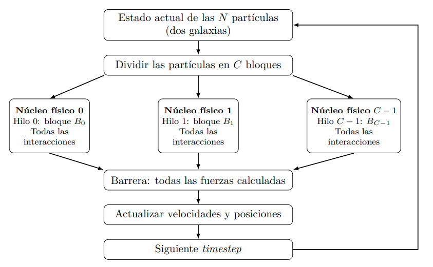

# Simulación N-body de dos galaxias en 2D


## Estado actual

La base secuencial incluye:

- dos galaxias distinguibles por color e identificador de origen;
- interacción N-body completa con complejidad $O(N^2)$ por paso;
- suavizado gravitacional para evitar singularidades numéricas;
- integración temporal mediante Euler simpléctico;
- trayectoria binaria con el estado inicial y todos los pasos;
- reproducción nativa 2D posterior al cálculo;
- ejecución sin ventana para mediciones;
- tiempo total de ejecución en CSV, antes de abrir la ventana;
- validación de masa, energía, momento lineal y centro de masa en las pruebas;
- condiciones iniciales reproducibles mediante una semilla;
- pruebas físicas, de interfaz de línea de comandos y de visualización.

Las cinco estrategias están implementadas: secuencial, Fine-Grained,
Coarse-Grained, SMT y CMP. Sus diagramas documentan la distribución y
sincronización del cálculo gravitacional.

La entrada predeterminada es de **500 cuerpos por galaxia (1000 en total)**.
Respecto a los 200 cuerpos totales anteriores, el trabajo de fuerzas por paso
crece aproximadamente 25 veces y la captura 5 veces. Esto permite evaluar mejor
el beneficio del paralelismo frente al costo de sincronización, sin garantizar
una aceleración para todas las configuraciones. Se mantienen los 10000 pasos.

## Fine-Grained: planificación cooperativa simulada

Para ejecutar y visualizar:

```bash
make ARGS="--model fine-grained --quantum 1"
```

Para generar 200 muestras con la misma política de captura:

```bash
make benchmark BENCHMARK_MODELS=fine-grained BENCHMARK_ARGS="--quantum 1"
```

El modelo crea una tarea por cuerpo. Cada tarea conserva el índice de la próxima
fuente y su aceleración acumulada. El planificador visita todas las tareas
pendientes en orden round-robin; cada turno calcula como máximo `quantum`
interacciones distintas de sí misma y cede el turno, sin esperar bloqueos.
El quantum predeterminado es 1. Si excede `N-1`, cada tarea puede terminar en
una sola visita y la intercalación se reduce. Cambiarlo no cambia `dt`.

Cuando todas las tareas terminan se alcanza una barrera lógica y el integrador
común puede actualizar los cuerpos. Los contextos se reinician al calcular las
fuerzas del siguiente estado; los contadores de rondas y despachos se acumulan
durante toda la ejecución (incluidas las aceleraciones iniciales) y se imprimen
por stderr, después del CSV. Un despacho es una visita a una tarea pendiente,
no un cambio de contexto del sistema operativo.

Esta aproximación se ejecuta en **un único hilo real**, sin OpenMP ni std::thread.
Simula la intercalación fina; no implementa multithreading microarquitectónico ni
promete aceleración en varios núcleos. La comparación mide también el costo del
planificador. `workers=1` no debe confundirse con las `N` tareas simuladas.

La ecuación y el orden de suma de cada cuerpo coinciden con la referencia.
Las pruebas verifican aceleraciones y trayectorias completas para varios
quantums, además del reinicio de contextos y los conteos de planificación.
El formato de trayectoria v1 y `viewer.cpp` se comparten sin cambios; el modelo
y quantum se registran en el CSV y el comando del lote, no en la trayectoria.

## Coarse-Grained: hilos persistentes y bloques completos

```bash
make ARGS="--model coarse-grained --threads 4"
make benchmark BENCHMARK_MODELS=coarse-grained BENCHMARK_ARGS="--threads 4"
```

Se crean `--threads` hilos de C++ (2 por defecto) una sola vez. Cada hilo
recibe un bloque contiguo de cuerpos y calcula todas sus interacciones sin
ceder voluntariamente por quantum. Los bloques difieren como máximo en un
cuerpo; si hay más hilos que cuerpos, algunos bloques quedan vacíos y todos
los hilos siguen participando en la sincronización. `workers` registra el
número de hilos trabajadores creados, sin contar el hilo coordinador.

Al completar un bloque, el hilo espera trabajo mediante una variable de
condición. El coordinador espera que todos los bloques estén listos antes de
actualizar posiciones, guardar el estado y publicar la siguiente fase. Estas
esperas son el evento de bloqueo explícito de la aproximación Coarse-Grained;
no se simulan fallos de caché ni se fuerzan pausas artificiales. El SO puede
interrumpir hilos en otros momentos: `std::thread` no controla la política de
cambios de contexto del hardware. No se fija afinidad a núcleos físicos.

La salida informa las fases de sincronización completadas (`steps + 1`,
incluyendo las fuerzas iniciales), sin presentarlas como un conteo de cambios
de contexto o de esperas efectivas. El tiempo total incluye crear y unir los
hilos. La actualización del integrador y la escritura permanecen secuenciales.
Las pruebas comparan fuerzas y trayectorias completas con el secuencial para
varias cantidades de hilos, incluidos bloques vacíos y particiones desiguales.

## SMT: aproximación por sobresuscripción

```bash
make ARGS="--model smt"
make benchmark BENCHMARK_MODELS=smt
```

Con `C` núcleos físicos disponibles, el modelo crea `2*C` hilos persistentes.
También acepta `--threads N`, pero rechaza `N <= C`: la sobresuscripción respecto
a núcleos físicos es obligatoria, incluso si SMT del hardware está desactivado
o no existe. En un equipo con 4 núcleos, el valor automático es 8 trabajadores.
No se usa `hardware_concurrency()` como conteo físico, porque representa
procesadores lógicos y cambia al activar/desactivar SMT.

En Linux se cuentan pares únicos `(physical_package_id, core_id)` entre las CPU
permitidas por `sched_getaffinity`, respetando restricciones como `taskset`.
La detección falla explícitamente si no puede determinar la topología; no
sustituye núcleos físicos por procesadores lógicos. En macOS se consultan
`hw.physicalcpu` y `hw.logicalcpu`; el alcance es el sistema, sin máscara de
afinidad equivalente. El estado de hardware que no puede verificarse se
registra como `unknown`, sin deducir soporte a partir de una razón 1:1.

```bash
./build/nbody --topology
```

SMT reutiliza el pool de bloques y sincronización de Coarse-Grained. Su condición
experimental adicional es la sobresuscripción comprobada; no es un simulador de
unidades funcionales ni reproduce la emisión de instrucciones del hardware.
El SO decide dónde ejecutar los hilos, sin afinidad impuesta. Los hilos adicionales
pueden competir por CPU, caché y ancho de banda; no se garantiza una aceleración.
Si hay menos cuerpos que trabajadores, algunos bloques quedan vacíos.

Cada lote conserva `topology.txt` y añade la topología a `environment.txt`, con
núcleos físicos accesibles, CPU lógicas accesibles, máscara de CPU y los estados
Linux `smt/control` y `smt/active` (estos últimos tienen alcance del sistema).
Se compara la topología antes y después de cada ejecución y se interrumpe el
lote si cambia, antes de incorporar la muestra afectada. Estas comprobaciones
están fuera del tiempo medido; detectan diferencias entre instantáneas, no
cambios transitorios que se reviertan entre ellas. El CSV mantiene el esquema
común: `model=smt`, `workers=N`, `quantum=0`. Los lotes se analizan por separado.

### Comparación con SMT de hardware

El enunciado §4.1.c exige repetir las mediciones con SMT **habilitado y deshabilitado
desde BIOS/UEFI**, manteniendo iguales entrada, número de hilos, compilación y
política de captura. Ejecutar un lote de al menos 200 repeticiones por condición,
conservar sus directorios separados y documentar la configuración de firmware
usada (el estado de sysfs por sí solo no prueba cómo se configuró). Repetir también
la referencia secuencial bajo ambas condiciones. La implementación no modifica
BIOS/UEFI ni el estado global de SMT; la comparación experimental queda pendiente
hasta ejecutar ambos lotes en hardware compatible.

Linux permite consultar y, en equipos compatibles, cambiar SMT desde terminal:

```bash
cat /sys/devices/system/cpu/smt/control
cat /sys/devices/system/cpu/smt/active
# Solo para equipos compatibles; cambia la configuración global de Linux:
echo off | sudo tee /sys/devices/system/cpu/smt/control
echo on  | sudo tee /sys/devices/system/cpu/smt/control
```

Estos comandos no sustituyen el procedimiento BIOS/UEFI exigido por el enunciado.
`notsupported` indica que SMT no está disponible para el kernel; `forceoff` impide
reactivarlo mediante esta interfaz. Véase la [documentación del kernel Linux](https://www.kernel.org/doc/html/v6.8/admin-guide/hw-vuln/l1tf.html#smt-control).

En el equipo revisado, Linux identifica un AMD Ryzen 3 3200G, 4 núcleos / 4 hilos,
con `smt/control=notsupported` y `smt/active=0`. Aquí se puede evaluar la aproximación
por software con 8 hilos, pero se necesita otro equipo con SMT compatible para
hacer la comparación de hardware activado/desactivado solicitada.

## CMP: paralelismo entre núcleos físicos

```bash
make ARGS="--model cmp"
make benchmark BENCHMARK_MODELS=cmp
# Para medir escalabilidad, un lote por cantidad de trabajadores:
make benchmark BENCHMARK_MODELS=cmp BENCHMARK_ARGS="--threads 2"
```

Con `C` núcleos físicos disponibles, CMP crea `C` hilos trabajadores persistentes.
`--threads N` permite seleccionar entre 1 y `C`; se rechaza la sobresuscripción.
En Linux se elige una CPU lógica permitida por cada par `(socket, núcleo)` y se
fija cada trabajador a una CPU de un núcleo distinto mediante afinidad. No se
asignan dos trabajadores a hermanos SMT. La máscara efectiva se comprueba antes
de empezar el cálculo: si no se puede fijar la afinidad, la ejecución falla,
cierra los hilos creados y no publica métricas de éxito. Las restricciones de
`taskset` se respetan y el coordinador conserva su máscara original.

Cada trabajador calcula las aceleraciones de su bloque contiguo de cuerpos.
Todos leen el mismo estado físico y escriben posiciones distintas del vector de
aceleraciones. Una barrera de finalización precede la actualización secuencial
de velocidades y posiciones. Se reutiliza el pool de Coarse-Grained para
mantener iguales el kernel, la partición y la sincronización: CMP añade la
selección de núcleos físicos y afinidad, mientras SMT exige más hilos que núcleos.
La captura y reproducción siguen el mismo flujo en los cinco modelos.

La salida registra `model=cmp`, `workers=N`, `quantum=0` y, en stderr, las CPU
seleccionadas. `--topology` y `topology.txt` incluyen `core_cpus`, una CPU lógica
representativa por núcleo físico accesible. Las CPU fijadas son las primeras
`N` de esa lista, en orden ascendente de identificador lógico. El tiempo total
incluye creación, fijación de afinidad, sincronización y cierre de trabajadores.
No se modifica el estado global de SMT ni se reservan núcleos exclusivamente:
otros procesos y el coordinador pueden competir por ellos. Con un solo núcleo
permitido, CMP funciona con un trabajador, sin paralelismo entre núcleos.

En macOS se limita la cantidad de trabajadores a `hw.physicalcpu`, pero la
ubicación de los hilos la administra el SO: no se garantiza afinidad a núcleos
físicos distintos. Esta limitación se indica en la salida; los experimentos que
requieren verificar la colocación por núcleo deben ejecutarse en Linux.

Las pruebas verifican fuerzas y trayectorias completas contra el secuencial,
particiones desiguales, bloques vacíos, reutilización del pool, afinidad inválida,
restricciones de CPU y cierre ante errores. Las mediciones representativas de
escalabilidad deben realizarse por separado en hardware físico, variando `N`
y el tamaño de la entrada bajo las mismas condiciones.

## Modelo físico

Cada cuerpo almacena masa, posición, velocidad y aceleración en el plano XY.
La aceleración del cuerpo $i$ se obtiene de la contribución de todos los
cuerpos $j \ne i$:

$$
\vec{a}_i =
\sum_{j \ne i}
Gm_j
\frac{\vec{r}_j - \vec{r}_i}
{\left(\lVert\vec{r}_j - \vec{r}_i\rVert^2 + \epsilon^2\right)^{3/2}}
$$

La implementación utiliza unidades normalizadas, $G = 1$ y un suavizado
$\epsilon = 0.05$. Después de calcular todas las aceleraciones desde el
mismo estado temporal, actualiza cada cuerpo con Euler simpléctico:

$$
\vec{v}_i(t + \Delta t) =
\vec{v}_i(t) + \vec{a}_i(t)\Delta t
$$

$$
\vec{r}_i(t + \Delta t) =
\vec{r}_i(t) + \vec{v}_i(t + \Delta t)\Delta t
$$

La simulación representa la interacción gravitacional entre galaxias. No
modela choques rígidos entre estrellas.

## Requisitos

- compilador compatible con C++17, como GCC o Clang;
- GNU Make;
- SDL2 con archivos de desarrollo;
- `pkg-config`.

En Debian o Ubuntu:

```bash
sudo apt install build-essential pkg-config libsdl2-dev
```

En macOS con Homebrew:

```bash
brew install sdl2 pkg-config
```

## Compilación y ejecución

Desde la carpeta `n-body-sim`:

```bash
make
```

La ejecución normal sigue este orden:

1. Ejecuta toda la simulación y guarda el estado inicial y cada paso.
2. Finaliza y cierra `output/trajectory.nbody`.
3. Imprime el tiempo total y los parámetros de la ejecución en CSV por stdout.
4. Abre una ventana que reproduce el archivo, sin recalcular la física.

Para generar datos sin abrir la ventana:

```bash
./build/nbody --no-output --trajectory output/run-001.nbody > metrics-001.csv
```

`--no-output` conserva la captura y escritura de todos los estados; únicamente
omite el reproductor y no inicializa SDL2. Los directorios de la trayectoria
se crean automáticamente. La ruta elegida se sobrescribe en cada ejecución;
use rutas distintas si desea conservar varias trayectorias.

Para reproducir un archivo ya generado, en una ejecución independiente:

```bash
./build/nbody --replay output/run-001.nbody
```

`--replay` se utiliza sin opciones de simulación: lee sus parámetros del archivo,
no ejecuta el integrador ni imprime nuevas métricas. Espacio pausa; N avanza un
frame; R vuelve al estado inicial y pausa; F encuadra. La rueda y el arrastre
controlan la cámara, +/- cambia el ritmo de reproducción y Esc cierra la ventana.

El reproductor muestra estrellas con halos suaves, colores por galaxia y etiquetas
que siguen sus centros geométricos. Las estelas contienen posiciones reales de
los últimos 32 estados muestreados, aproximadamente cada 0.025 unidades de tiempo
simulado (o cada paso si `dt` es mayor). Su duración no depende de los FPS.
El fondo estrellado es decorativo y no representa cuerpos de la simulación.

- `T`: mostrar u ocultar estelas.
- `G`: mostrar u ocultar la rejilla, desactivada inicialmente; una regla indica la escala.
- Flechas izquierda/derecha: buscar en saltos del 1 % de la trayectoria y pausar.
- Clic en la barra de progreso: buscar un instante y pausar.

Al buscar se reconstruye el historial desde el archivo; al reiniciar se vacía.
El brillo y las estelas se generan únicamente durante la reproducción y no
intervienen en las métricas ni alteran los estados guardados.

### Interpretación de métricas

El enunciado (§4.4) exige tiempo total de ejecución, speedup, eficiencia paralela
y escalabilidad según la cantidad de hilos o procesos. Una ejecución individual
registra el tiempo total y los parámetros necesarios para comparar muestras:

```text
model,workers,bodies,steps,dt,seed,quantum,total_seconds
```

`total_seconds` es el intervalo continuo desde la creación de la estrategia de
ejecución hasta finalizar la trayectoria, incluyendo apertura, cálculo, captura,
liberación de trabajadores y flush/cierre. Excluye inicialización aleatoria,
impresión y reproducción. `model` y `workers` identifican el esquema de ejecución;
`bodies`, `steps`, `dt` y `seed` identifican la entrada. Se utiliza `sequential` como referencia y `fine-grained` como planificación
cooperativa simulada. Ambos tienen `workers=1`, que cuenta hilos reales del SO.
`coarse-grained`, `smt` y `cmp` registran sus hilos persistentes en `workers`.
`quantum=0` corresponde al secuencial, Coarse-Grained, SMT y CMP; en Fine-Grained es el número máximo de
interacciones entre cuerpos distintos por turno. Cada quantum define una
configuración diferente. El analizador también acepta los CSV secuenciales
anteriores que no tenían esta columna.

La salida normal no imprime diagnósticos físicos ni tiempos parciales. Las
validaciones físicas siguen disponibles mediante `make test`.

Las métricas comparativas se obtienen externamente mediante Make/scripts:

- Speedup: tiempo medio secuencial dividido entre tiempo medio del modelo,
  con la misma entrada y política de captura.
- Eficiencia: speedup dividido entre la cantidad de trabajadores, explicando
  su significado para cada modelo, especialmente si es simulado.
- Escalabilidad: evolución del tiempo, speedup y eficiencia al variar la cantidad
  de hilos o procesos.
- Estadísticas: número de repeticiones, media, desviación estándar e intervalos
  de confianza del 95 % del tiempo y speedup.
- Distribuciones y estabilidad: boxplots o histogramas de las muestras y análisis
  de convergencia para justificar si las 200 repeticiones iniciales bastan.

El enunciado también exige perfilado con herramientas como perf o VTune
(ciclos, instrucciones, uso de CPU por hilo lógico, stalls) y comparación de SMT
habilitado/deshabilitado. Estos datos se recolectan con el perfilador.
Las repeticiones, estadísticas del tiempo e histograma están implementados.
El reporte conjunto calcula speedup, eficiencia e intervalos de confianza y
permite comparar configuraciones. La comparación de SMT por BIOS/UEFI sigue
pendiente de recolectar ambos estados en hardware compatible.

El cierre comprueba los errores de escritura, pero no fuerza persistencia física
con `fsync`; el sistema operativo puede mantener datos en su caché de archivos.
Todos los modelos futuros deberán conservar estas mismas condiciones.

### Perfilado con perf (Linux)

`make profile` ejecuta `perf stat` sobre los cinco modelos, con tres repeticiones
por modelo por defecto, sin ventana y con la misma captura de trayectoria.
Requiere `perf` compatible con el kernel y permisos para acceder a los eventos.
Las repeticiones de perfilado son diagnósticas; no sustituyen las 200 muestras
por configuración del benchmark sin instrumentación.

```bash
make profile
# Prueba pequeña de integración:
make profile PROFILE_MODELS=sequential PROFILE_REPETITIONS=1 \
  PROFILE_ARGS="--bodies-per-galaxy 10 --steps 20"
# Un perfil con cantidad de trabajadores explícita:
make profile PROFILE_MODELS=cmp PROFILE_REPETITIONS=3 \
  PROFILE_ARGS="--threads 4 --bodies-per-galaxy 500 --steps 1000"
```

Cada modelo crea un directorio independiente `output/profile-FECHA-HORA-ID/`:

| Archivo | Contenido |
|---|---|
| `perf-N.csv` | Contadores originales de la repetición N, separados por `;` |
| `metrics-N.csv` | CSV de la simulación instrumentada |
| `run-N.log` | Diagnósticos de la simulación y errores de perf |
| `environment.txt` | SO, CPU, versión de perf, permisos, commit, estado Git y SHA-256 del ejecutable |
| `topology.txt` | Núcleos, CPU permitidas y estado SMT |
| `command.txt` | Eventos, repeticiones y comandos exactos |
| `preflight.csv`, `preflight.log` | Comprobación previa de acceso a los eventos |
| `status.txt` | `complete` solo si todas las repeticiones terminaron con contadores disponibles |
| `trajectory.nbody` | Trayectoria de la última ejecución |

Make añade el compilador, su versión y las banderas solicitadas al entorno.
Estas banderas describen la invocación actual de Make; si se reutiliza un binario
anterior, no certifican cómo fue compilado. Para un experimento final, reconstruya
con `make -B build` usando las mismas banderas antes de perfilar.

Se miden `task-clock`, `context-switches`, `cpu-migrations`, `page-faults`,
`cycles`, `instructions`, `cache-references` y `cache-misses`. Los contadores
incluyen el proceso y sus hilos heredados, agregados; no son mediciones por CPU
lógica ni del sistema completo. El alcance es toda la ejecución sin ventana,
incluyendo inicialización, cálculo y E/S, por lo que difiere del intervalo
interno `total_seconds`. Ningún contador se interpreta como cero si no está
soportado o no pudo medirse: el lote queda incompleto y conserva sus archivos.
La topología se compara antes y después de cada repetición.

Para el análisis, compare instrucciones/ciclos (IPC), fallos/referencias de caché
y cambios de contexto entre configuraciones con la misma entrada. `task-clock`
es tiempo de CPU acumulado y puede superar el tiempo de pared al usar varios
hilos. Los cambios de contexto corresponden al SO, no a los despachos simulados
de Fine-Grained. Conserve las columnas de tiempo activo y porcentaje de ejecución
de perf: si hay multiplexación, los conteos pueden estar escalados y deben
interpretarse considerando ese porcentaje.

Los eventos específicos de stalls y recursos compartidos dependen de la PMU.
Consulte `perf list` y seleccione eventos compatibles mediante `PERF_EVENTS`:

```bash
perf list
make profile PROFILE_MODELS=smt \
  PERF_EVENTS="cycles,instructions,stalled-cycles-backend"
```

El ejemplo requiere que la CPU soporte `stalled-cycles-backend`; no se añade a
los eventos predeterminados. Los contadores genéricos ayudan a comparar las
condiciones SMT, pero no identifican por sí solos contención entre hermanos SMT.
Repita perfiles con SMT habilitado/deshabilitado por BIOS/UEFI en hardware
compatible, manteniendo entrada, trabajadores y compilación; documente el
firmware y analice los lotes por separado.

Si aparece un error de permisos, consulte `preflight.log` y
`cat /proc/sys/kernel/perf_event_paranoid`. El script no usa sudo ni modifica
permisos. Un administrador debe habilitar el acceso adecuado al equipo de
pruebas; cambiar esta configuración es independiente de integrar el perfilador.
Véanse la [documentación de seguridad de perf del kernel](https://www.kernel.org/doc/html/latest/admin-guide/perf-security.html)
y el manual local `man perf-stat` para permisos, herencia y formato de salida.

### Repeticiones y análisis estadístico

Se requiere Python 3.8 o posterior, sin paquetes externos. C++ ejecuta la
simulación, Bash controla las repeticiones y Python analiza los tiempos.

```bash
make benchmark
```

Ejecuta los cinco modelos en orden: secuencial, Fine-Grained, Coarse-Grained,
SMT y CMP, con **200 repeticiones por modelo (1000 ejecuciones en total)**.
Cada invocación crea una sesión `output/benchmark-suite-FECHA-HORA-ID/`.
Dentro, cada modelo conserva su propio lote `benchmark-FECHA-HORA-ID/`, con
estadísticas e histograma independientes. Al terminar todos los modelos se
genera `report.html`, que los reúne. Los modelos y sus repeticiones se
ejecutan consecutivamente, sin ventana. Conserva el mismo estado inicial y
la misma captura por paso en todas las repeticiones. Se sobrescribe la trayectoria
del lote para conservar únicamente la última; las muestras y lotes anteriores
se mantienen. No ejecuta simulaciones en paralelo, ni descarta warmups u outliers.
Un proceso fallido detiene el benchmark completo y conserva las muestras ya completadas.

Para cambiar la entrada o la cantidad de repeticiones:

```bash
make benchmark REPETITIONS=200 BENCHMARK_ARGS="--bodies-per-galaxy 200 --steps 15000 --dt 0.002 --seed 42"
```

`REPETITIONS` permite valores desde 2 para pruebas rápidas; usar menos de 200
se indica explícitamente en el reporte y requiere justificación experimental.
`BENCHMARK_ARGS` acepta opciones físicas; el script controla la ruta de captura
y la ejecución sin ventana. `BENCHMARK_MODELS` permite seleccionar uno o varios
modelos, por ejemplo `BENCHMARK_MODELS="sequential cmp"`. No incluya `--model`
en `BENCHMARK_ARGS`. Opciones específicas como `--threads` o `--quantum` deben
usarse seleccionando los modelos compatibles. Cada lote incluye:

| Archivo | Contenido |
|---|---|
| `samples.csv` | Número de repetición, configuración y tiempo individual |
| `summary.csv` | n, media, desviación estándar muestral e IC 95 % de la media |
| `histogram.svg` | Histograma de todos los tiempos, con frecuencias absolutas |
| `convergence.csv` | Media, desviación e IC para cada prefijo desde n=2 |
| `trajectory.nbody` | Trayectoria de la última repetición, lista para reproducir |
| `command.txt`, `environment.txt` | Comando, repeticiones, SO y topología de CPU si hay lscpu |
| `last-run.log` | Mensajes de la última simulación |

Puede recalcular el análisis sin repetir simulaciones:

```bash
python3 scripts/analyze.py output/benchmark-FECHA-HORA-ID/samples.csv
```

### Reporte conjunto interactivo

```bash
# Reúne los lotes existentes, sin ejecutar nuevas simulaciones:
make report
xdg-open output/benchmark-report.html

# Analiza únicamente una sesión elegida:
make report REPORT_INPUT=output/benchmark-suite-FECHA-HORA-ID \
  REPORT_OUTPUT=output/comparacion.html
```

El reporte HTML es autónomo: funciona sin servidor, conexión ni paquetes Python
externos. Python calcula métricas, distribuciones y gráficas SVG; JavaScript
permite cambiar grupo experimental, métrica y configuración. Se incluyen:

- tiempo medio, desviación estándar muestral e IC 95 % de la media;
- speedup frente a la referencia secuencial y eficiencia `speedup / workers`;
- IC 95 % del speedup mediante bootstrap independiente del cociente de medias
  (2000 remuestreos, semilla 42, percentiles 2.5 y 97.5); el IC de eficiencia
  divide esos límites entre el número de trabajadores;
- histogramas con todas las ejecuciones y curvas de convergencia de media e IC;
- curvas de tiempo, speedup y eficiencia según trabajadores, cuando existan al
  menos dos cantidades de hilos para un mismo modelo y entrada;
- parámetros, fuentes, topología y advertencias sobre evidencia faltante.

Los IC suponen observaciones suficientemente independientes. El bootstrap no
elimina sesgos de carga, deriva temporal ni diferencias de compilación. La
referencia comparada consigo misma tiene speedup 1 e IC `[1, 1]`. Las gráficas
recortan a cero límites inferiores negativos del tiempo; las tablas y CSV
conservan los límites estadísticos originales.

El selector separa entradas diferentes (cuerpos, pasos, dt, semilla), CPU,
sistema y topología/estado SMT registrados. Si están presentes, también separa
los metadatos de compilación. La ausencia de metadatos aparece como `unknown`
y requiere verificar manualmente comparabilidad. No se afirma que compartir
entrada y topología garantice igualdad de compilación o política de captura.
Los lotes con menos de 200 ejecuciones se identifican explícitamente.

Solo se usan lotes con `samples.csv` válido y `summary.csv` final. Un lote
interrumpido queda excluido. Para cada configuración dentro de un grupo se
selecciona el lote más reciente por nombre cronológico; no se fusionan muestras
de sesiones distintas. Los grupos completos con al menos 200 muestras y mayor
carga de cálculo aparecen primero. Si falta referencia secuencial compatible,
se conservan los tiempos pero no se calculan speedup ni eficiencia.

Junto al HTML se generan `benchmark-report.csv` con todas las métricas y
`benchmark-report-samples.csv` con las muestras y sus fuentes (los nombres
siguen el nombre de salida elegido). La vista también permite descargar la
tabla del grupo seleccionado e imprimirla o guardarla como PDF desde el navegador.

Para recolectar escalabilidad, ejecute lotes manteniendo la misma entrada y
variando trabajadores, y luego regenere la comparación. Por ejemplo, en un
equipo de al menos cuatro núcleos físicos:

```bash
for p in 1 2 4; do
  make benchmark BENCHMARK_MODELS=cmp \
    BENCHMARK_ARGS="--threads $p --bodies-per-galaxy 500 --steps 1000"
done
make report
```

La referencia secuencial debe existir para esa misma entrada y entorno.
Fine-Grained utiliza un único hilo real: variar su quantum no equivale a variar
núcleos o hilos. La eficiencia SMT usa trabajadores de software y no prueba
beneficio de SMT por hardware. El reporte no incorpora datos de `perf`.

El generador también puede invocarse directamente:

```bash
python3 scripts/report.py output --output output/benchmark-report.html --bootstrap 2000
```

La desviación estándar utiliza el denominador `n-1`. El intervalo de confianza
bilateral para la media es `media ± t(0.975, n-1) * s / sqrt(n)`; no es un rango
que contenga el 95 % de las ejecuciones. El cuantil Student t se calcula por
integración numérica y bisección, con pruebas contra casos analíticos y la
[tabla de NIST](https://www.itl.nist.gov/div898/handbook/eda/section3/eda3672.htm).
La fórmula sigue los [límites de confianza para la media de NIST](https://www.itl.nist.gov/div898/handbook/eda/section3/eda352.htm).

Se supone que las mediciones son suficientemente independientes y que la media
puede aproximarse con este método. Para justificar el número de repeticiones,
revise `convergence.csv`, el semiancho del IC relativo a la media y el cambio
entre las medias de las dos mitades del lote, incluidos en el resumen.
Un IC estrecho por sí solo no demuestra estabilidad ni elimina sesgos por
carga, temperatura o cachés. El script no declara automáticamente convergencia:
la tolerancia aceptable debe justificarse en el paper. El histograma usa la
regla de Sturges para la cantidad de intervalos e incluye todas las muestras.

Las mediciones principales deben ejecutarse sobre hardware físico, como exige
el enunciado. Registre además compilador, banderas y estado de SMT para cada
experimento. Cada modelo escribe unos 120 GB acumulados en 200 ejecuciones; el benchmark
completo escribe unos 600 GB acumulados. Solo conserva la última trayectoria
de cada modelo: unos 600 MB por lote, aproximadamente 3 GB entre los cinco.

### Archivo de trayectoria

El formato binario v1 comienza con `NBODY001`, una marca de orden de bytes,
cantidad total de cuerpos, pasos, `dt` y semilla. Cada frame guarda, en orden,
masa, posición XY, velocidad XY, aceleración XY e identificador de galaxia de
cada cuerpo. El frame 0 incluye las aceleraciones iniciales; hay `steps + 1`
frames. El archivo usa doubles IEEE 754 de 64 bits y enteros de tamaño fijo,
sin volcar estructuras C++ ni su padding. Se rechaza otro orden de bytes.
El modelo v1 utiliza las constantes físicas documentadas arriba.

Tamaño: `40 + (steps + 1) * cuerpos * 60` bytes. La configuración predeterminada
ocupa aproximadamente 600 MB. Se escribe y reproduce un frame a la vez, con
memoria O(N). El lector verifica versión, dimensiones y tamaño exacto, y valida
los valores de cada frame al leerlo. Si la generación falla, puede quedar un
archivo parcial; no se publican métricas exitosas y el lector rechaza su tamaño
incompleto.

### Parámetros

| Opción | Descripción | Valor predeterminado |
|---|---|---:|
| `--model MODELO` | `sequential`, `fine-grained`, `coarse-grained`, `smt` o `cmp` | `sequential` |
| `--threads N` | Trabajadores Coarse-Grained, SMT o CMP | Coarse: `2`; SMT: `2*C`; CMP: `C` |
| `--topology` | Consulta CPU disponibles y estado SMT sin simular | — |
| `--quantum N` | Interacciones por turno; requiere Fine-Grained | `1` |
| `--bodies-per-galaxy N` | Cantidad de cuerpos en cada galaxia | `500` |
| `--steps N` | Cantidad de pasos temporales | `10000` |
| `--dt X` | Duración de cada paso | `0.002` |
| `--seed N` | Semilla de 32 bits para la inicialización | `42` |
| `--trajectory ARCHIVO` | Ruta de la trayectoria generada | `output/trajectory.nbody` |
| `--no-output` | Guarda y mide sin abrir el reproductor | desactivado |
| `--replay ARCHIVO` | Reproduce un archivo existente sin simular | — |

Ejemplo con 400 cuerpos totales:

```bash
./build/nbody --bodies-per-galaxy 200 --steps 15000 --dt 0.002
```

Ejecución del ejemplo anterior:



La ayuda integrada muestra las opciones disponibles:

```bash
./build/nbody --help
```


## Opciones de Make

| Comando | Acción |
|---|---|
| `make` | Compila si es necesario, simula, guarda, imprime métricas y reproduce |
| `make ARGS="--model fine-grained --quantum 1"` | Ejecuta el flujo completo con Fine-Grained |
| `make build` | Solo compila `build/nbody` |
| `make benchmark` | Ejecuta los 5 modelos, 200 repeticiones por modelo, con estadísticas e histogramas |
| `make report` | Reúne lotes existentes en un HTML interactivo, métricas y muestras CSV |
| `make test` | Compila y ejecuta todas las pruebas |
| `make clean` | Elimina los ejecutables generados en `build/` |


## Estructura del proyecto

```text
n-body-sim/
├── src/
│   ├── main.cpp             CLI y flujo de ejecución/medición
│   ├── nbody.hpp            Único contrato compartido
│   ├── viewer.cpp           Reproductor SDL2, cámara, estelas y fuente
│   ├── common/
│   │   ├── physics.cpp      Inicialización, ecuación gravitacional e integrador
│   │   └── trajectory.cpp   Lectura y escritura del formato común
│   └── models/
│       ├── sequential.cpp   Estrategia de referencia sin hilos
│       ├── fine_grained.cpp Planificador cooperativo round-robin
│       ├── coarse_grained.cpp Hilos persistentes y sincronización por bloques
│       ├── smt.cpp            Topología y sobresuscripción comprobada
│       └── cmp.cpp            Trabajadores sobre núcleos físicos distintos
├── scripts/                 Repeticiones Bash y análisis Python
├── tests/                   Validación física, archivos, reproductor y estadísticas
├── docs/diagrams/            Diseños de los cuatro modelos posteriores
├── Makefile
└── README.md
```

El código de producción utiliza **un header y una fuente por modelo**, además
del programa principal, el reproductor y las dos fuentes comunes. Se mantiene un único header porque las unidades C++ necesitan
compartir los tipos y sus contratos. La configuración vive en `main.cpp` y la
fuente bitmap es privada a `viewer.cpp`. Los diagnósticos físicos se calculan
dentro de las pruebas, sin fuentes adicionales en el ejecutable.

### Organización de los cinco modelos

[`ExecutionModel`](src/nbody.hpp) define el nombre, la cantidad de trabajadores
y el método `compute_accelerations`. Cada implementación recibe posiciones de
solo lectura y devuelve aceleraciones en un vector separado. Debe completar y
sincronizar sus tareas antes de retornar. El objeto permanece vivo durante la
simulación para reutilizar trabajadores o el estado del planificador.

| Modelo | Archivo en `src/models/` | Estado / estrategia |
|---|---|---|
| Secuencial | `sequential.cpp` | Implementado: recorre los cuerpos en un único hilo |
| Fine-Grained | `fine_grained.cpp` | Implementado: tareas con progreso y cuantums round-robin |
| Coarse-Grained | `coarse_grained.cpp` | Implementado: hilos persistentes, bloques completos y espera por fases |
| SMT | `smt.cpp` | Implementado: sobresuscripción respecto a núcleos físicos disponibles |
| CMP | `cmp.cpp` | Implementado: bloques sobre núcleos físicos; afinidad explícita en Linux |

No hay implementaciones vacías ni modos que ejecuten secuencial haciéndose pasar por
paralelos. El Makefile incorpora las fuentes de `src/models/` automáticamente;
la selección y parámetros de los modelos se gestionan en `main.cpp`.

La inicialización y el integrador de [`common/physics.cpp`](src/common/physics.cpp),
la captura de [`common/trajectory.cpp`](src/common/trajectory.cpp), el CSV y el
reproductor son compartidos. La primera interfaz permite variar el cálculo de
fuerzas manteniendo la actualización de velocidades/posiciones común y
secuencial. `acceleration_for_body` conserva la misma ecuación y orden de suma
para las estrategias que reparten cuerpos completos. Fine-Grained conserva sumas parciales entre cuantums usando el mismo helper
`accumulate_accelerations` y manteniendo el orden ascendente de las fuentes.

El ciclo crea el modelo dentro del cronómetro y lo destruye antes de finalizar
la trayectoria; así las creaciones/cierres de trabajadores forman parte
del tiempo total. Las pruebas pueden recibir cualquier implementación de
`ExecutionModel`, usando la secuencial como referencia. Los comandos `make`,
`make build`, `make benchmark` y `make test` conservan sus comportamientos.

## Variables que aumentan el paralelismo disponible

La cantidad de cuerpos es el único parámetro actual que aumenta el paralelismo
disponible por paso: cada cuerpo añade un cálculo de aceleración independiente,
que lee las posiciones de todos y escribe su propio resultado. Los pasos
adicionales dependen del estado anterior; `dt`, la semilla y la visualización
cambian la evolución física o las condiciones de ejecución, pero no agregan
tareas independientes por paso. 

### Cantidad de cuerpos

`--bodies-per-galaxy` determina el tamaño total del sistema:

```text
N = 2 × bodies_per_galaxy
```

El
[núcleo de cálculo gravitacional](src/common/physics.cpp) es la región que
concentra la mayor parte del trabajo de la simulación: cada cuerpo `i` calcula
su aceleración recorriendo los otros $N-1$ cuerpos. Por tanto:

- existen $N$ resultados de aceleración que pueden calcularse de manera
  independiente dentro de un paso;
- cada resultado requiere $N-1$ contribuciones;
- el trabajo total por paso crece como $O(N^2)$;
- aumentar $N$ incrementa tanto el trabajo como la cantidad de tareas que
  pueden distribuirse entre unidades de ejecución.

La separación entre el vector de entrada `bodies` y el vector de salida
`accelerations` evita que el cálculo de un cuerpo modifique las posiciones
que leen los demás. Esa interfaz está declarada en
[`src/nbody.hpp`](src/nbody.hpp).


## Diagramas de los modelos de ejecución

Los diagramas representan el diseño preliminar de los cuatro modelos. En ellos,
$N$ es la cantidad total de partículas, $B_i$ es un bloque de partículas, $M$
es la cantidad de hilos de grano grueso, $C$ es la cantidad de núcleos físicos
y $K$ es la cantidad de interacciones que una tarea Fine-Grained procesa durante
cada turno.

### Fine-Grained Multithreading

Se crea una tarea $P_i$ por cada partícula. El planificador las recorre en orden
*round-robin* y cada tarea calcula únicamente las siguientes $K$ interacciones
de su partícula durante su turno. Si todavía quedan interacciones pendientes,
la tarea conserva su progreso y espera la siguiente ronda. Cuando las $N$
tareas terminan, una barrera permite actualizar velocidades y posiciones antes
de comenzar el siguiente paso temporal.



### Coarse-Grained Multithreading

Las $N$ partículas se dividen en $M$ bloques grandes y cada bloque $B_i$ se
asigna a un hilo. Cada hilo calcula todas las interacciones de las partículas de
su bloque antes de alcanzar la barrera. La barrera es el punto de sincronización
costoso del diagrama: solo después de que todos los hilos terminan se actualizan
velocidades y posiciones y comienza el siguiente paso temporal.



### SMT — Simultaneous Multithreading

Con $C$ núcleos físicos, las partículas se dividen en $2C$ bloques para ejecutar
dos hilos lógicos por núcleo. Los dos hilos lógicos de cada núcleo comparten sus
recursos de ejecución, tal como indica el diagrama. Todos los hilos se reúnen en
una barrera después de calcular las fuerzas. La evaluación deberá comparar el
mismo trabajo con SMT habilitado y deshabilitado en el hardware.



### CMP — Chip Multiprocessing

Las partículas se dividen en $C$ bloques y cada bloque se asigna a un hilo que
se ejecuta en un núcleo físico diferente. Así, los núcleos calculan fuerzas en
paralelo real sin compartir un mismo núcleo. Una barrera espera a que los $C$
bloques estén listos antes de actualizar velocidades y posiciones y avanzar al
siguiente paso temporal.


