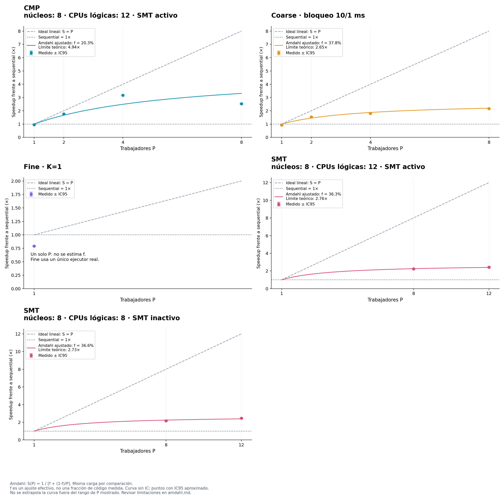

# Ley de Amdahl

Carga: cuerpos=1000, pasos=1000, dt=0.002, semilla=42.

S(P) = 1 / [f + (1-f)/P]. P es el número de trabajadores; f es una fracción secuencial efectiva.
El ajuste minimiza la suma de errores cuadrados de 1/S(P) = f + (1-f)/P, con igual peso por configuración y f restringida a [0,1]. No impone que el modelo con P=1 tenga speedup 1.
No mide directamente código secuencial: puede absorber creación de hilos, esperas, contención, carga desigual y efectos de hardware. SMT comparte recursos y coarse añade bloqueos; Amdahl es una referencia idealizada, no una validación de esos modelos ni una predicción garantizada.
Las barras negras son IC95 del speedup medido; la curva ajustada no incluye un intervalo de confianza. El límite 1/f es teórico y no implica que el equipo disponga de suficientes núcleos.

| Política | P medidos | f efectiva | Límite teórico 1/f | RMSE en tiempo relativo | Nota |
| --- | --- | ---: | ---: | ---: | --- |
| CMP · núcleos: 8 · CPUs lógicas: 12 · SMT activo | [1, 2, 4, 8] | 20.2588% | 4.94× | 0.06899 | Ajuste descriptivo |
| Coarse · bloqueo 10/1 ms | [1, 2, 4, 8] | 37.7989% | 2.65× | 0.04602 | Ajuste descriptivo |
| Fine · K=1 | [1] | — | — | — | Un único P; ajuste no estimado |
| SMT · núcleos: 8 · CPUs lógicas: 12 · SMT activo | [8, 12] | 36.2944% | 2.76× | 0.00389 | Ajuste descriptivo |
| SMT · núcleos: 8 · CPUs lógicas: 8 · SMT inactivo | [8, 12] | 36.5889% | 2.73× | 0.01435 | Ajuste descriptivo |

