# Perfilado de los modelos con perf

Contadores del proceso completo (incluye carga, inicialización, cálculo, salida y cierre). No tienen el mismo alcance que los tiempos internos de los benchmarks. Pared incluye el lanzamiento de perf. Cada CSV corresponde a la última campaña de ese problema; las campañas crudas permanecen en raw/.

En alcance process se heredan los hilos del programa. En alcance cpu se mide toda la actividad del sistema en cada CPU lógica permitida, incluido trabajo ajeno al programa. cpu-clock no demuestra ocupación exclusiva del programa; para atribución de uso de CPU use alcance process.

perf escala los contadores multiplexados. Se conserva porcentaje_activo y tiempo_contador_ns; la cobertura baja limita la comparación. Las PMUs cpu_core/cpu_atom se muestran separadas. Los eventos no soportados o no contados no se sustituyen por cero. No se calcula IPC entre PMUs ni eventos medidos en intervalos potencialmente distintos.

## Relación con los modelos

- Secuencial: referencia de instrucciones, ciclos y tiempo de CPU para la misma carga.
- Fine-grained: planificación cooperativa en un hilo real. El quantum añade trabajo del planificador; compare instrucciones y ciclos sin interpretar sus tareas como CPUs utilizadas.
- Coarse-grained: trabajadores reales y sincronización. En N-body, ray tracing y DL hay esperas artificiales configurables; en Sentinel el reparto es por tiles sin esas pausas. Context switches y tiempo de CPU ayudan a discutir esperas; DL reparte las actualizaciones y conserva forward/backprop secuenciales.
- SMT: afinidad a CPUs lógicas, primero una por núcleo y luego siblings. Registrar P y smt_activo: P menor o igual a los núcleos físicos no prueba uso de siblings. Compartir recursos puede cambiar ciclos, stalls y fallos de caché. Esta campaña conserva el estado SMT del sistema.
- CMP: un trabajador por núcleo físico seleccionado. Compare reducción del tiempo de pared con tiempo de CPU agregado y costo de sincronización; los ciclos acumulados no son tiempo de pared.

Stalls frontend/backend son eventos dependientes del procesador; su ausencia no significa cero stalls. Estas relaciones orientan la discusión; los contadores por sí solos no prueban causalidad.

## dl

Fuente: [dl.csv](dl.csv). Campaña: `dl-20261016T212414.147989Z`. Alcance: `process`.

| Modelo | CPU | Evento / PMU | Unidad | n válido / capturas | Media | Desviación | Cobertura mínima (%) |
| --- | --- | --- | --- | ---: | ---: | ---: | ---: |
| sequential | proceso | task-clock |  | 3/3 | 2.75058e+10 | 1.78677e+09 | 100.0 |
| sequential | proceso | context-switches |  | 3/3 | 286.333 | 23.9653 | 100.0 |
| sequential | proceso | cpu-migrations |  | 3/3 | 3.66667 | 3.51188 | 100.0 |
| sequential | proceso | page-faults |  | 3/3 | 511.667 | 1.52753 | 100.0 |
| sequential | proceso | cpu_atom/cycles/ |  | 2/3 | 8.66462e+10 | 2.36157e+08 | 0.0 |
| sequential | proceso | cpu_core/cycles/ |  | 3/3 | 1.2038e+11 | 7.82048e+09 | 99.0 |
| sequential | proceso | cpu_atom/instructions/ |  | 2/3 | 1.32978e+11 | 2.03831e+10 | 0.0 |
| sequential | proceso | cpu_core/instructions/ |  | 3/3 | 2.62238e+11 | 1.14204e+07 | 99.0 |
| sequential | proceso | cpu_atom/cache-references/ |  | 2/3 | 6.00506e+08 | 1.70482e+08 | 0.0 |
| sequential | proceso | cpu_core/cache-references/ |  | 3/3 | 2.05436e+09 | 1.42533e+09 | 99.0 |
| sequential | proceso | cpu_atom/cache-misses/ |  | 2/3 | 2.499e+08 | 1.82345e+08 | 0.0 |
| sequential | proceso | cpu_core/cache-misses/ |  | 3/3 | 887964 | 119001 | 99.0 |
| sequential | no_disponible | stalled-cycles-frontend |  | 0/3 | no disponible | — | — |
| sequential | no_disponible | stalled-cycles-backend |  | 0/3 | no disponible | — | — |
| fine | proceso | task-clock |  | 3/3 | 4.14208e+11 | 1.40519e+09 | 100.0 |
| fine | proceso | context-switches |  | 3/3 | 3913 | 260.553 | 100.0 |
| fine | proceso | cpu-migrations |  | 3/3 | 26.6667 | 7.50555 | 100.0 |
| fine | proceso | page-faults |  | 3/3 | 923 | 0 | 100.0 |
| fine | proceso | cpu_atom/cycles/ |  | 3/3 | 1.36143e+12 | 4.3269e+09 | 0.0 |
| fine | proceso | cpu_core/cycles/ |  | 3/3 | 1.81799e+12 | 6.21229e+09 | 99.0 |
| fine | proceso | cpu_atom/instructions/ |  | 3/3 | 2.15861e+12 | 7.07074e+10 | 0.0 |
| fine | proceso | cpu_core/instructions/ |  | 3/3 | 3.3487e+12 | 4.95688e+07 | 99.0 |
| fine | proceso | cpu_atom/cache-references/ |  | 3/3 | 8.68078e+09 | 1.88699e+09 | 0.0 |
| fine | proceso | cpu_core/cache-references/ |  | 3/3 | 1.06552e+10 | 1.34213e+09 | 99.0 |
| fine | proceso | cpu_atom/cache-misses/ |  | 3/3 | 2.41046e+09 | 1.41073e+09 | 0.0 |
| fine | proceso | cpu_core/cache-misses/ |  | 3/3 | 1.08207e+07 | 825913 | 99.0 |
| fine | no_disponible | stalled-cycles-frontend |  | 0/3 | no disponible | — | — |
| fine | no_disponible | stalled-cycles-backend |  | 0/3 | no disponible | — | — |
| coarse | proceso | task-clock |  | 3/3 | 4.8694e+10 | 1.38968e+09 | 100.0 |
| coarse | proceso | context-switches |  | 3/3 | 535307 | 467.397 | 100.0 |
| coarse | proceso | cpu-migrations |  | 3/3 | 1862.67 | 276.117 | 100.0 |
| coarse | proceso | page-faults |  | 3/3 | 742.667 | 3.05505 | 100.0 |
| coarse | proceso | cpu_atom/cycles/ |  | 3/3 | 1.0712e+11 | 1.62849e+10 | 4.0 |
| coarse | proceso | cpu_core/cycles/ |  | 3/3 | 1.94333e+11 | 3.3003e+09 | 93.0 |
| coarse | proceso | cpu_atom/instructions/ |  | 3/3 | 3.42415e+11 | 5.08723e+10 | 4.0 |
| coarse | proceso | cpu_core/instructions/ |  | 3/3 | 3.71871e+11 | 3.14893e+08 | 93.0 |
| coarse | proceso | cpu_atom/cache-references/ |  | 3/3 | 7.01493e+09 | 1.11802e+09 | 4.0 |
| coarse | proceso | cpu_core/cache-references/ |  | 3/3 | 8.50773e+09 | 2.51288e+08 | 93.0 |
| coarse | proceso | cpu_atom/cache-misses/ |  | 3/3 | 1.60748e+07 | 3.37694e+06 | 4.0 |
| coarse | proceso | cpu_core/cache-misses/ |  | 3/3 | 6.0618e+06 | 1.35336e+06 | 93.0 |
| coarse | no_disponible | stalled-cycles-frontend |  | 0/3 | no disponible | — | — |
| coarse | no_disponible | stalled-cycles-backend |  | 0/3 | no disponible | — | — |
| smt | proceso | task-clock |  | 3/3 | 1.4888e+11 | 6.40823e+08 | 100.0 |
| smt | proceso | context-switches |  | 3/3 | 5685.33 | 243.537 | 100.0 |
| smt | proceso | cpu-migrations |  | 3/3 | 13 | 1 | 100.0 |
| smt | proceso | page-faults |  | 3/3 | 568.667 | 5.50757 | 100.0 |
| smt | proceso | cpu_atom/cycles/ |  | 3/3 | 2.02968e+11 | 6.89321e+08 | 79.0 |
| smt | proceso | cpu_core/cycles/ |  | 3/3 | 4.05606e+11 | 1.17515e+09 | 99.0 |
| smt | proceso | cpu_atom/instructions/ |  | 3/3 | 1.30571e+11 | 4.27151e+08 | 79.0 |
| smt | proceso | cpu_core/instructions/ |  | 3/3 | 2.16426e+11 | 4.43981e+08 | 99.0 |
| smt | proceso | cpu_atom/cache-references/ |  | 3/3 | 2.52618e+09 | 8.82078e+07 | 79.0 |
| smt | proceso | cpu_core/cache-references/ |  | 3/3 | 8.93434e+09 | 3.48341e+08 | 99.0 |
| smt | proceso | cpu_atom/cache-misses/ |  | 3/3 | 898589 | 89793.8 | 79.0 |
| smt | proceso | cpu_core/cache-misses/ |  | 3/3 | 1.34449e+06 | 43255.4 | 99.0 |
| smt | no_disponible | stalled-cycles-frontend |  | 0/3 | no disponible | — | — |
| smt | no_disponible | stalled-cycles-backend |  | 0/3 | no disponible | — | — |
| cmp | proceso | task-clock |  | 3/3 | 4.16398e+10 | 4.31261e+08 | 100.0 |
| cmp | proceso | context-switches |  | 3/3 | 241.667 | 6.50641 | 100.0 |
| cmp | proceso | cpu-migrations |  | 3/3 | 4.66667 | 0.57735 | 100.0 |
| cmp | proceso | page-faults |  | 3/3 | 533.333 | 2.3094 | 100.0 |
| cmp | proceso | cpu_atom/cycles/ |  | 3/3 | 1.841e+07 | 266816 | 82.0 |
| cmp | proceso | cpu_core/cycles/ |  | 3/3 | 1.69476e+11 | 1.58483e+09 | 99.0 |
| cmp | proceso | cpu_atom/instructions/ |  | 3/3 | 1.83666e+07 | 460992 | 82.0 |
| cmp | proceso | cpu_core/instructions/ |  | 3/3 | 2.83312e+11 | 2.09237e+07 | 99.0 |
| cmp | proceso | cpu_atom/cache-references/ |  | 3/3 | 245952 | 33925.5 | 82.0 |
| cmp | proceso | cpu_core/cache-references/ |  | 3/3 | 7.73453e+09 | 2.88264e+08 | 99.0 |
| cmp | proceso | cpu_atom/cache-misses/ |  | 3/3 | 146198 | 16051.4 | 82.0 |
| cmp | proceso | cpu_core/cache-misses/ |  | 3/3 | 883692 | 162134 | 99.0 |
| cmp | no_disponible | stalled-cycles-frontend |  | 0/3 | no disponible | — | — |
| cmp | no_disponible | stalled-cycles-backend |  | 0/3 | no disponible | — | — |

Promedios de pared y uso agregado del proceso:

| Modelo | P | Pared media (s) | CPUs lógicas equivalentes ocupadas |
| --- | ---: | ---: | ---: |
| sequential | 1 | 27.5295 | no disponible |
| fine | 1 | 414.26 | no disponible |
| coarse | 4 | 87.5546 | no disponible |
| smt | 12 | 12.4862 | no disponible |
| cmp | 4 | 10.4333 | no disponible |

Comparación observada de pared (instrumentada por perf): fine: 0.066× respecto al secuencial; coarse: 0.314× respecto al secuencial; smt: 2.205× respecto al secuencial; cmp: 2.639× respecto al secuencial. Un cociente menor que 1 indica mayor tiempo. La tabla de eventos permite contrastar esa variación con trabajo ejecutado, sincronización y memoria; no separa sus causas.

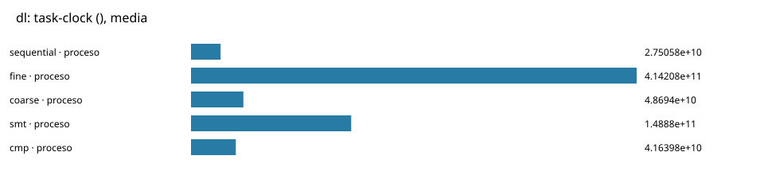

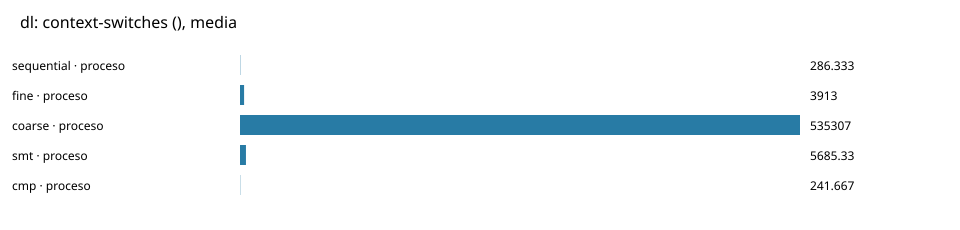

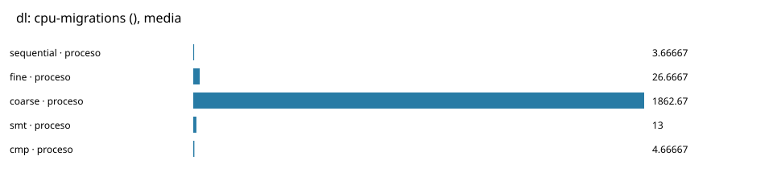

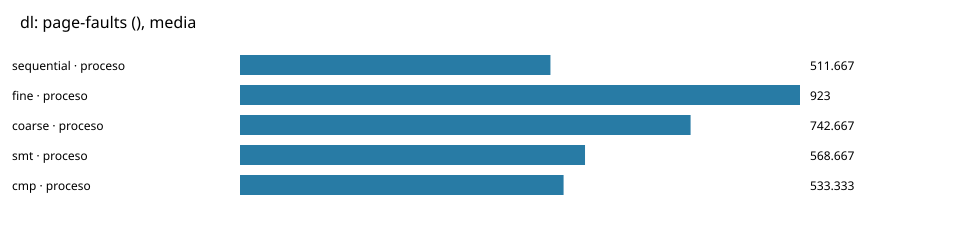

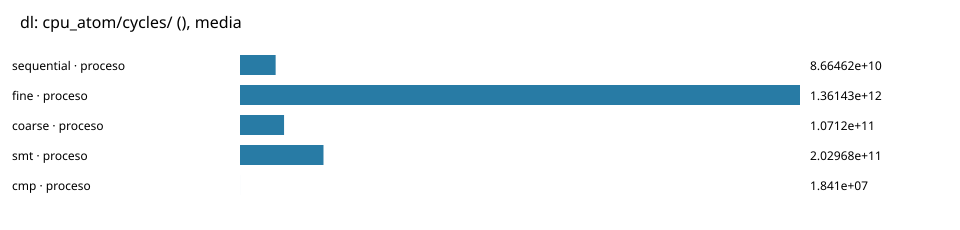

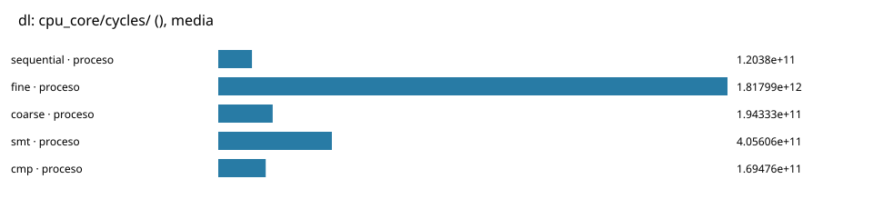

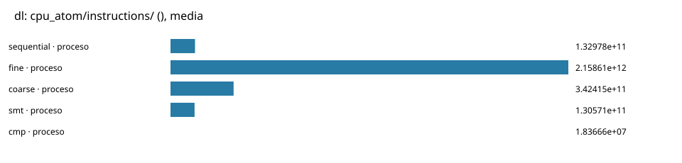

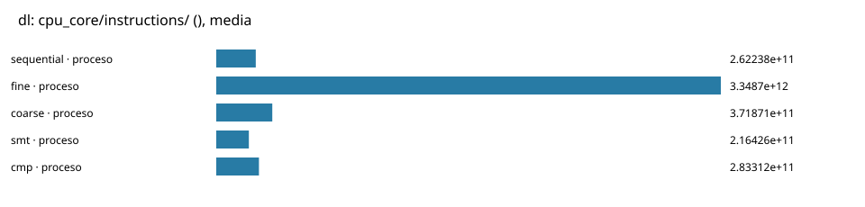

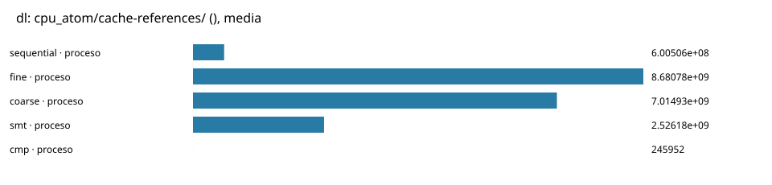

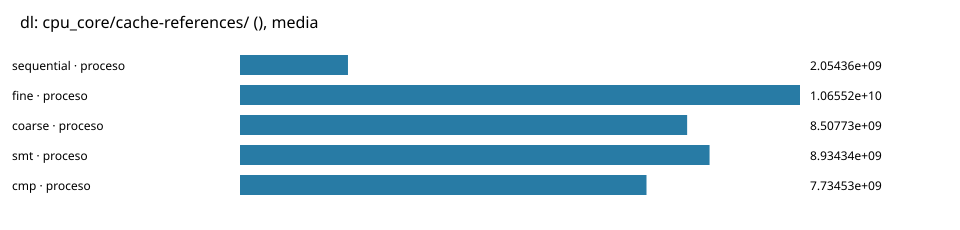

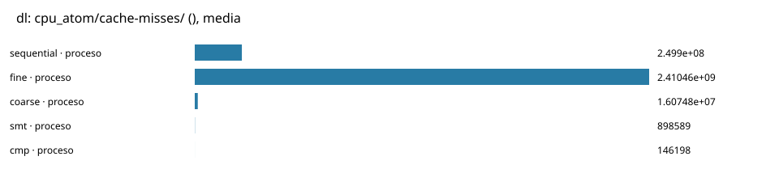

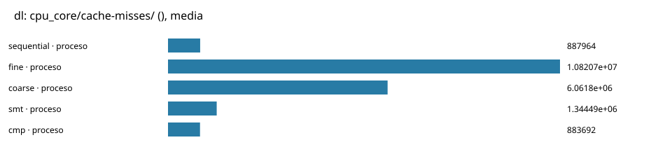

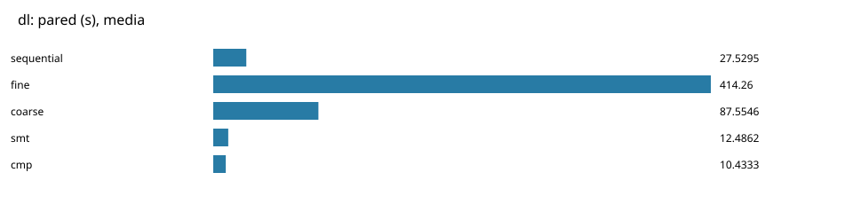

Eventos no disponibles: cpu_atom/cache-misses/: <not counted>; cpu_atom/cache-references/: <not counted>; cpu_atom/cycles/: <not counted>; cpu_atom/instructions/: <not counted>; stalled-cycles-backend: no_soportado; stalled-cycles-frontend: no_soportado.

Estado de campaña: **complete**.

## nbody

Fuente: [nbody.csv](nbody.csv). Campaña: `nbody-20261016T212339.819681Z`. Alcance: `process`.

| Modelo | CPU | Evento / PMU | Unidad | n válido / capturas | Media | Desviación | Cobertura mínima (%) |
| --- | --- | --- | --- | ---: | ---: | ---: | ---: |
| sequential | proceso | task-clock |  | 3/3 | 2.43982e+09 | 1.79535e+07 | 100.0 |
| sequential | proceso | context-switches |  | 3/3 | 29.6667 | 5.68624 | 100.0 |
| sequential | proceso | cpu-migrations |  | 3/3 | 5 | 1.73205 | 100.0 |
| sequential | proceso | page-faults |  | 3/3 | 539 | 3.4641 | 100.0 |
| sequential | proceso | cpu_atom/cycles/ |  | 3/3 | 7.63566e+09 | 3.20937e+08 | 0.0 |
| sequential | proceso | cpu_core/cycles/ |  | 3/3 | 1.05695e+10 | 4.11736e+06 | 99.0 |
| sequential | proceso | cpu_atom/instructions/ |  | 3/3 | 8.15953e+09 | 2.87183e+09 | 0.0 |
| sequential | proceso | cpu_core/instructions/ |  | 3/3 | 3.23052e+10 | 7.68422e+07 | 99.0 |
| sequential | proceso | cpu_atom/cache-references/ |  | 3/3 | 1.24622e+08 | 6.00956e+07 | 0.0 |
| sequential | proceso | cpu_core/cache-references/ |  | 3/3 | 2.03495e+06 | 146523 | 99.0 |
| sequential | proceso | cpu_atom/cache-misses/ |  | 3/3 | 7.01935e+07 | 2.03644e+07 | 0.0 |
| sequential | proceso | cpu_core/cache-misses/ |  | 3/3 | 1.29084e+06 | 83757.9 | 99.0 |
| sequential | no_disponible | stalled-cycles-frontend |  | 0/3 | no disponible | — | — |
| sequential | no_disponible | stalled-cycles-backend |  | 0/3 | no disponible | — | — |
| fine | proceso | task-clock |  | 3/3 | 2.92828e+09 | 7.53083e+06 | 100.0 |
| fine | proceso | context-switches |  | 3/3 | 52.3333 | 21.2211 | 100.0 |
| fine | proceso | cpu-migrations |  | 3/3 | 5.66667 | 2.51661 | 100.0 |
| fine | proceso | page-faults |  | 3/3 | 541.333 | 2.3094 | 100.0 |
| fine | proceso | cpu_atom/cycles/ |  | 3/3 | 9.61204e+09 | 2.35471e+07 | 0.0 |
| fine | proceso | cpu_core/cycles/ |  | 3/3 | 1.28033e+10 | 3.58148e+07 | 99.0 |
| fine | proceso | cpu_atom/instructions/ |  | 3/3 | 1.46901e+10 | 5.39177e+09 | 0.0 |
| fine | proceso | cpu_core/instructions/ |  | 3/3 | 7.33872e+10 | 5.4024e+07 | 99.0 |
| fine | proceso | cpu_atom/cache-references/ |  | 3/3 | 1.48915e+08 | 4.82653e+07 | 0.0 |
| fine | proceso | cpu_core/cache-references/ |  | 3/3 | 2.22056e+06 | 61937 | 99.0 |
| fine | proceso | cpu_atom/cache-misses/ |  | 3/3 | 8.51451e+07 | 3.00713e+07 | 0.0 |
| fine | proceso | cpu_core/cache-misses/ |  | 3/3 | 1.38377e+06 | 77738.5 | 99.0 |
| fine | no_disponible | stalled-cycles-frontend |  | 0/3 | no disponible | — | — |
| fine | no_disponible | stalled-cycles-backend |  | 0/3 | no disponible | — | — |
| coarse | proceso | task-clock |  | 3/3 | 3.24229e+09 | 3.56204e+08 | 100.0 |
| coarse | proceso | context-switches |  | 3/3 | 5200.67 | 87.8427 | 100.0 |
| coarse | proceso | cpu-migrations |  | 3/3 | 368.333 | 220.019 | 100.0 |
| coarse | proceso | page-faults |  | 3/3 | 555 | 2 | 100.0 |
| coarse | proceso | cpu_atom/cycles/ |  | 3/3 | 7.50049e+09 | 2.22896e+09 | 13.0 |
| coarse | proceso | cpu_core/cycles/ |  | 3/3 | 1.3254e+10 | 1.50413e+09 | 62.0 |
| coarse | proceso | cpu_atom/instructions/ |  | 3/3 | 1.17439e+10 | 3.47057e+09 | 13.0 |
| coarse | proceso | cpu_core/instructions/ |  | 3/3 | 3.80256e+10 | 2.97091e+09 | 62.0 |
| coarse | proceso | cpu_atom/cache-references/ |  | 3/3 | 7.68576e+06 | 4.76566e+06 | 13.0 |
| coarse | proceso | cpu_core/cache-references/ |  | 3/3 | 2.1408e+07 | 9.22101e+06 | 62.0 |
| coarse | proceso | cpu_atom/cache-misses/ |  | 3/3 | 1.75036e+06 | 1.5432e+06 | 13.0 |
| coarse | proceso | cpu_core/cache-misses/ |  | 3/3 | 1.94486e+06 | 469734 | 62.0 |
| coarse | no_disponible | stalled-cycles-frontend |  | 0/3 | no disponible | — | — |
| coarse | no_disponible | stalled-cycles-backend |  | 0/3 | no disponible | — | — |
| smt | proceso | task-clock |  | 3/3 | 5.70744e+09 | 3.12847e+07 | 100.0 |
| smt | proceso | context-switches |  | 3/3 | 14578.3 | 113.773 | 100.0 |
| smt | proceso | cpu-migrations |  | 3/3 | 38.6667 | 13.2035 | 100.0 |
| smt | proceso | page-faults |  | 3/3 | 584.333 | 3.21455 | 100.0 |
| smt | proceso | cpu_atom/cycles/ |  | 3/3 | 8.98788e+09 | 1.51556e+09 | 69.0 |
| smt | proceso | cpu_core/cycles/ |  | 3/3 | 1.82642e+10 | 3.25751e+09 | 63.0 |
| smt | proceso | cpu_atom/instructions/ |  | 3/3 | 1.3165e+10 | 2.15934e+09 | 69.0 |
| smt | proceso | cpu_core/instructions/ |  | 3/3 | 2.82762e+10 | 5.16322e+09 | 63.0 |
| smt | proceso | cpu_atom/cache-references/ |  | 3/3 | 5.43455e+06 | 1.41301e+06 | 69.0 |
| smt | proceso | cpu_core/cache-references/ |  | 3/3 | 1.48735e+07 | 6.45781e+06 | 63.0 |
| smt | proceso | cpu_atom/cache-misses/ |  | 3/3 | 1.17158e+06 | 305942 | 69.0 |
| smt | proceso | cpu_core/cache-misses/ |  | 3/3 | 1.24784e+06 | 609299 | 63.0 |
| smt | no_disponible | stalled-cycles-frontend |  | 0/3 | no disponible | — | — |
| smt | no_disponible | stalled-cycles-backend |  | 0/3 | no disponible | — | — |
| cmp | proceso | task-clock |  | 3/3 | 2.64278e+09 | 2.45814e+07 | 100.0 |
| cmp | proceso | context-switches |  | 3/3 | 5132.33 | 66.8905 | 100.0 |
| cmp | proceso | cpu-migrations |  | 3/3 | 55.6667 | 33.9755 | 100.0 |
| cmp | proceso | page-faults |  | 3/3 | 554 | 1 | 100.0 |
| cmp | proceso | cpu_atom/cycles/ |  | 2/3 | 1.91583e+09 | 1.18956e+09 | 1.0 |
| cmp | proceso | cpu_core/cycles/ |  | 3/3 | 1.07529e+10 | 5.69088e+07 | 99.0 |
| cmp | proceso | cpu_atom/instructions/ |  | 2/3 | 2.33199e+09 | 1.45117e+09 | 1.0 |
| cmp | proceso | cpu_core/instructions/ |  | 3/3 | 3.24077e+10 | 4.99055e+07 | 99.0 |
| cmp | proceso | cpu_atom/cache-references/ |  | 2/3 | 4.06352e+07 | 2.44229e+07 | 1.0 |
| cmp | proceso | cpu_core/cache-references/ |  | 3/3 | 1.06325e+07 | 736886 | 99.0 |
| cmp | proceso | cpu_atom/cache-misses/ |  | 2/3 | 2.15556e+07 | 1.27913e+07 | 1.0 |
| cmp | proceso | cpu_core/cache-misses/ |  | 3/3 | 1.36927e+06 | 184755 | 99.0 |
| cmp | no_disponible | stalled-cycles-frontend |  | 0/3 | no disponible | — | — |
| cmp | no_disponible | stalled-cycles-backend |  | 0/3 | no disponible | — | — |

Promedios de pared y uso agregado del proceso:

| Modelo | P | Pared media (s) | CPUs lógicas equivalentes ocupadas |
| --- | ---: | ---: | ---: |
| sequential | 1 | 2.46025 | no disponible |
| fine | 1 | 2.95803 | no disponible |
| coarse | 4 | 1.18563 | no disponible |
| smt | 12 | 0.747211 | no disponible |
| cmp | 4 | 0.796133 | no disponible |

Comparación observada de pared (instrumentada por perf): fine: 0.832× respecto al secuencial; coarse: 2.075× respecto al secuencial; smt: 3.293× respecto al secuencial; cmp: 3.090× respecto al secuencial. Un cociente menor que 1 indica mayor tiempo. La tabla de eventos permite contrastar esa variación con trabajo ejecutado, sincronización y memoria; no separa sus causas.

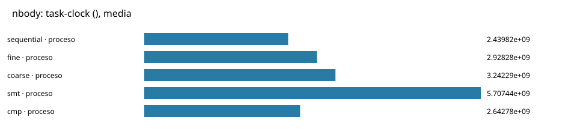

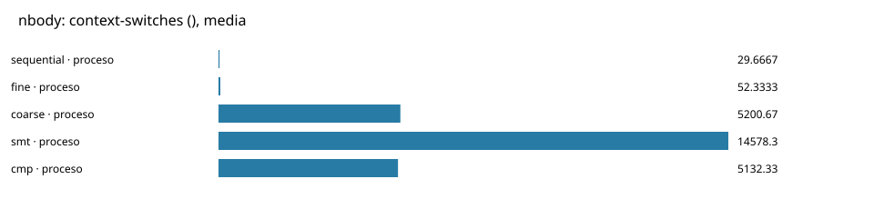

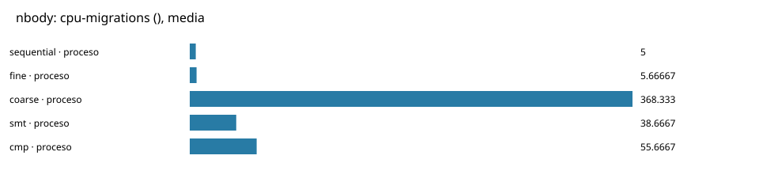

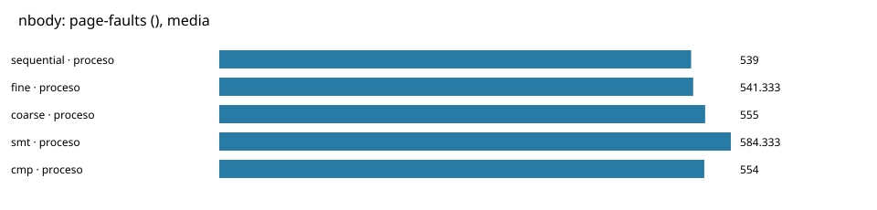

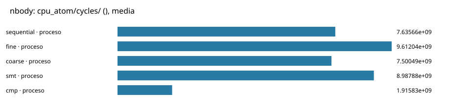

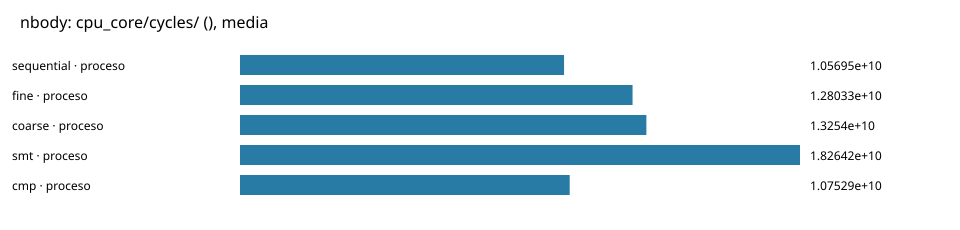

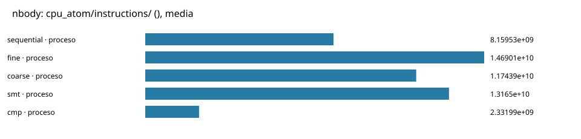

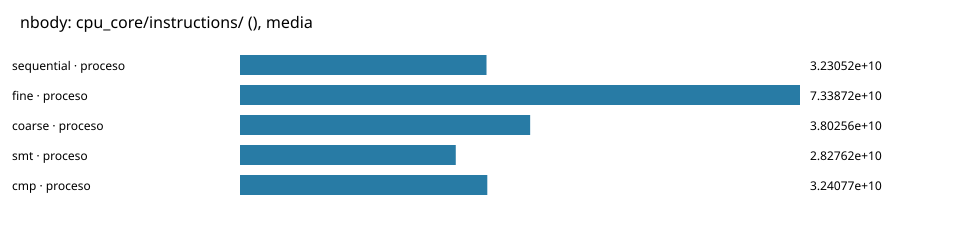

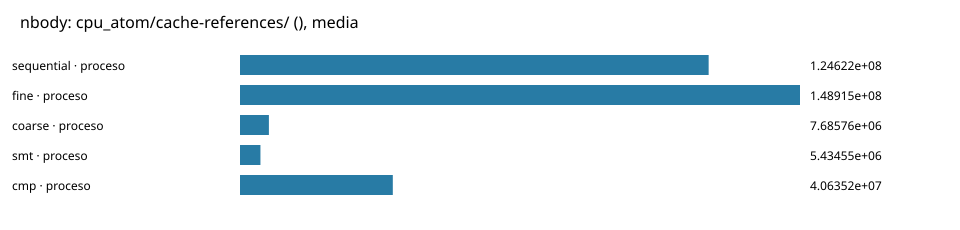

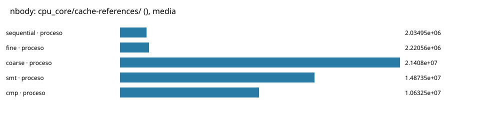

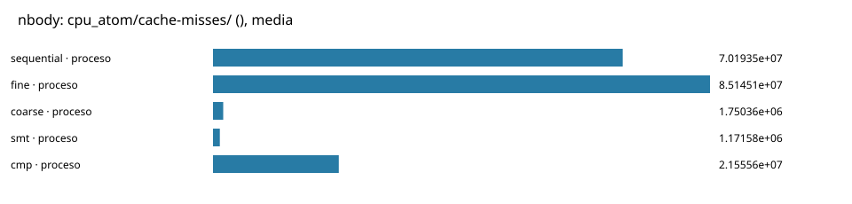

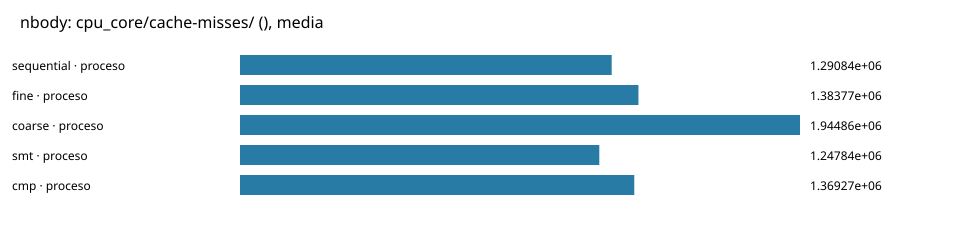

Eventos no disponibles: cpu_atom/cache-misses/: <not counted>; cpu_atom/cache-references/: <not counted>; cpu_atom/cycles/: <not counted>; cpu_atom/instructions/: <not counted>; stalled-cycles-backend: no_soportado; stalled-cycles-frontend: no_soportado.

Estado de campaña: **complete**.

## ray

Fuente: [ray.csv](ray.csv). Campaña: `ray-20261016T212404.480258Z`. Alcance: `process`.

| Modelo | CPU | Evento / PMU | Unidad | n válido / capturas | Media | Desviación | Cobertura mínima (%) |
| --- | --- | --- | --- | ---: | ---: | ---: | ---: |
| sequential | proceso | task-clock |  | 3/3 | 1.12105e+09 | 4.54036e+06 | 100.0 |
| sequential | proceso | context-switches |  | 3/3 | 20 | 12.1655 | 100.0 |
| sequential | proceso | cpu-migrations |  | 3/3 | 3 | 1 | 100.0 |
| sequential | proceso | page-faults |  | 3/3 | 369.333 | 1.52753 | 100.0 |
| sequential | proceso | cpu_atom/cycles/ |  | 3/3 | 3.68126e+09 | 2.05252e+07 | 0.0 |
| sequential | proceso | cpu_core/cycles/ |  | 3/3 | 4.87929e+09 | 2.12145e+07 | 97.0 |
| sequential | proceso | cpu_atom/instructions/ |  | 3/3 | 9.8973e+09 | 1.74061e+09 | 0.0 |
| sequential | proceso | cpu_core/instructions/ |  | 3/3 | 2.19138e+10 | 9.22285e+07 | 97.0 |
| sequential | proceso | cpu_atom/cache-references/ |  | 3/3 | 1.78838e+07 | 1.06429e+07 | 0.0 |
| sequential | proceso | cpu_core/cache-references/ |  | 3/3 | 177555 | 23072.1 | 97.0 |
| sequential | proceso | cpu_atom/cache-misses/ |  | 3/3 | 1.17625e+07 | 7.60276e+06 | 0.0 |
| sequential | proceso | cpu_core/cache-misses/ |  | 3/3 | 49976.3 | 2701.18 | 97.0 |
| sequential | no_disponible | stalled-cycles-frontend |  | 0/3 | no disponible | — | — |
| sequential | no_disponible | stalled-cycles-backend |  | 0/3 | no disponible | — | — |
| fine | proceso | task-clock |  | 3/3 | 1.12901e+09 | 1.74054e+07 | 100.0 |
| fine | proceso | context-switches |  | 3/3 | 11.6667 | 3.78594 | 100.0 |
| fine | proceso | cpu-migrations |  | 3/3 | 2.33333 | 0.57735 | 100.0 |
| fine | proceso | page-faults |  | 3/3 | 370.667 | 2.08167 | 100.0 |
| fine | proceso | cpu_atom/cycles/ |  | 3/3 | 3.68789e+09 | 8.08301e+07 | 0.0 |
| fine | proceso | cpu_core/cycles/ |  | 3/3 | 4.91942e+09 | 7.04514e+07 | 99.0 |
| fine | proceso | cpu_atom/instructions/ |  | 3/3 | 8.65641e+09 | 1.86793e+09 | 0.0 |
| fine | proceso | cpu_core/instructions/ |  | 3/3 | 2.18603e+10 | 3.91323e+07 | 99.0 |
| fine | proceso | cpu_atom/cache-references/ |  | 3/3 | 2.93551e+07 | 1.64861e+07 | 0.0 |
| fine | proceso | cpu_core/cache-references/ |  | 3/3 | 197443 | 22805.4 | 99.0 |
| fine | proceso | cpu_atom/cache-misses/ |  | 3/3 | 1.71768e+07 | 8.23491e+06 | 0.0 |
| fine | proceso | cpu_core/cache-misses/ |  | 3/3 | 54287 | 12379.4 | 99.0 |
| fine | no_disponible | stalled-cycles-frontend |  | 0/3 | no disponible | — | — |
| fine | no_disponible | stalled-cycles-backend |  | 0/3 | no disponible | — | — |
| coarse | proceso | task-clock |  | 3/3 | 1.23977e+09 | 1.17131e+07 | 100.0 |
| coarse | proceso | context-switches |  | 3/3 | 209 | 6.08276 | 100.0 |
| coarse | proceso | cpu-migrations |  | 3/3 | 8.33333 | 4.04145 | 100.0 |
| coarse | proceso | page-faults |  | 3/3 | 383.333 | 1.52753 | 100.0 |
| coarse | proceso | cpu_atom/cycles/ |  | 3/3 | 1.3343e+09 | 4.59781e+08 | 18.0 |
| coarse | proceso | cpu_core/cycles/ |  | 3/3 | 5.00087e+09 | 1.37403e+08 | 91.0 |
| coarse | proceso | cpu_atom/instructions/ |  | 3/3 | 4.33672e+09 | 1.44097e+09 | 18.0 |
| coarse | proceso | cpu_core/instructions/ |  | 3/3 | 2.2204e+10 | 5.32789e+08 | 91.0 |
| coarse | proceso | cpu_atom/cache-references/ |  | 3/3 | 913796 | 579322 | 18.0 |
| coarse | proceso | cpu_core/cache-references/ |  | 3/3 | 822216 | 91184.7 | 91.0 |
| coarse | proceso | cpu_atom/cache-misses/ |  | 3/3 | 286606 | 216581 | 18.0 |
| coarse | proceso | cpu_core/cache-misses/ |  | 3/3 | 84223.7 | 39622 | 91.0 |
| coarse | no_disponible | stalled-cycles-frontend |  | 0/3 | no disponible | — | — |
| coarse | no_disponible | stalled-cycles-backend |  | 0/3 | no disponible | — | — |
| smt | proceso | task-clock |  | 3/3 | 2.18837e+09 | 9.74661e+06 | 100.0 |
| smt | proceso | context-switches |  | 3/3 | 351.667 | 27.5379 | 100.0 |
| smt | proceso | cpu-migrations |  | 3/3 | 11 | 2.64575 | 100.0 |
| smt | proceso | page-faults |  | 3/3 | 411 | 0 | 100.0 |
| smt | proceso | cpu_atom/cycles/ |  | 3/3 | 2.41826e+09 | 3.43614e+08 | 79.0 |
| smt | proceso | cpu_core/cycles/ |  | 3/3 | 6.26974e+09 | 4.32515e+08 | 88.0 |
| smt | proceso | cpu_atom/instructions/ |  | 3/3 | 7.8976e+09 | 1.1245e+09 | 79.0 |
| smt | proceso | cpu_core/instructions/ |  | 3/3 | 1.5804e+10 | 1.11759e+09 | 88.0 |
| smt | proceso | cpu_atom/cache-references/ |  | 3/3 | 356361 | 11929.8 | 79.0 |
| smt | proceso | cpu_core/cache-references/ |  | 3/3 | 372943 | 16500.9 | 88.0 |
| smt | proceso | cpu_atom/cache-misses/ |  | 3/3 | 126090 | 15636.2 | 79.0 |
| smt | proceso | cpu_core/cache-misses/ |  | 3/3 | 72163.7 | 12082.2 | 88.0 |
| smt | no_disponible | stalled-cycles-frontend |  | 0/3 | no disponible | — | — |
| smt | no_disponible | stalled-cycles-backend |  | 0/3 | no disponible | — | — |
| cmp | proceso | task-clock |  | 3/3 | 1.21471e+09 | 2.57338e+07 | 100.0 |
| cmp | proceso | context-switches |  | 3/3 | 75.3333 | 6.65833 | 100.0 |
| cmp | proceso | cpu-migrations |  | 3/3 | 5.33333 | 2.3094 | 100.0 |
| cmp | proceso | page-faults |  | 3/3 | 386.667 | 1.1547 | 100.0 |
| cmp | proceso | cpu_atom/cycles/ |  | 3/3 | 1.18469e+07 | 3.86379e+06 | 3.0 |
| cmp | proceso | cpu_core/cycles/ |  | 3/3 | 4.96508e+09 | 1.06518e+08 | 99.0 |
| cmp | proceso | cpu_atom/instructions/ |  | 3/3 | 1.28473e+07 | 8.58301e+06 | 3.0 |
| cmp | proceso | cpu_core/instructions/ |  | 3/3 | 2.18502e+10 | 3.76335e+07 | 99.0 |
| cmp | proceso | cpu_atom/cache-references/ |  | 3/3 | 286378 | 33475.4 | 3.0 |
| cmp | proceso | cpu_core/cache-references/ |  | 3/3 | 313443 | 54623.2 | 99.0 |
| cmp | proceso | cpu_atom/cache-misses/ |  | 3/3 | 117807 | 18237.8 | 3.0 |
| cmp | proceso | cpu_core/cache-misses/ |  | 3/3 | 62666.3 | 35061.3 | 99.0 |
| cmp | no_disponible | stalled-cycles-frontend |  | 0/3 | no disponible | — | — |
| cmp | no_disponible | stalled-cycles-backend |  | 0/3 | no disponible | — | — |

Promedios de pared y uso agregado del proceso:

| Modelo | P | Pared media (s) | CPUs lógicas equivalentes ocupadas |
| --- | ---: | ---: | ---: |
| sequential | 1 | 1.1377 | no disponible |
| fine | 1 | 1.14338 | no disponible |
| coarse | 4 | 0.359563 | no disponible |
| smt | 12 | 0.203313 | no disponible |
| cmp | 4 | 0.32067 | no disponible |

Comparación observada de pared (instrumentada por perf): fine: 0.995× respecto al secuencial; coarse: 3.164× respecto al secuencial; smt: 5.596× respecto al secuencial; cmp: 3.548× respecto al secuencial. Un cociente menor que 1 indica mayor tiempo. La tabla de eventos permite contrastar esa variación con trabajo ejecutado, sincronización y memoria; no separa sus causas.

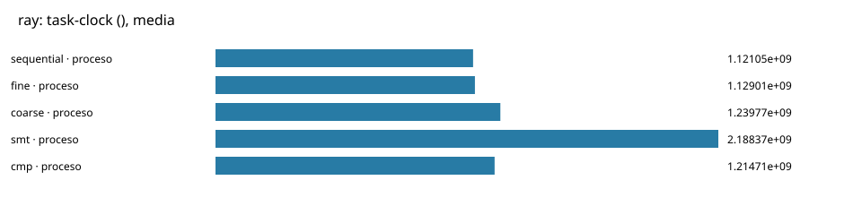

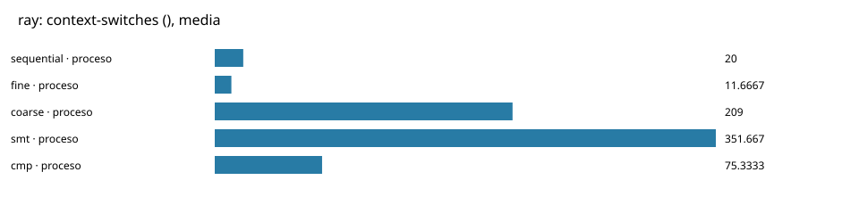

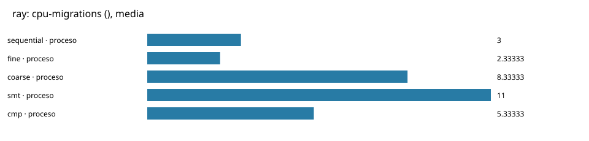

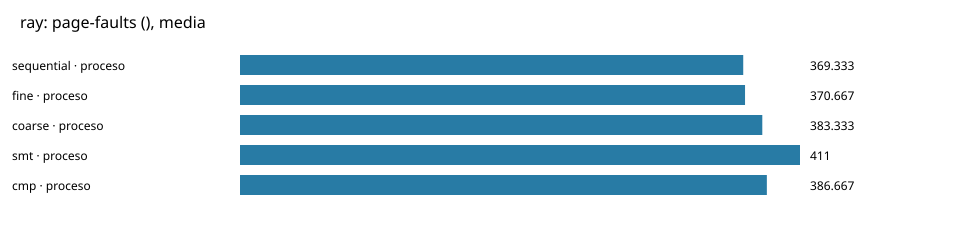

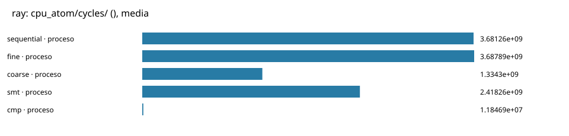

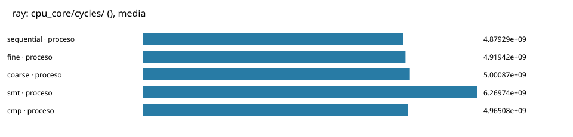

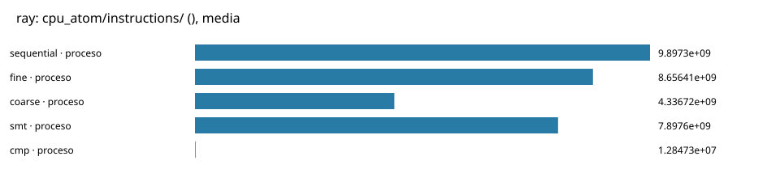

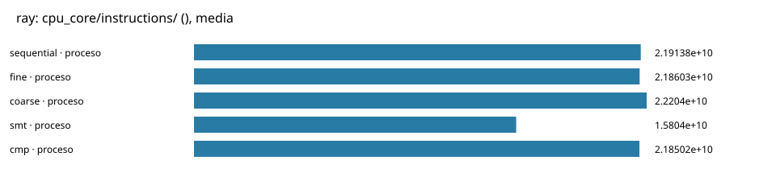

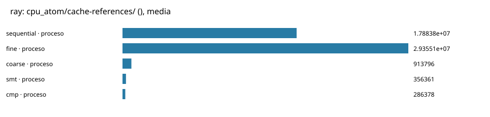

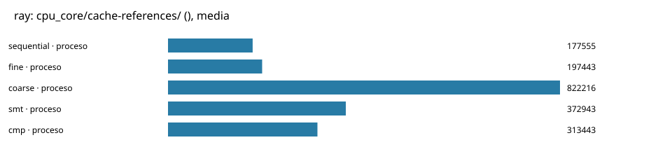

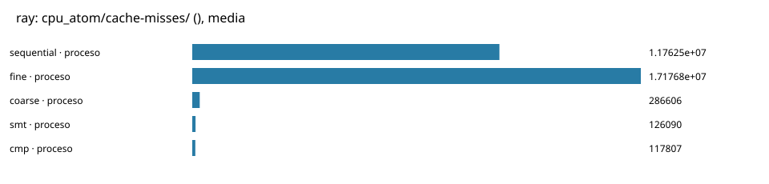

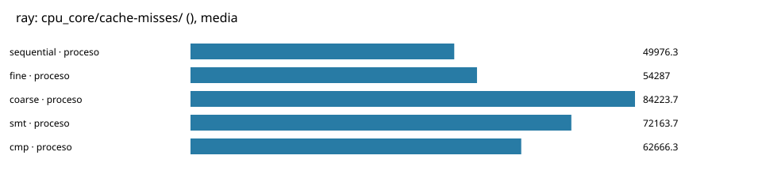

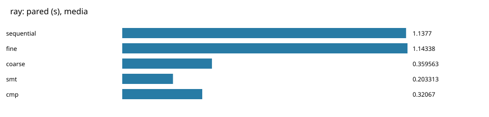

Eventos no disponibles: stalled-cycles-backend: no_soportado; stalled-cycles-frontend: no_soportado.

Estado de campaña: **complete**.

## sentinel

Fuente: [sentinel.csv](sentinel.csv). Campaña: `sentinel-20261016T215151.131117Z`. Alcance: `process`.

| Modelo | CPU | Evento / PMU | Unidad | n válido / capturas | Media | Desviación | Cobertura mínima (%) |
| --- | --- | --- | --- | ---: | ---: | ---: | ---: |
| sequential | proceso | task-clock |  | 3/3 | 2.17015e+09 | 2.47109e+07 | 100.0 |
| sequential | proceso | context-switches |  | 3/3 | 409.667 | 671.465 | 100.0 |
| sequential | proceso | cpu-migrations |  | 3/3 | 3.33333 | 2.51661 | 100.0 |
| sequential | proceso | page-faults |  | 3/3 | 580304 | 100.201 | 100.0 |
| sequential | proceso | cpu_atom/cycles/ |  | 2/3 | 7.07387e+09 | 5.46311e+07 | 0.0 |
| sequential | proceso | cpu_core/cycles/ |  | 3/3 | 9.41762e+09 | 8.74301e+07 | 99.0 |
| sequential | proceso | cpu_atom/instructions/ |  | 2/3 | 7.16883e+09 | 3.04737e+08 | 0.0 |
| sequential | proceso | cpu_core/instructions/ |  | 3/3 | 1.91293e+10 | 8.01445e+07 | 99.0 |
| sequential | proceso | cpu_atom/cache-references/ |  | 2/3 | 1.29421e+08 | 6.23036e+06 | 0.0 |
| sequential | proceso | cpu_core/cache-references/ |  | 3/3 | 1.37013e+08 | 5.42182e+06 | 99.0 |
| sequential | proceso | cpu_atom/cache-misses/ |  | 2/3 | 8.0867e+07 | 6.63878e+06 | 0.0 |
| sequential | proceso | cpu_core/cache-misses/ |  | 3/3 | 1.01006e+08 | 2.3919e+06 | 99.0 |
| sequential | no_disponible | stalled-cycles-frontend |  | 0/3 | no disponible | — | — |
| sequential | no_disponible | stalled-cycles-backend |  | 0/3 | no disponible | — | — |
| fine | proceso | task-clock |  | 3/3 | 2.63836e+09 | 2.43138e+06 | 100.0 |
| fine | proceso | context-switches |  | 3/3 | 25.3333 | 5.50757 | 100.0 |
| fine | proceso | cpu-migrations |  | 3/3 | 1.66667 | 1.1547 | 100.0 |
| fine | proceso | page-faults |  | 3/3 | 581157 | 2.64575 | 100.0 |
| fine | proceso | cpu_atom/cycles/ |  | 3/3 | 8.605e+09 | 1.18924e+08 | 0.0 |
| fine | proceso | cpu_core/cycles/ |  | 3/3 | 1.1484e+10 | 1.43902e+07 | 99.0 |
| fine | proceso | cpu_atom/instructions/ |  | 3/3 | 7.91144e+09 | 2.0932e+09 | 0.0 |
| fine | proceso | cpu_core/instructions/ |  | 3/3 | 1.99614e+10 | 4.16529e+07 | 99.0 |
| fine | proceso | cpu_atom/cache-references/ |  | 3/3 | 1.69101e+08 | 3.01735e+07 | 0.0 |
| fine | proceso | cpu_core/cache-references/ |  | 3/3 | 2.75564e+08 | 505856 | 99.0 |
| fine | proceso | cpu_atom/cache-misses/ |  | 3/3 | 9.9878e+07 | 1.14763e+07 | 0.0 |
| fine | proceso | cpu_core/cache-misses/ |  | 3/3 | 2.23405e+08 | 640449 | 99.0 |
| fine | no_disponible | stalled-cycles-frontend |  | 0/3 | no disponible | — | — |
| fine | no_disponible | stalled-cycles-backend |  | 0/3 | no disponible | — | — |
| coarse | proceso | task-clock |  | 3/3 | 2.38788e+09 | 595478 | 100.0 |
| coarse | proceso | context-switches |  | 3/3 | 39.3333 | 7.37111 | 100.0 |
| coarse | proceso | cpu-migrations |  | 3/3 | 4 | 1 | 100.0 |
| coarse | proceso | page-faults |  | 3/3 | 580623 | 1.73205 | 100.0 |
| coarse | proceso | cpu_atom/cycles/ |  | 3/3 | 6.91196e+09 | 3.21883e+08 | 0.0 |
| coarse | proceso | cpu_core/cycles/ |  | 3/3 | 1.02259e+10 | 1.54877e+08 | 97.0 |
| coarse | proceso | cpu_atom/instructions/ |  | 3/3 | 4.86994e+09 | 4.1777e+08 | 0.0 |
| coarse | proceso | cpu_core/instructions/ |  | 3/3 | 1.92112e+10 | 1.20522e+08 | 97.0 |
| coarse | proceso | cpu_atom/cache-references/ |  | 3/3 | 2.25185e+08 | 4.83036e+07 | 0.0 |
| coarse | proceso | cpu_core/cache-references/ |  | 3/3 | 1.29365e+08 | 4.85893e+06 | 97.0 |
| coarse | proceso | cpu_atom/cache-misses/ |  | 3/3 | 1.92542e+08 | 2.40724e+07 | 0.0 |
| coarse | proceso | cpu_core/cache-misses/ |  | 3/3 | 1.01194e+08 | 4.72283e+06 | 97.0 |
| coarse | no_disponible | stalled-cycles-frontend |  | 0/3 | no disponible | — | — |
| coarse | no_disponible | stalled-cycles-backend |  | 0/3 | no disponible | — | — |
| smt | proceso | task-clock |  | 3/3 | 3.11958e+09 | 2.03052e+07 | 100.0 |
| smt | proceso | context-switches |  | 3/3 | 141.667 | 5.1316 | 100.0 |
| smt | proceso | cpu-migrations |  | 3/3 | 14 | 1 | 100.0 |
| smt | proceso | page-faults |  | 3/3 | 580655 | 5.1316 | 100.0 |
| smt | proceso | cpu_atom/cycles/ |  | 3/3 | 7.58382e+09 | 1.23825e+09 | 13.0 |
| smt | proceso | cpu_core/cycles/ |  | 3/3 | 1.18761e+10 | 6.3478e+07 | 99.0 |
| smt | proceso | cpu_atom/instructions/ |  | 3/3 | 1.62228e+09 | 3.55759e+08 | 13.0 |
| smt | proceso | cpu_core/instructions/ |  | 3/3 | 1.89197e+10 | 2.16541e+07 | 99.0 |
| smt | proceso | cpu_atom/cache-references/ |  | 3/3 | 1.05962e+08 | 1.57963e+07 | 13.0 |
| smt | proceso | cpu_core/cache-references/ |  | 3/3 | 1.33219e+08 | 176372 | 99.0 |
| smt | proceso | cpu_atom/cache-misses/ |  | 3/3 | 7.88807e+07 | 1.16851e+07 | 13.0 |
| smt | proceso | cpu_core/cache-misses/ |  | 3/3 | 9.30688e+07 | 188423 | 99.0 |
| smt | no_disponible | stalled-cycles-frontend |  | 0/3 | no disponible | — | — |
| smt | no_disponible | stalled-cycles-backend |  | 0/3 | no disponible | — | — |
| cmp | proceso | task-clock |  | 3/3 | 2.40166e+09 | 4.68787e+06 | 100.0 |
| cmp | proceso | context-switches |  | 3/3 | 50 | 7 | 100.0 |
| cmp | proceso | cpu-migrations |  | 3/3 | 7.33333 | 1.52753 | 100.0 |
| cmp | proceso | page-faults |  | 3/3 | 580622 | 3 | 100.0 |
| cmp | proceso | cpu_atom/cycles/ |  | 3/3 | 4.99241e+09 | 3.42581e+08 | 0.0 |
| cmp | proceso | cpu_core/cycles/ |  | 3/3 | 1.03631e+10 | 2.13568e+07 | 98.0 |
| cmp | proceso | cpu_atom/instructions/ |  | 3/3 | 5.77173e+09 | 2.18997e+09 | 0.0 |
| cmp | proceso | cpu_core/instructions/ |  | 3/3 | 1.91389e+10 | 4.28779e+07 | 98.0 |
| cmp | proceso | cpu_atom/cache-references/ |  | 3/3 | 1.53521e+08 | 1.022e+08 | 0.0 |
| cmp | proceso | cpu_core/cache-references/ |  | 3/3 | 1.32282e+08 | 211140 | 98.0 |
| cmp | proceso | cpu_atom/cache-misses/ |  | 3/3 | 1.05422e+08 | 8.6805e+07 | 0.0 |
| cmp | proceso | cpu_core/cache-misses/ |  | 3/3 | 1.04136e+08 | 82512.2 | 98.0 |
| cmp | no_disponible | stalled-cycles-frontend |  | 0/3 | no disponible | — | — |
| cmp | no_disponible | stalled-cycles-backend |  | 0/3 | no disponible | — | — |

Promedios de pared y uso agregado del proceso:

| Modelo | P | Pared media (s) | CPUs lógicas equivalentes ocupadas |
| --- | ---: | ---: | ---: |
| sequential | 1 | 2.21357 | no disponible |
| fine | 1 | 2.65397 | no disponible |
| coarse | 4 | 2.17826 | no disponible |
| smt | 12 | 2.19283 | no disponible |
| cmp | 4 | 2.18932 | no disponible |

Comparación observada de pared (instrumentada por perf): fine: 0.834× respecto al secuencial; coarse: 1.016× respecto al secuencial; smt: 1.009× respecto al secuencial; cmp: 1.011× respecto al secuencial. Un cociente menor que 1 indica mayor tiempo. La tabla de eventos permite contrastar esa variación con trabajo ejecutado, sincronización y memoria; no separa sus causas.

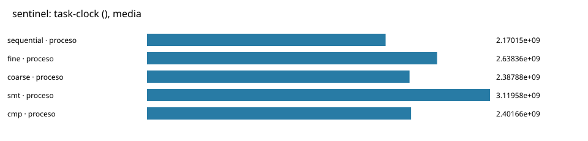

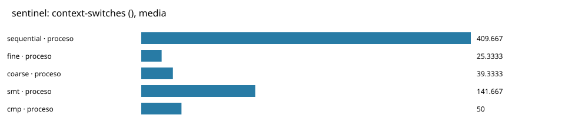

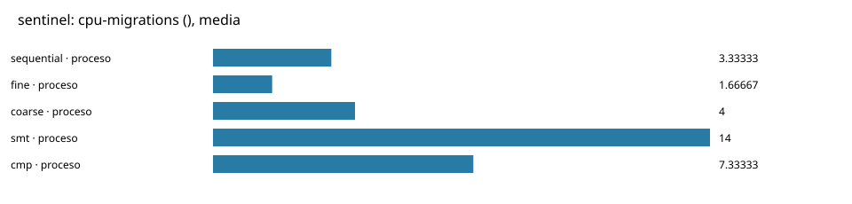

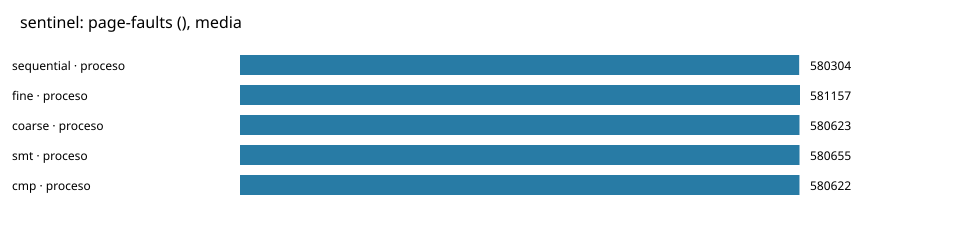

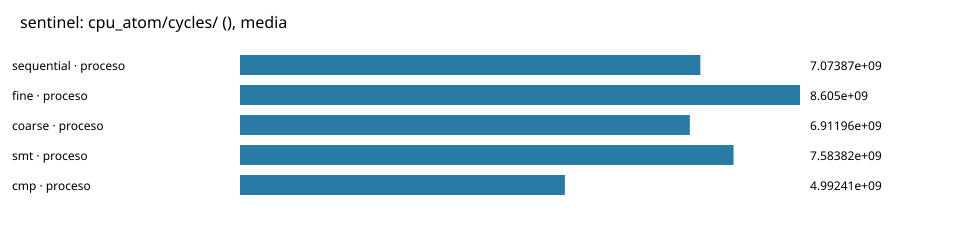

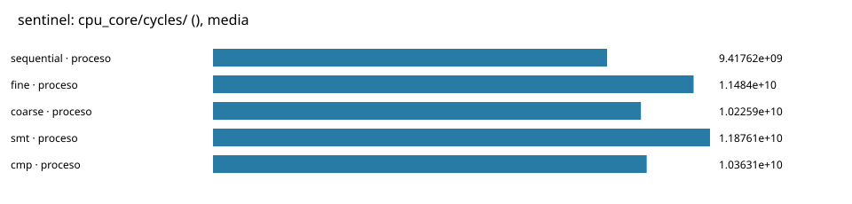

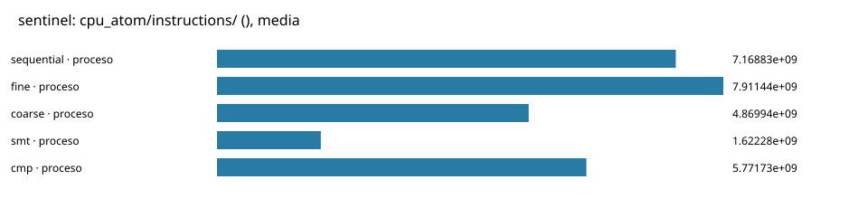

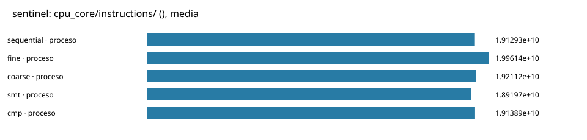

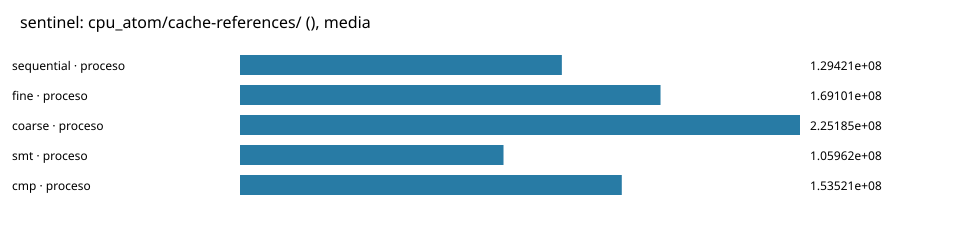

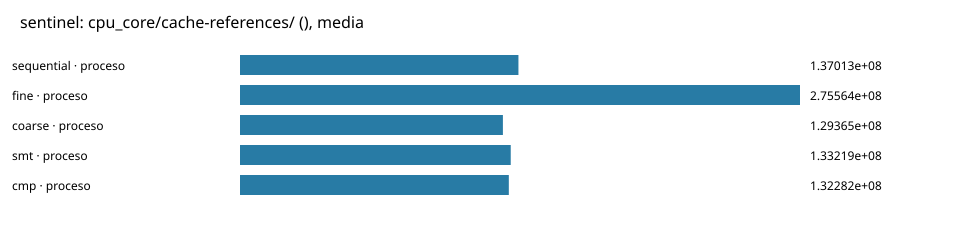

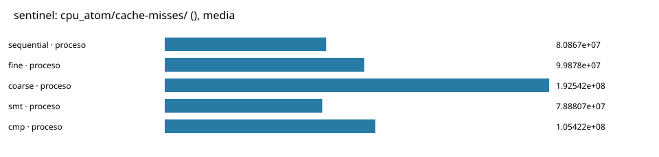

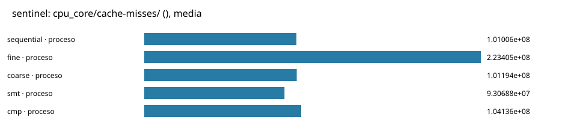

Eventos no disponibles: cpu_atom/cache-misses/: <not counted>; cpu_atom/cache-references/: <not counted>; cpu_atom/cycles/: <not counted>; cpu_atom/instructions/: <not counted>; stalled-cycles-backend: no_soportado; stalled-cycles-frontend: no_soportado.

Estado de campaña: **complete**.
