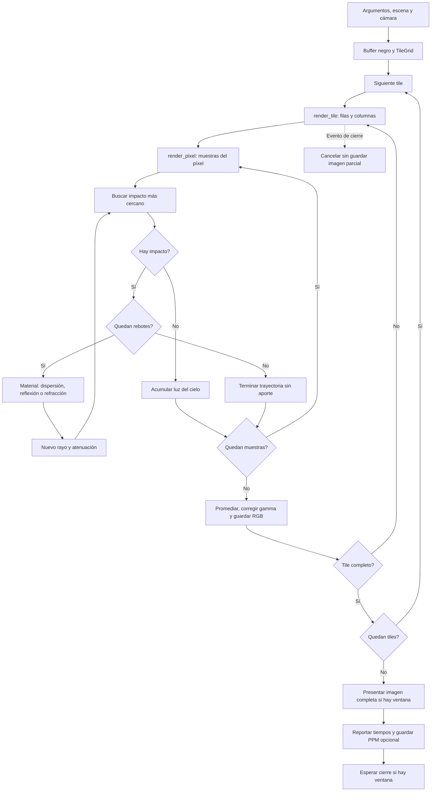
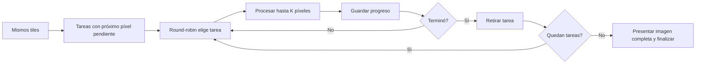
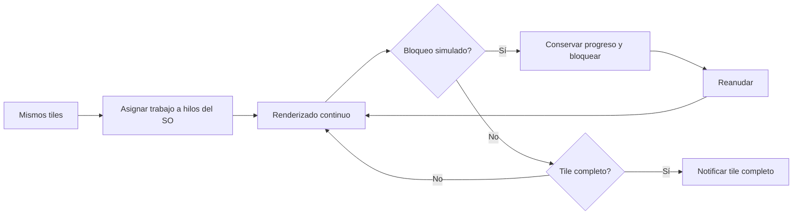

# Diseño de la base secuencial

Cambios respecto a la propuesta de demostración 1: se concretan cámara, escena,
iluminación, buffer RGB, tiles recortados y presentación SDL2. Se mantiene
la separación entre partición espacial y política de ejecución.

Los siguientes esquemas son diseños futuros, no código implementado.
Compartirán escena, cámara, partición y cálculo de píxel. El callback de eventos
actual no implementa quantums ni bloqueos simulados.

En coarse-grained el temporizador futuro provoca el bloqueo, no un quantum
round-robin. Los hilos del SO siguen sujetos a planificación preventiva:
esta aproximación no controla los cambios de contexto del hardware. La cantidad
de hilos y la asignación de tiles se decidirán al implementar y medir ese modelo.

| Variable | Efecto |
| --- | --- |
| Ancho × alto | Cantidad de rayos y memoria del buffer |
| Número de esferas | Pruebas geométricas por rayo; Tres principales, hasta 88 pequeñas y una esfera para el piso |
| Tamaño de tile | Cantidad de tareas y granularidad |
| Distribución de objetos | Cantidad de impactos que requieren iluminación |
| Muestras y máximo de rebotes | Calidad, ruido y cantidad de rayos secundarios |
| K, hilos, bloqueos, afinidad | Parámetros futuros de ejecución |

Con búsqueda lineal de impactos, el trabajo geométrico está acotado por
O(ancho × alto × muestras × (rebotes + 1) × esferas). Reducir tiles no cambia
el número de rayos; aumenta la administración de tareas. El buffer ocupa
tres bytes por píxel. Para comparar políticas se conservarán escena, resolución,
partición y compilación, usando el mismo criterio de medición sin ventana.

La demostración 2 completa aún requiere ejecuciones triviales medidas de
fine-grained, coarse-grained, SMT y CMP y la revisión correspondiente de diagramas.
Esos modelos quedan fuera de la implementación solicitada en esta etapa.

## Separación del código

El recorrido del diagrama se implementa en `sequential.cpp`, el cálculo en
`raytracer.cpp` y la presentación en `display.cpp`. `main.cpp` conecta estos
módulos mediante callbacks. Geometría, escena, cámara, imagen, tiles y argumentos
tienen sus propias interfaces y archivos de implementación. Así, cambiar la
política de ejecución no requiere modificar las fórmulas ni incorporar SDL al núcleo.

La presentación actual ocurre una vez que termina toda la imagen. La ventana
permanece negra y receptiva durante el cálculo. Secuencial describe la ejecución
sin paralelismo, no la forma de mostrar los píxeles.

La iluminación actual es path tracing: los rayos rebotan según el material y
reciben luz del cielo al escapar. La semilla por píxel es independiente de los
tiles. Para comparar políticas hay que fijar también muestras, rebotes y semilla.
Fine-grained seguirá contando K píxeles completos; ahora cada píxel implica
varias muestras y una cantidad variable de rebotes. Las mediciones previas de
la versión de un rayo por píxel no son directamente comparables.

## Correspondencia con la propuesta LaTeX

Revisión del estado actual: 22 de septiembre de 2026. La referencia es
`../../.local/Raytracing.tex`, propuesta de la demostración 1. Ese archivo original
no se ha modificado; esta documentación registra la evolución del diseño.

**La unidad de partición sigue siendo el tile**, no la esfera, la muestra ni
el rebote. Para una resolución W×H y tiles de Tw×Th:

`M = ceil(W / Tw) * ceil(H / Th)`

Con 640×480 y tiles 32×32 hay 300 tiles. `TileGrid` define la misma partición que
reutilizarán los modelos. `render_sequential` termina un tile antes del siguiente;
`render_tile` calcula sus píxeles y `render_pixel` termina todas las muestras de
cada píxel. Los reflejos y la refracción consultan la geometría de la escena,
no leen el color de otros píxeles: los tiles siguen siendo independientes.

| Punto de la propuesta | Estado actual y siguiente paso |
| --- | --- |
| Misma escena, imagen y M tiles | Implementado para la base; se conservará en las comparaciones |
| Fine-grained: tarea por tile, round-robin y progreso | Diseño preliminar; falta implementarlo |
| Coarse-grained: hilo por tile y bloqueo simulado | Diseño del LaTeX; faltan hilos, temporizador, bloqueo y reanudación |
| Cálculo común entre políticas | `render_pixel`, cámara, geometría, materiales y buffer reutilizables |
| Mediciones comparables | Tiempo secuencial disponible; faltan los modelos y sus mediciones |

**Precisión nueva sobre K:** el LaTeX alterna “K rayos o píxeles” y “K rayos”.
Ahora que cada píxel tiene varias muestras y rebotes, ya no son equivalentes.
La decisión para la próxima implementación es **K píxeles completos por turno**.
Hay que reflejar esa precisión en el texto y las etiquetas del LaTeX antes de
presentar los diagramas actualizados. Un turno puede costar más tiempo que otro:
K es una unidad lógica de trabajo, no K ciclos de CPU ni una duración fija.

Para reanudar una tarea se guardará el tile y el índice del siguiente píxel.
Las muestras de un píxel se calculan completas antes de ceder. Esto conserva
la semilla por coordenadas y el orden de suma, independientemente de la política.
La función actual `render_tile` todavía no permite pausar y reanudar por K.

El LaTeX propone un hilo por tile en coarse-grained; con la configuración inicial
eso serían 300 hilos. M (tiles) y P (trabajadores) son conceptos diferentes. Si
posteriormente se opta por P trabajadores que reciben varios tiles, se deberá
registrar como un cambio explícito de diseño respecto a esa propuesta. Todavía
no se ha implementado ni elegido esa alternativa.

Cambios desde la propuesta inicial: el cálculo del píxel pasó de iluminación
simple a múltiples muestras y rebotes; se añadieron metales, vidrio y gamma.
La presentación ocurre al finalizar toda la imagen. Ninguno de estos cambios
elimina la partición por tiles. Para comparar ejecuciones se fijarán escena,
cámara, resolución, tiles, muestras, límite de rebotes y semillas. Se medirá sin
ventana ni escritura dentro del intervalo de renderizado, usando el mismo alcance
del reloj. En paralelo, el tiempo total será tiempo de pared del modelo, no la
suma de los tiempos de todos los trabajadores.

## Estado de la demostración 2

Según `../../.local/ProyectoA2.txt`, apartado 4.1, punto 4.b:

| Requisito | Estado |
| --- | --- |
| Ejecución del sistema base sin hilos adicionales | Implementado y probado |
| Variables relevantes para la paralelización | Identificadas en este documento |
| Diagramas preliminares y cambios significativos | Actualizados aquí para base, fine-grained y coarse-grained; falta trasladar los cambios al LaTeX y completar el diseño de SMT/CMP |
| Ejecución trivial de cada esquema multihilo con mediciones | Pendiente: fine-grained, coarse-grained, SMT y CMP |

La demostración 2 todavía no está completa. Las pruebas SDL con controlador
`dummy` solo verifican la ventana: **no son las ejecuciones dummy de modelos
multihilo** que exige el enunciado. La mejora visual tampoco sustituye esas pruebas.
