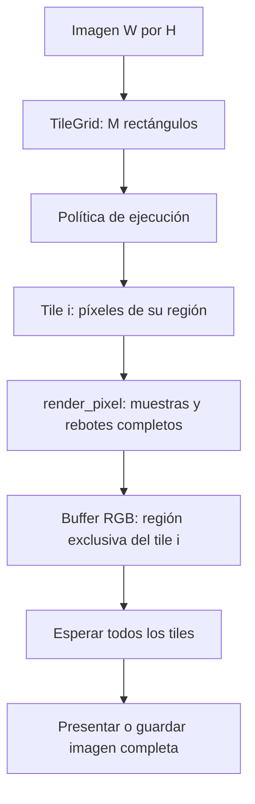
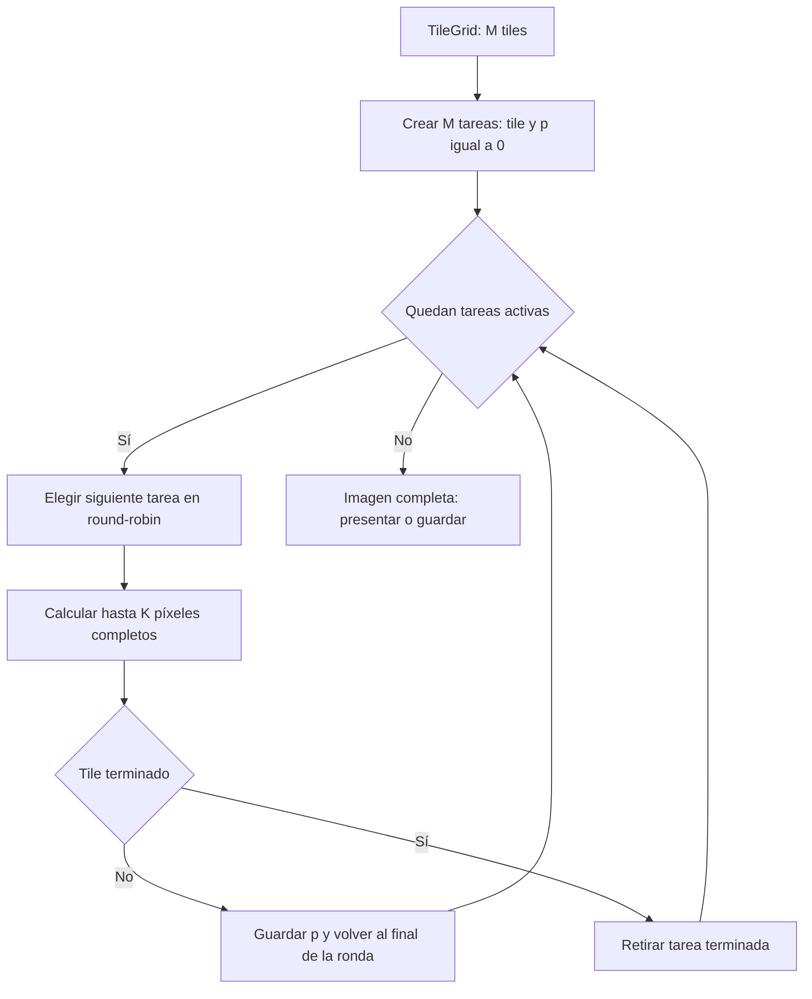
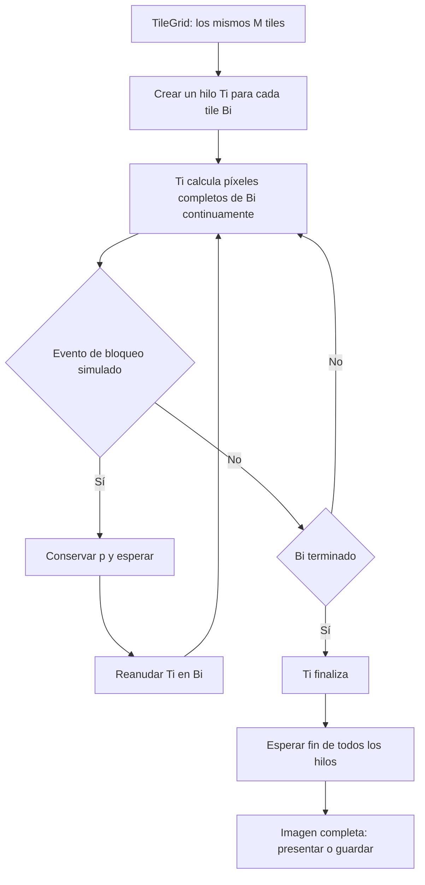
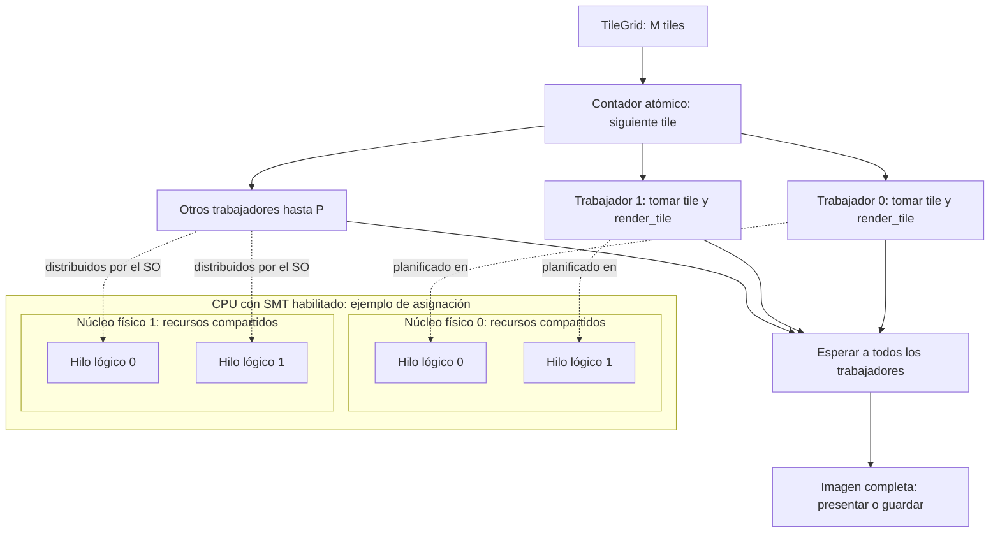
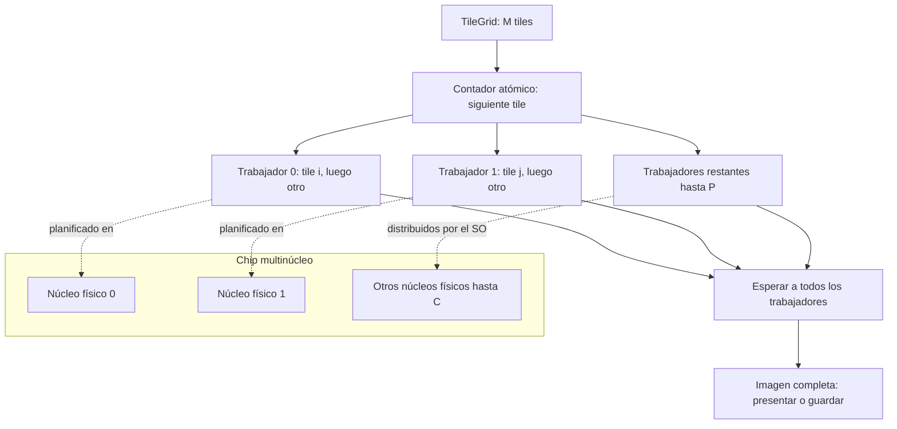

# Diseño del ray tracing por tiles

La base actual renderiza en un solo hilo de CPU. La imagen se divide en tiles,
pero `render_sequential` termina uno antes de comenzar el siguiente y SDL2
presenta el resultado al finalizar. Fine-grained, coarse-grained, SMT y CMP son
diseños para etapas posteriores: todos usarán la **misma escena, cámara, imagen y
partición en tiles**. Lo que cambiará será la política de ejecución.

## Unidad común de trabajo

Para una imagen de ancho `W` y alto `H`, y tiles de `Tw × Th` píxeles:

`M = ceil(W / Tw) × ceil(H / Th)`

`TileGrid` produce los `M` rectángulos con límites superiores exclusivos
`[x0, x1) × [y0, y1)`. Recorta los de la última fila y columna si la resolución
no es divisible por el tamaño del tile. Con 640 × 480 y tiles de 32 × 32 hay
20 × 15 = **300 tiles**. Cada píxel pertenece exactamente a uno.

La **tarea** que se reparte es un tile; el trabajo dentro de ella es calcular
sus píxeles. `render_pixel` completa todas las muestras y rebotes de un píxel;
`render_tile` recorre los píxeles del rectángulo. Una tarea puede guardar el
índice del siguiente píxel para continuar después. La escena y la cámara se
comparten solo para lectura. Cada tile escribe una región exclusiva del buffer,
por lo que no hace falta bloquear cada píxel si la imagen no se redimensiona ni
se presenta mientras los trabajadores escriben. La semilla depende de las
coordenadas del píxel: cambiar el orden de tiles no cambia sus muestras.

La parte que se sustituirá está en el recorrido de `sequential.cpp`. El cálculo
de `render_pixel` y la geometría son comunes a los modelos. En la base actual,
`render_tile` termina el rectángulo completo; durante el cálculo la ventana
permanece negra y receptiva. En los modelos con hilos, la presentación y los
eventos SDL permanecerán en el hilo principal. Los trabajadores avisarán cuando
termine un tile; al cerrar la ventana, una señal de cancelación se comprobará
entre píxeles, se esperará la salida de los trabajadores y no se guardará una
imagen parcial.

## Fine-grained: turnos cortos entre tareas de tiles

Se crea **una tarea lógica por tile**, con su rectángulo y un índice `p` del
siguiente píxel pendiente. Un planificador cooperativo toma las tareas activas
en orden circular. En cada turno calcula como máximo **K píxeles completos**
del tile elegido; si aún quedan píxeles, guarda `p` y pasa obligatoriamente al
siguiente tile, aunque no haya ocurrido ningún bloqueo. Al terminar un tile,
lo retira de la ronda. K es una cantidad de píxeles, no una duración en tiempo.

Para reanudar, el ancho real del tile es `x1 - x0`. A partir de `p` se obtiene
`x = x0 + p % ancho` y `y = y0 + p / ancho`. Así también funcionan los tiles
recortados de los bordes. El turno acaba **entre** píxeles: no se interrumpe una
muestra ni un rebote, y no hay que guardar el estado interno de un rayo.
Actualmente `render_tile` siempre llega al final; hará falta una variante que
acepte `p` y el límite K. Por ejemplo, con `K = 64`, la ronda procesa los
píxeles 0–63 del tile 0, luego 0–63 del tile 1, y vuelve al tile 0 para sus
píxeles 64–127.

Este intercalado puede implementarse con **un solo hilo del sistema**. En ese
caso simula los cambios frecuentes de tarea, pero no calcula dos tiles a la
vez ni ofrece speedup por varios núcleos. Si se añadieran trabajadores, habría
que documentar esa decisión como otra configuración del modelo.

## Coarse-grained: hilos que avanzan hasta un bloqueo

La propuesta LaTeX asigna **un hilo del sistema por tile**. Cada hilo avanza
continuamente por los píxeles de su tile. Solo el evento de bloqueo costoso
simulado provoca una cesión **a nivel de la lógica del modelo**: el hilo conserva
el siguiente índice `p`, espera y luego continúa su mismo tile. No hay un turno
obligatorio cada K píxeles ni una cola round-robin de tareas.

Un temporizador puede marcar cuándo toca el evento y una espera suspender
al hilo. La marca se comprobará después de terminar el píxel actual para
conservar el resultado. El temporizador **dispara un bloqueo**, no representa
un quantum
fine-grained. Los hilos reales también pueden ser desplanificados por el sistema
operativo en cualquier momento; el programa no puede garantizar cambios de
contexto exclusivamente durante los bloqueos simulados.

Con la configuración inicial serían **300 hilos para 300 tiles**. Eso sigue
literalmente la propuesta, aunque crear tantos hilos puede costar más que el
trabajo de tiles pequeños y aumentar la contención. Una alternativa futura sería
usar `P` trabajadores que tomen varios tiles; conservaría la partición espacial,
pero sería un cambio explícito respecto al modelo de un hilo por tile del LaTeX.
Todavía no se ha elegido ni implementado esa alternativa.

| Aspecto | Fine-grained | Coarse-grained |
| --- | --- | --- |
| Unidad asignada | Tarea lógica por tile | Hilo del sistema por tile en la propuesta |
| Avance | Hasta K píxeles completos por turno | Píxeles continuos hasta bloqueo o fin del tile |
| Motivo de cesión modelado | Fin obligatorio del turno | Evento de bloqueo simulado |
| Estado para continuar | Tile e índice `p` | Mismo tile e índice `p` |
| Paralelismo real inicial | Ninguno con un solo planificador | Posible en varios núcleos, sujeto al SO |

## SMT: trabajadores sobre hilos lógicos compartidos

La propuesta SMT reutiliza los `M` tiles de `TileGrid` y el cálculo completo de
`render_tile`. Se crearán `P` trabajadores del sistema y un contador de siguiente
tile, compartido y atómico. Cada trabajador tomará un índice distinto, procesará
ese tile hasta terminarlo y repetirá hasta agotar los `M` índices. Así se pueden
repartir tiles de costo desigual sin crear un hilo por tile. La escena y la
cámara serán de solo lectura; cada trabajador escribirá únicamente los píxeles
de su tile. El contador de tiles completados y las notificaciones se
sincronizarán; ningún trabajador llamará a SDL.

Con SMT habilitado, un núcleo físico puede exponer varios hilos lógicos que
comparten sus recursos de ejecución. Si la máquina tiene `C` núcleos físicos y
`L` hilos lógicos por núcleo, se probará `P` hasta `min(M, C × L)`; `L` se
obtendrá del equipo de pruebas y no se supondrá que siempre vale dos. El
diagrama muestra una **asignación conceptual**: el sistema operativo puede
mover trabajadores entre hilos lógicos, a menos que se configure afinidad.

Esto **aproxima SMT desde software** al mantener suficientes tiles listos y
trabajadores para ocupar los hilos lógicos; el programa no controla la emisión
simultánea de instrucciones dentro del núcleo. Para aislar el efecto del SMT de
hardware, el enunciado exige medir en el mismo equipo físico con SMT habilitado
y deshabilitado desde BIOS/UEFI. Se repetirán configuraciones comparables de
`P`, incluidas `P = C` y una sobresuscrita respecto a los núcleos físicos
(`P > C`), manteniendo fija la carga y registrando los hilos lógicos disponibles
en cada estado. Con SMT deshabilitado, los trabajadores adicionales compiten por
los `C` núcleos mediante planificación del sistema operativo.

## CMP: tiles distribuidos entre núcleos físicos

La propuesta CMP usará el mismo contador atómico y un grupo de `P` trabajadores,
con `P ≤ min(M, C)`. Cada trabajador reclamará un tile completo, ejecutará
`render_tile` y tomará otro hasta vaciar el trabajo. El sistema operativo podrá
ejecutar trabajadores en distintos núcleos físicos al mismo tiempo; una afinidad
explícita solo sería necesaria si la medición exige fijar esa correspondencia.
Con los valores iniciales (`M = 300`), los `P` trabajadores se repartirían los
300 tiles, sin crear 300 hilos.

El reparto reemplazará el `for` de `render_sequential` con una política nueva;
`render_pixel`, la semilla por coordenadas y los límites de cada tile seguirán
iguales. La finalización de todos los trabajadores precederá a la presentación
o escritura del buffer. El hilo principal atenderá SDL y comunicará la
cancelación entre píxeles sin invocar callbacks de SDL desde trabajadores.

| Aspecto | SMT propuesto | CMP propuesto |
| --- | --- | --- |
| Trabajadores | `P` puede superar `C` para ocupar hilos lógicos | `P ≤ C` para distribuir trabajo entre núcleos físicos |
| Recurso compartido | Hilos lógicos de un mismo núcleo comparten recursos de ejecución | Núcleos físicos ejecutan tiles en paralelo; pueden compartir caché y memoria |
| Reparto de tiles | Siguiente índice atómico; un tile completo por toma | Siguiente índice atómico; un tile completo por toma |
| Comprobación clave | Comparar SMT habilitado y deshabilitado en BIOS/UEFI | Escalar `P` hasta `C` núcleos físicos |

## Variables que afectan el paralelismo

Conviene distinguir **más trabajo disponible** de **más ejecución simultánea**.
Aumentar muestras o rebotes encarece cada píxel, pero no crea tiles nuevos.
Reducir el tamaño del tile crea más tareas independientes, pero tampoco crea
núcleos de CPU. Las variables principales son:

| Variable | Efecto al repartir tiles | Compromiso o condición de comparación |
| --- | --- | --- |
| Resolución `W × H` | Más píxeles y, con `Tw` y `Th` fijos, más tiles `M` | Aumenta trabajo total y memoria; la imagen debe ser idéntica entre modelos |
| Tamaño `Tw × Th` | Determina `M` y cuántos píxeles tiene cada tarea | Tiles pequeños facilitan repartir carga desigual, pero elevan costo de planificación; tiles grandes reducen tareas y pueden dejar núcleos ociosos |
| Trabajadores `P` y núcleos físicos `C` | Determinan cuántos tiles se asignan y cuántos núcleos físicos pueden trabajar en paralelo | `P > C` no añade núcleos físicos; en fine-grained con un planificador `P = 1` |
| Hilos lógicos por núcleo `L` y estado de SMT | Con SMT habilitado, `C × L` contextos lógicos pueden ejecutar trabajadores | Compartir un núcleo no equivale a añadir núcleos físicos; registrar el estado de BIOS/UEFI y comparar con igual carga |
| Quantum `K` | Determina cada cuánto alterna fine-grained entre tiles | K pequeño aumenta intercalado y sobrecarga; K grande se aproxima a terminar un tile por turno. No aumenta por sí solo el paralelismo físico |
| Frecuencia y duración del bloqueo | Determinan cuánto tiempo puede avanzar cada hilo coarse-grained | Más bloqueos pueden dejar hilos inactivos y añadir tiempo de espera; no cambian los píxeles de la imagen |
| Muestras `S` y rebotes máximos `R` | Aumentan trabajo por píxel y pueden hacer rentable distribuir tiles | No crean tareas nuevas; mantenerlos fijos al comparar tiempos y calidad |
| Esferas `N` y su distribución | Más objetos elevan pruebas de intersección; unas zonas pueden costar más que otras | La carga por tile puede ser desigual; conservar escena y semilla para comparar políticas |

Una cota aproximada del trabajo de intersecciones, por la búsqueda lineal actual,
es `O(W × H × S × (R + 1) × N)`. Es una **cota**, no el tiempo exacto: algunos
rayos escapan antes y otros rebotan varias veces. Con los datos iniciales hay
hasta 75 esferas decorativas, tres principales y una esfera grande que hace de
suelo. El buffer RGB ocupa `3 × W × H` bytes, sin contar estructuras auxiliares.

Para aprovechar varios núcleos se necesitan suficientes tiles listos y
trabajadores que puedan ejecutarlos: en CMP, los tiles en ejecución sobre
núcleos físicos distintos no superan `min(M, P, C)`. Con SMT habilitado puede
haber hasta `min(M, P, C × L)` trabajadores ejecutándose en hilos lógicos, pero
comparten recursos dentro de cada núcleo y eso no equivale al rendimiento de
`C × L` núcleos físicos. En la práctica influyen la carga desigual, el
costo de crear o planificar tareas, la memoria y los bloqueos. Por eso `M`, `P`
y `K` no deben confundirse: **M es la partición**, **P es el número de
trabajadores** y **K es la duración lógica del turno fine-grained**.

Al comparar políticas se fijarán escena, cámara, resolución, tiles, muestras,
rebotes, semilla y compilación. El tiempo de renderizado paralelo será tiempo
de pared desde el comienzo del trabajo hasta que terminen todos los tiles; no
se sumarán tiempos de hilos. La ventana y la escritura PPM quedarán fuera de
ese intervalo, como en la medición sin ventana de la base actual.

