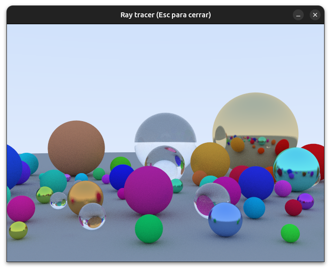
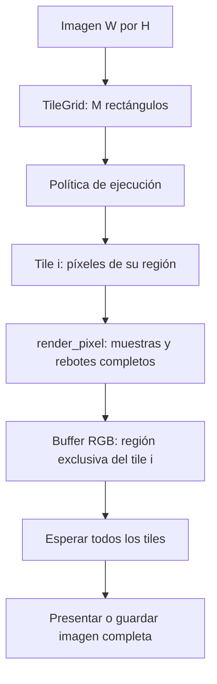
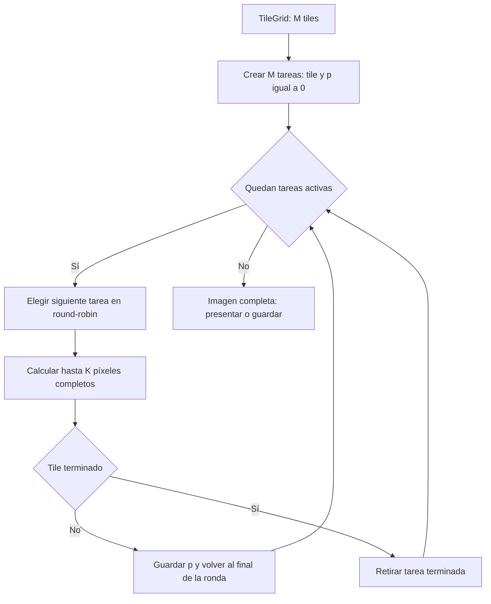
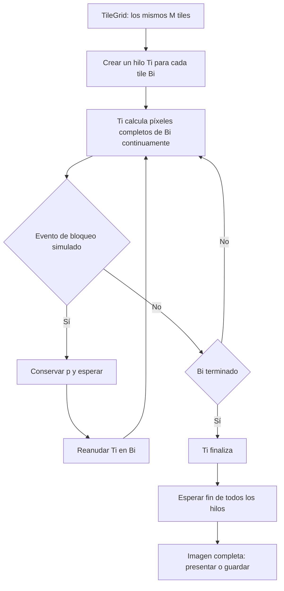
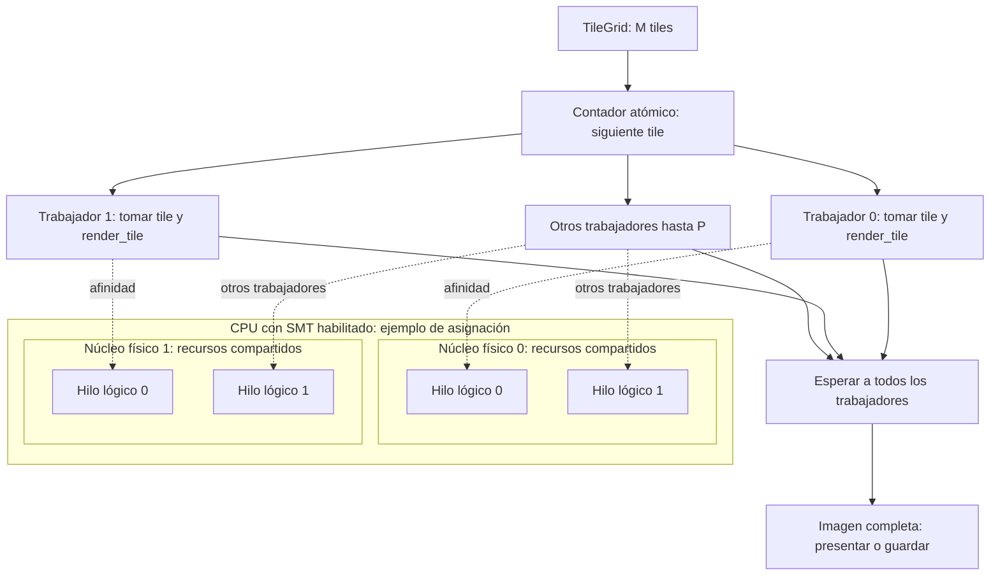
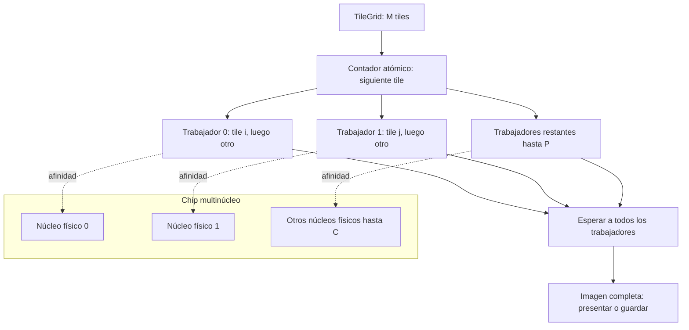

# Diseño del ray tracing por tiles

La referencia secuencial termina un tile antes de comenzar el siguiente.
Fine-grained, coarse-grained, SMT y CMP ya están implementados.
Todos comparten la **misma escena, cámara,
imagen y partición en tiles**. Cambia la política de ejecución y SDL2 presenta
el resultado completo al finalizar.

## Unidad común de trabajo

Para una imagen de ancho `W` y alto `H`, y tiles de `Tw × Th` píxeles:

`M = ceil(W / Tw) × ceil(H / Th)`

`TileGrid` produce los `M` rectángulos con límites superiores exclusivos
`[x0, x1) × [y0, y1)`. Recorta los de la última fila y columna si la resolución
no es divisible por el tamaño del tile. Con 640 × 480 y tiles de 32 × 32 hay
20 × 15 = **300 tiles**. Cada píxel pertenece exactamente a uno.

La **tarea** que se reparte es un tile; el trabajo dentro de ella es calcular
sus píxeles. `render_pixel` completa todas las muestras y rebotes de un píxel;
`render_tile` recorre los píxeles del rectángulo. Una tarea puede guardar el
índice del siguiente píxel para continuar después. La escena y la cámara se
comparten solo para lectura. Cada tile escribe una región exclusiva del buffer,
por lo que no hace falta bloquear cada píxel si la imagen no se redimensiona ni
se presenta mientras los trabajadores escriben. La semilla depende de las
coordenadas del píxel: cambiar el orden de tiles no cambia sus muestras.

Los modelos de `fine.cpp`, `coarse.cpp` y `parallel.cpp` sustituyen el reparto de `sequential.cpp`. El cálculo
de `render_pixel` y la geometría son comunes a los modelos. En la base actual,
`render_tile` termina el rectángulo completo; durante el cálculo la ventana
permanece negra y receptiva. En los modelos con hilos, la presentación y los
eventos SDL permanecen en el hilo principal. Los trabajadores avisan cuando
termina un tile; al cerrar la ventana, la cancelación se comprueba entre píxeles.
El principal espera la salida de los trabajadores y omite guardar una imagen
parcial.

## Fine-grained: turnos cortos entre tareas de tiles

Se crea **una tarea lógica por tile**, con su rectángulo y un índice `p` del
siguiente píxel pendiente. Un planificador cooperativo toma las tareas activas
en orden circular. En cada turno calcula como máximo **K píxeles completos**
del tile elegido; si aún quedan píxeles, guarda `p` y pasa obligatoriamente al
siguiente tile, aunque no haya ocurrido ningún bloqueo. Al terminar un tile,
lo retira de la ronda. K es una cantidad de píxeles, no una duración en tiempo.

Para reanudar, el ancho real del tile es `x1 - x0`. A partir de `p` se obtiene
`x = x0 + p % ancho` y `y = y0 + p / ancho`. Así también funcionan los tiles
recortados de los bordes. El turno acaba **entre** píxeles: no se interrumpe una
muestra ni un rebote, y no hay que guardar el estado interno de un rayo.
`render_tile_step` ya acepta el estado `TileProgress` y el límite K.
`fine.cpp` mantiene una cola circular de tareas pendientes. Por ejemplo, con dos tiles activos y `K = 64`, la ronda procesa los
píxeles 0–63 del tile 0, luego 0–63 del tile 1, y vuelve al tile 0 para sus
píxeles 64–127. Con 300 tiles activos visita los 300 antes de repetir el primero.

Este intercalado está implementado con **un solo hilo del sistema**. Simula
los cambios frecuentes de tarea, pero no calcula dos tiles a la vez ni ofrece
speedup por varios núcleos.

## Coarse-grained: hilos que avanzan hasta un bloqueo

Coarse asigna por defecto **un hilo del sistema por tile**. Cada hilo avanza
continuamente por los píxeles de su tile. Solo el evento de bloqueo costoso
simulado provoca una cesión **a nivel de la lógica del modelo**: el hilo conserva
el siguiente índice `p`, espera y luego continúa su mismo tile. No hay un turno
obligatorio cada K píxeles ni una cola round-robin de tareas.

Un temporizador puede marcar cuándo toca el evento y una espera suspender
al hilo. La marca se comprobará después de terminar el píxel actual para
conservar el resultado. El temporizador **dispara un bloqueo**, no representa
un quantum fine-grained. Los hilos reales también pueden ser desplanificados por el sistema
operativo en cualquier momento; el programa no puede garantizar cambios de
contexto exclusivamente durante los bloqueos simulados.

La implementación crea **300 hilos para 300 tiles** con la configuración inicial. Eso sigue
la asignación de un hilo por tile, aunque crear tantos hilos puede costar más que el
trabajo de tiles pequeños y aumentar la contención. `--threads P` activa una
variante implementada con P trabajadores: un índice atómico asigna el siguiente
tile disponible a cada uno. El trabajador conserva el tile mientras está bloqueado.
Esta extensión permite medir escalabilidad manteniendo la misma imagen y partición;
utiliza un grupo de trabajadores en lugar de crear un hilo por tile.
El comportamiento predeterminado conserva la asignación Ti a Bi.

| Aspecto | Fine-grained | Coarse-grained |
| --- | --- | --- |
| Unidad asignada | Tarea lógica por tile | Hilo del sistema por tile por defecto |
| Avance | Hasta K píxeles completos por turno | Píxeles continuos hasta bloqueo o fin del tile |
| Motivo de cesión modelado | Fin obligatorio del turno | Evento de bloqueo simulado |
| Estado para continuar | Tile e índice `p` | Mismo tile e índice `p` |
| Paralelismo real inicial | Ninguno con un solo planificador | Posible en varios núcleos, sujeto al SO |

## SMT: trabajadores sobre hilos lógicos compartidos

SMT reutiliza los `M` tiles de `TileGrid` y el cálculo completo de
`render_tile`. `parallel.cpp` crea `P` trabajadores del sistema y un contador de siguiente
tile, compartido y atómico. Cada trabajador toma un índice distinto, procesa
ese tile hasta terminarlo y repite hasta agotar los `M` índices. Así se pueden
repartir tiles de costo desigual sin crear un hilo por tile. La escena y la
cámara son de solo lectura; cada trabajador escribe únicamente los píxeles
de su tile. El contador de tiles completados y las notificaciones se
sincronizan; ningún trabajador llama a SDL.

Con SMT habilitado, un núcleo físico puede exponer varios hilos lógicos que
comparten sus recursos de ejecución. `cpu.cpp` agrupa las CPUs permitidas por
`(socket, core_id)` y lee la afinidad del principal. No presupone dos hilos por
núcleo: en equipos híbridos puede haber cantidades distintas. Si H es el total
de CPUs lógicas disponibles y C los núcleos físicos, por defecto P es `min(M,H)`;
si H = C, se usa `min(M,2C)` para aproximar mediante sobresuscripción.
Cada trabajador se fija a una CPU lógica antes de reclamar tiles. El orden ocupa
primero un contexto por núcleo y después los hermanos. Para P > H se repite el
orden: varios trabajadores compiten por la misma CPU; esto no añade hardware SMT.
El diagrama muestra un ejemplo con hermanos lógicos; los identificadores reales
se registran en `afinidad_cpus`.

Esto **aproxima SMT desde software** al mantener suficientes tiles listos y
trabajadores para ocupar los hilos lógicos; el programa no controla la emisión
simultánea de instrucciones dentro del núcleo. La comparación on/off mantiene
la carga y P, incluidas configuraciones con `P = C` y `P > C`. El CSV registra
los hilos lógicos disponibles y el estado SMT informado por Linux. Con SMT deshabilitado, los trabajadores adicionales compiten por
los `C` núcleos mediante planificación del sistema operativo.

## CMP: tiles distribuidos entre núcleos físicos

CMP usa el mismo motor `parallel.cpp`, contador atómico y grupo de `P` trabajadores,
con `P ≤ min(M, C)`. Cada trabajador reclama un tile completo, ejecuta
`render_tile` y toma otro hasta vaciar el trabajo. `cmp_cpus` elige una CPU lógica
por núcleo físico y aplica afinidad explícita, evitando asignar dos trabajadores
a hermanos de un mismo núcleo. Sin `--threads`, P es `min(M,C)`.
Con los valores iniciales (`M = 300`), los `P` trabajadores se reparten los
300 tiles, sin crear 300 hilos.

El reparto sustituye el `for` de `render_sequential` con una política nueva;
`render_pixel`, la semilla por coordenadas y los límites de cada tile permanecen
iguales. La finalización de todos los trabajadores precede a la presentación
o escritura del buffer. El hilo principal atiende SDL y comunica la
cancelación entre píxeles sin invocar callbacks de SDL desde trabajadores.

| Aspecto | SMT implementado | CMP implementado |
| --- | --- | --- |
| Trabajadores | `P` puede superar `C` para ocupar hilos lógicos | `P ≤ C` para distribuir trabajo entre núcleos físicos |
| Recurso compartido | Hilos lógicos de un mismo núcleo comparten recursos de ejecución | Núcleos físicos ejecutan tiles en paralelo; pueden compartir caché y memoria |
| Reparto de tiles | Siguiente índice atómico; un tile completo por toma | Siguiente índice atómico; un tile completo por toma |
| Comprobación clave | Comparar SMT habilitado y deshabilitado en BIOS/UEFI | Escalar `P` hasta `C` núcleos físicos |

## Parámetros implementados y sincronización

`--model sequential|fine|coarse|smt|cmp` selecciona la política; sequential sigue siendo
el valor predeterminado. `--quantum` controla K (64 por defecto).
`--block-interval-ms` fija el tiempo de pared desde la última reanudación para
provocar el siguiente bloqueo (10 ms); `--block-duration-ms` fija cuánto espera
el hilo (1 ms). El intervalo 0 permite ejecutar coarse sin bloqueos. Estos
valores son configurables y todavía no están optimizados experimentalmente.

Coarse reutiliza `render_tile`; sus bucles mantienen el siguiente píxel mientras
el callback interno espera. La escena y cámara son inmutables y cada hilo
escribe su tile exclusivo. Flags atómicos publican los tiles terminados y una
señal de cancelación. Los callbacks de la aplicación permanecen en el principal;
la espera usa una variable de condición para despertar inmediatamente al cancelar.
Se hace `join` de todos los hilos antes de devolver el buffer o propagar un error.

`tiempo_total_ms` mide tiempo de pared en los cinco modelos y es la referencia para
comparar en modo sin ventana. Coarse incluye creación de hilos, coordinación,
esperas simuladas y finalización; no suma los tiempos individuales de los hilos.
La presentación y la escritura se realizan después del intervalo medido.

## Variables que afectan el paralelismo

Conviene distinguir **más trabajo disponible** de **más ejecución simultánea**.
Aumentar muestras o rebotes encarece cada píxel, pero no crea tiles nuevos.
Reducir el tamaño del tile crea más tareas independientes, pero tampoco crea
núcleos de CPU. Las variables principales son:

| Variable | Efecto al repartir tiles | Compromiso o condición de comparación |
| --- | --- | --- |
| Resolución `W × H` | Más píxeles y, con `Tw` y `Th` fijos, más tiles `M` | Aumenta trabajo total y memoria; la imagen debe ser idéntica entre modelos |
| Tamaño `Tw × Th` | Determina `M` y cuántos píxeles tiene cada tarea | Tiles pequeños facilitan repartir carga desigual, pero elevan costo de planificación; tiles grandes reducen tareas y pueden dejar núcleos ociosos |
| Trabajadores `P` y núcleos físicos `C` | Determinan cuántos tiles se asignan y cuántos núcleos físicos pueden trabajar en paralelo | `P > C` no añade núcleos físicos; en fine-grained con un planificador `P = 1` |
| CPUs lógicas disponibles `H` y estado de SMT | H suma los contextos disponibles de cada núcleo; en equipos uniformes H = C × L | Compartir un núcleo no equivale a añadir núcleos físicos; L puede variar entre núcleos |
| Quantum `K` | Determina cada cuánto alterna fine-grained entre tiles | K pequeño aumenta intercalado y sobrecarga; K grande se aproxima a terminar un tile por turno. No aumenta por sí solo el paralelismo físico |
| Frecuencia y duración del bloqueo | Determinan cuánto tiempo puede avanzar cada hilo coarse-grained | Más bloqueos pueden dejar hilos inactivos y añadir tiempo de espera; no cambian los píxeles de la imagen |
| Muestras `S` y rebotes máximos `R` | Aumentan trabajo por píxel y pueden hacer rentable distribuir tiles | No crean tareas nuevas; mantenerlos fijos al comparar tiempos y calidad |
| Esferas `N` y su distribución | Más objetos elevan pruebas de intersección; unas zonas pueden costar más que otras | La carga por tile puede ser desigual; conservar escena y semilla para comparar políticas |

Una cota aproximada del trabajo de intersecciones, por la búsqueda lineal actual,
es `O(W × H × S × (R + 1) × N)`. Es una **cota**, no el tiempo exacto: algunos
rayos escapan antes y otros rebotan varias veces. Con los datos iniciales hay
hasta 75 esferas decorativas, tres principales y una esfera grande que hace de
suelo. El buffer RGB ocupa `3 × W × H` bytes, sin contar estructuras auxiliares.

Para aprovechar varios núcleos se necesitan suficientes tiles listos y
trabajadores que puedan ejecutarlos: en CMP, los tiles en ejecución sobre
núcleos físicos distintos no superan `min(M, P, C)`. Con SMT habilitado puede
haber hasta `min(M, P, H)` trabajadores ejecutándose en hilos lógicos, pero
comparten recursos dentro de cada núcleo y eso no equivale al rendimiento de
H núcleos físicos. En la práctica influyen la carga desigual, el
costo de crear o planificar tareas, la memoria y los bloqueos. Por eso `M`, `P`
y `K` no deben confundirse: **M es la partición**, **P es el número de
trabajadores** y **K es la duración lógica del turno fine-grained**.

Al comparar políticas se fijarán escena, cámara, resolución, tiles, muestras,
rebotes, semilla y compilación. El tiempo de renderizado paralelo será tiempo
de pared desde el comienzo del trabajo hasta que terminen todos los tiles; no
se sumarán tiempos de hilos. La ventana y la escritura PPM quedarán fuera de
ese intervalo, como en la medición sin ventana de la base actual.

## Métricas y comparación con carga fija

`make run-all` mide primero una única referencia sequential (200 ejecuciones
por defecto) y guarda sus tiempos en `resultsrt/sequential.csv`. Los modelos
fine, coarse, CMP y SMT reutilizan ese archivo mediante `--baseline-csv`, sin
volver a ejecutar sequential ni en el calentamiento de cada modelo. La carga
se valida al importar y una huella FNV-1a del buffer RGB verifica la imagen;
esa comprobación queda fuera del tiempo medido y no es una prueba criptográfica.

En este modo se calcula `S = media(Tseq) / media(Tmodelo)` y `E = S / P`.
El error estándar aproximado del cociente, por método delta, es
`S × sqrt((sd_seq/media_seq)^2/n_seq + (sd_modelo/media_modelo)^2/n_modelo)`;
el IC95 es `S ± 1.96 × error_estándar`. Se supone independencia entre campañas
y estabilidad: la fórmula no corrige deriva térmica, correlación ni cambios de
frecuencia. Todas las comparaciones comparten la incertidumbre de la referencia.
El CSV distingue `referencia_tipo=compartida` y conserva la ruta relativa al CSV
original, la huella de la imagen y el estado SMT de la referencia. Los cocientes
por fila sirven para describir variabilidad; no se promedian para el speedup global.

Se reutiliza la misma referencia incluso al desactivar SMT, por decisión de
usar una única base. Con el barrido on/off se mide inicialmente con SMT activado;
los tiempos absolutos on/off permiten comparar ambos estados con la misma carga y P. Perf
mantiene una referencia instrumentada separada, capturada una sola vez, y
reutiliza sus contadores para los demás perfiles. No se mezclan tiempos con y
sin instrumentación. `BASELINE_REPETITIONS` permite fijar n de sequential;
`REPETITIONS` fija n de cada modelo y `PROFILE_REPETITIONS` el del perfilado.

El modo `--benchmark` repite una comparación
pareada contra sequential cuando se ejecuta sin `--baseline-csv`, verifica igualdad de la imagen y exporta CSV por
repetición y por configuración. Por defecto realiza 200 repeticiones; una prueba
corta puede reducirlas explícitamente. El calentamiento y la escritura no se miden.

Para cada par se calcula `S = Tseq / Tmodelo` y `E = S / P`, usando tiempo de
pared y trabajadores reales. Fine usa P = 1. Coarse con `--thread-counts 1,2,4,8`
repite la misma carga para cada P y produce los puntos de la escalabilidad;
los tamaños de tiles permanecen fijos. Variar tiles para cambiar el número de
hilos mezclaría dos variables distintas en el experimento.

El resumen incluye medias, desviación estándar muestral e IC95 normal aproximado
de la media, con margen `1.96 × desviación / sqrt(n)`. Los speedups resumidos son
medias de los cocientes pareados. Las esperas simuladas están incluidas en el
tiempo de coarse. Cambiarlas durante el barrido modifica la carga además de P.

`scripts/plot_metrics.py` utiliza las iteraciones crudas para generar boxplots e
histogramas por modelo, cantidad de trabajadores y política, sin eliminar valores
atípicos. La referencia secuencial permanece explícita: coarse con P = 1 también
tiene planificación y no sustituye a sequential como base. Las curvas de
escalabilidad muestran medias y barras del IC95 aproximado; las cargas distintas
se analizan por separado. `make benchmark` encadena medición y análisis,
siempre en ese orden. Las gráficas y su escritura quedan fuera del tiempo medido.

El reporte incluye n, desviación e IC95. El margen relativo del intervalo
expresa la precisión estimada de la media. El IC no corrige sesgos térmicos,
correlación entre ejecuciones ni interferencia de otros procesos.

Para SMT y CMP, detectar topología queda fuera de la medición. Construir la lista
de asignaciones, crear trabajadores, aplicar afinidad, calcular tiles y hacer join
sí forma parte del tiempo del modelo. Se exportan los núcleos físicos disponibles,
las CPUs lógicas disponibles, el estado SMT informado por Linux y la afinidad
por trabajador. Las gráficas distinguen topologías y estados SMT diferentes,
en lugar de agrupar sus iteraciones en una misma distribución.
`--cpu-info` muestra esa información sin renderizar. La opción `--model smt`
selecciona la política de reparto; no cambia el estado SMT del hardware.

`make profile` ejecuta `perf stat` alrededor de cada proceso, con referencia
secuencial, calentamiento y orden alternado. Conserva los contadores crudos y sus
porcentajes de ejecución, deriva IPC únicamente entre CPU/PMU coincidentes y
genera reporte y gráficas. En alcance cpu registra cada CPU lógica, incluyendo
actividad de todo el sistema; en alcance process observa el programa y sus hilos.
Es una campaña separada del benchmark: el intervalo incluye inicialización y
finalización del proceso y la instrumentación tiene sobrecarga. No cambia el
cálculo, la planificación ni la partición en tiles.
El procedimiento y los límites están en [perfilado.md](perfilado.md).

La presentación de resultados separa comparación, escalabilidad y variabilidad.
Las gráficas de barras muestran medias e IC95 aproximado; en tiempo se conserva
una referencia secuencial por comparación, evitando promediar baselines de
configuraciones distintas. Las curvas separan tiempo, speedup y eficiencia y
solo conectan puntos de una misma política con distintas cantidades P. Los
boxplots e histogramas mantienen todas las repeticiones. Los colores representan
el mismo modelo en benchmark y perf; la presentación no cambia los datos ni
el cálculo estadístico. `make profile-plots` permite actualizar capturas existentes.
