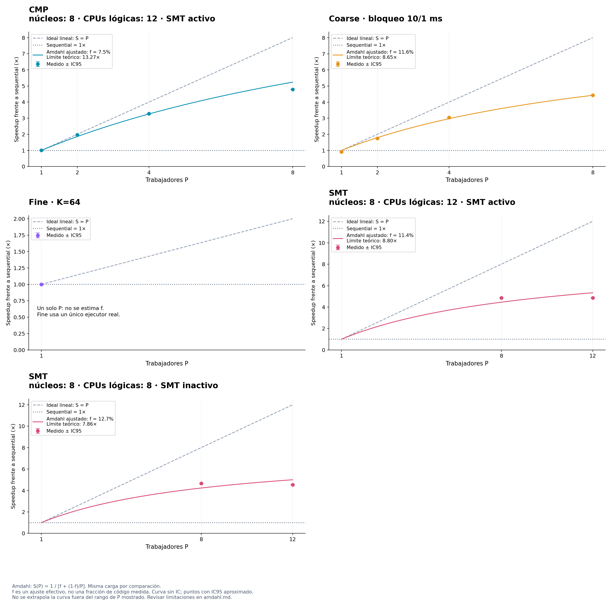

# Ley de Amdahl

Carga: ancho=640, alto=480, tile_ancho=32, tile_alto=32, muestras=8, rebotes=12, semilla=2026.

S(P) = 1 / [f + (1-f)/P]. P es el número de trabajadores; f es una fracción secuencial efectiva.
El ajuste minimiza la suma de errores cuadrados de 1/S(P) = f + (1-f)/P, con igual peso por configuración y f restringida a [0,1]. No impone que el modelo con P=1 tenga speedup 1.
No mide directamente código secuencial: puede absorber creación de hilos, esperas, contención, carga desigual y efectos de hardware. SMT comparte recursos y coarse añade bloqueos; Amdahl es una referencia idealizada, no una validación de esos modelos ni una predicción garantizada.
Las barras negras son IC95 del speedup medido; la curva ajustada no incluye un intervalo de confianza. El límite 1/f es teórico y no implica que el equipo disponga de suficientes núcleos.

| Política | P medidos | f efectiva | Límite teórico 1/f | RMSE en tiempo relativo | Nota |
| --- | --- | ---: | ---: | ---: | --- |
| CMP · núcleos: 8 · CPUs lógicas: 12 · SMT activo | [1, 2, 4, 8] | 7.5374% | 13.27× | 0.01861 | Ajuste descriptivo |
| Coarse · bloqueo 10/1 ms | [1, 2, 4, 8] | 11.5570% | 8.65× | 0.05367 | Ajuste descriptivo |
| Fine · K=64 | [1] | — | — | — | Un único P; ajuste no estimado |
| SMT · núcleos: 8 · CPUs lógicas: 12 · SMT activo | [8, 12] | 11.3624% | 8.80× | 0.01849 | Ajuste descriptivo |
| SMT · núcleos: 8 · CPUs lógicas: 8 · SMT inactivo | [8, 12] | 12.7179% | 7.86× | 0.02100 | Ajuste descriptivo |

