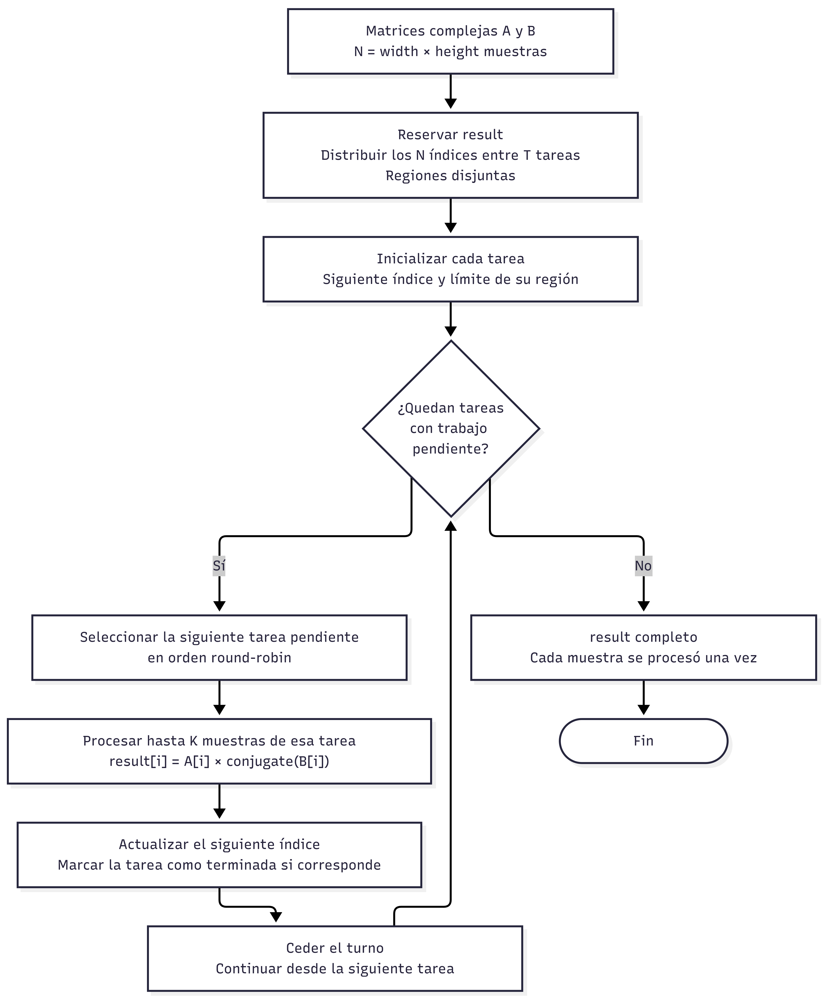
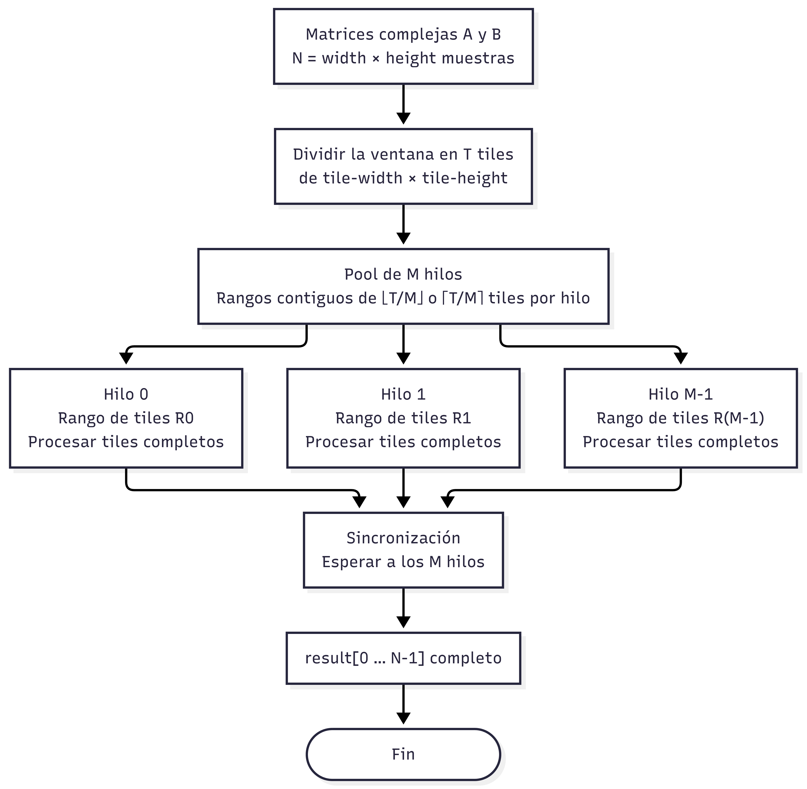
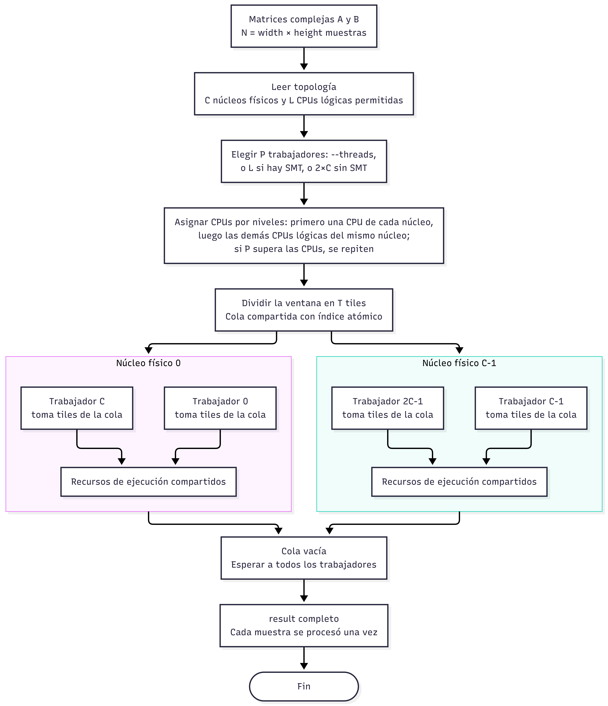
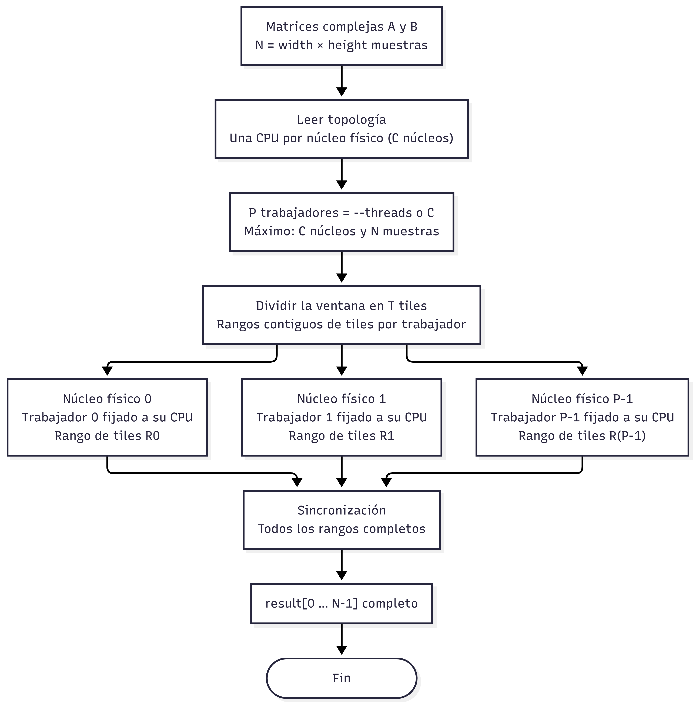

# Cálculo de interferogramas con Sentinel-1 SLC

## Qué hace el proyecto

El programa calcula el producto de una adquisición SLC por el conjugado de otra, píxel a píxel. Lee las componentes complejas con GDAL, selecciona la misma ventana en ambas imágenes y permite ejecutar el cálculo con cinco modos: `sequential`, `fine-grained`, `coarse-grained`, `smt` y `cmp`.

Todos utilizan la misma operación matemática. Lo que cambia es cómo recorren los datos, reparten el trabajo y asignan los trabajadores al procesador. La implementación incluye validación de entradas, exportación opcional a TIFF complejo, pruebas automatizadas y scripts para repetir las mediciones y generar gráficas.

## Modelo computacional

Cada muestra de los productos SLC se representa mediante un número complejo:

$$
z = a + bi
$$

En la implementación, cada muestra almacena explícitamente sus componentes real e imaginaria:

```cpp
struct Complex {
    double real;
    double imag;
};
```

Para dos muestras correspondientes a una misma posición $i$:

$$
A_i = a_i + b_i i
$$

$$
B_i = c_i + d_i i
$$

el kernel calcula la multiplicación conjugada:

$$
I_i = A_i \overline{B_i}
$$

Como:

$$
\overline{B_i} = c_i - d_i i
$$

entonces:

$$
I_i =
(a_i c_i + b_i d_i)
+
(b_i c_i - a_i d_i)i
$$

La implementación secuencial realiza directamente estas operaciones:

```cpp
result[i].real =
    a[i].real * b[i].real +
    a[i].imag * b[i].imag;

result[i].imag =
    a[i].imag * b[i].real -
    a[i].real * b[i].imag;
```

Por ejemplo:

$$
(2+3i)\overline{(4+5i)} = 23+2i
$$

Cada resultado depende únicamente de `A[i]` y `B[i]`. Por esta razón, las iteraciones del kernel son independientes y constituyen la región que se distribuye entre tareas y trabajadores en los distintos modelos.

Las ventanas se almacenan en vectores lineales utilizando orden por filas:

```text
index = row × width + column
```

## Objetivo del cálculo

Las dos adquisiciones Sentinel-1 SLC contienen información compleja de la señal radar obtenida sobre una misma zona en fechas diferentes. El objetivo del cálculo es comparar las muestras de ambas adquisiciones mediante la multiplicación conjugada.

Para cada posición $i$ se obtiene:

$$
I_i = A_i\overline{B_i}
$$

Al repetir esta operación para todas las muestras de la ventana seleccionada se genera una nueva matriz compleja del mismo tamaño. Cada posición de esta matriz contiene el resultado de combinar la muestra de la primera adquisición con la correspondiente de la segunda.

La importancia de esta operación es que el producto conserva información relacionada con la diferencia de fase entre ambas señales. En un procesamiento interferométrico completo, estas diferencias de fase funcionan para analizar cambios observados entre adquisiciones.

La implementación actual realiza esta operación sobre las mismas posiciones de ambas matrices.

## Datos utilizados

Los pasos para descargar, corregistrar y preparar los datos están en la [guía de adquisición de datos](data_acquisition.md).

La pareja seleccionada corresponde al punto P09-R2 y utiliza dos adquisiciones Sentinel-1:

| Campo                   | Adquisición A | Adquisición B |
| ----------------------- | ------------- | ------------- |
| Fecha                   | 2024-06-08    | 2024-06-20    |
| Plataforma              | S1A           | S1A           |
| Producto / modo         | SLC / IW      | SLC / IW      |
| Subswath / polarización | IW2 / VV      | IW2 / VV      |
| Dirección orbital       | ASCENDING     | DESCENDING    |
| Órbita absoluta         | 54239         | 54406         |
| Órbita relativa         | 92            | 84            |
| Burst                   | 195513        | 179298        |
| Dimensiones originales  | 24451 × 1499  | 24444 × 1500  |
| Tipo / bandas           | CInt16 / 1    | CInt16 / 1    |
| Datatake                | 432350        | 433836        |

A es la referencia y B la secundaria del corregistro. El programa lee los TIFF corregistrados `data/coregistered/P09-R2-2023-2024/A.tif` y `B.tif`, con I/Q complejos en la geometría de A. Las mediciones usan la ventana 24444 × 1499 desde el origen; sus bordes contienen NoData, por lo que se ejecutan con `--allow-nodata`.


La implementación actual debe considerarse un kernel computacional sobre datos Sentinel-1 SLC reales. Todavía no constituye un interferograma SAR científicamente validado ni se utiliza para estimar deformaciones del terreno.

## Requisitos

* compilador compatible con C++, como GCC o Clang;
* GNU Make;
* GDAL con archivos de desarrollo;
* `gdal-config`;
* los dos TIFF corregistrados disponibles localmente (ver la [guía de adquisición](data_acquisition.md)).

En Ubuntu:

```bash
sudo apt install build-essential libgdal-dev
```

Para comprobar GDAL:

```bash
gdal-config --version
```

El `Makefile` obtiene automáticamente las opciones necesarias mediante:

```bash
gdal-config --cflags
gdal-config --libs
```

## Compilación y ejecución

Desde la raíz del repositorio, entra primero al proyecto:

```bash
cd sentinel1-SLC
make
./build/interferogram --help
```

La configuración predeterminada procesa una ventana de:

```text
24444 × 1499
```

utilizando los TIFF corregistrados configurados en `config.hpp`. Las imágenes corregistradas tienen bordes NoData, así que para procesar la ventana completa se agrega `--allow-nodata`:

```bash
./build/interferogram --allow-nodata
make run ARGS=--allow-nodata
```

Para ejecutar las pruebas:

```bash
make test
```

### Ejemplos

Ventana de 256 × 256:

```bash
./build/interferogram --width 256 --height 256 --allow-nodata
```

Ventana de 512 × 512:

```bash
./build/interferogram --width 512 --height 512 --allow-nodata
```

Ventana de 1024 × 1024:

```bash
./build/interferogram --width 1024 --height 1024 --allow-nodata
```

Ventana desplazada dentro del burst:

```bash
./build/interferogram \
    --x 12000 \
    --y 750 \
    --width 16 \
    --height 16
```


## Parámetros

| Opción       | Descripción                      | Valor predeterminado |
| ------------ | -------------------------------- | -------------------- |
| `--a PATH`   | Ruta al TIFF de la adquisición A | `data/coregistered/P09-R2-2023-2024/A.tif` |
| `--b PATH`   | Ruta al TIFF de la adquisición B | `data/coregistered/P09-R2-2023-2024/B.tif` |
| `--width N`  | Ancho de la ventana              | `24444`              |
| `--height N` | Alto de la ventana               | `1499`               |
| `--x N`      | Columna inicial, base cero       | `0`                  |
| `--y N`      | Fila inicial, base cero          | `0`                  |
| `--mode MODE` | Modelo de ejecución | `sequential` |
| `--tile-width N` | Ancho de los tiles | `32` |
| `--tile-height N` | Alto de los tiles | `32` |
| `--quantum N` | Píxeles por turno en fine-grained | `1` |
| `--threads N` | Trabajadores de coarse, SMT o CMP | Según modelo |
| `--allow-nodata` | Admite NoData; excluye resultados no finitos del resumen | Desactivado |
| `--output PATH` | Exporta el resultado como TIFF complejo | Sin exportación |
| `--help`     | Muestra la ayuda                 | —                    |

Las dos adquisiciones utilizan exactamente la misma ventana.


## Cómo leer los tiempos y el resultado

La salida identifica ventana, modo y parámetros de ejecución. También distingue tres tiempos:

- `Kernel time`: cálculo y sincronización durante la ejecución, con los trabajadores ya preparados.
- `Model time`: preparación del modelo, creación de trabajadores, cálculo, sincronización y cierre. Excluye lectura de TIFF, resumen y exportación.
- `Export time`: escritura del TIFF cuando se solicita `--output`.

El benchmark utiliza el tiempo del modelo como métrica principal para incluir el costo de preparar y cerrar los trabajadores. El tiempo del proceso completo, por ejemplo al instrumentar con perf, también incluye lectura e inicialización.

`Result sum` resume las componentes real e imaginaria de la salida. Sirve para contrastar ejecuciones; no mide la calidad física del interferograma. 

## Opciones de Make

| Comando               | Acción                                        |
| --------------------- | --------------------------------------------- |
| `make`                | Compila `build/interferogram`                 |
| `make run`            | Compila si es necesario y ejecuta el programa |
| `make test`           | Compila y ejecuta todas las pruebas           |
| `make check-gdal`     | Comprueba que `gdal-config` esté disponible   |
| `make clean`          | Elimina los archivos generados en `build/`    |


## Estructura del proyecto

```text
sentinel1-SLC/
├── Makefile
├── build/                         # Ejecutable y pruebas compiladas
├── data/                          # Adquisiciones, metadatos y pares preparados
├── scripts/                       # Benchmark, gráficas y visualización
├── resultsen/                     # CSV, capturas y reportes experimentales
└── interferogram/
    ├── docs/                      # Esta documentación y adquisición de datos
    ├── images/                    # Diagramas de los modelos
    ├── include/interferogram/     # Interfaces y configuración
    ├── src/
    │   ├── main.cpp
    │   ├── config.cpp
    │   ├── cpu_info.cpp
    │   ├── slc_reader.cpp
    │   ├── interferogram.cpp
    │   └── models/                # Secuencial, fine, coarse, SMT y CMP
    └── tests/                     # Kernel, lectura, CLI y benchmark
```

Responsabilidades principales:

* [`main.cpp`](../src/main.cpp): coordina lectura, ejecución, medición y presentación de resultados.
* [`config.cpp`](../src/config.cpp): procesa y valida los argumentos de línea de comandos.
* [`slc_reader.cpp`](../src/slc_reader.cpp): abre los TIFF con GDAL, valida sus propiedades y carga la ventana solicitada.
* [`interferogram.cpp`](../src/interferogram.cpp): contiene la validación de vectores y el kernel secuencial de multiplicación conjugada.
* [`complex.hpp`](../include/interferogram/complex.hpp): define la representación de las muestras complejas.

### Lector SLC

El lector se encarga de abrir y procesar los archivos TIFF de los productos Sentinel-1 SLC utilizando GDAL (Geospatial Data Abstraction Library), una biblioteca de software que permite leer y trabajar con diferentes formatos de datos geoespaciales y ráster, entre ellos TIFF.

Para verificar el funcionamiento del lector, se crea temporalmente un TIFF complejo sintético utilizando GDAL. Esta prueba permite comprobar:

* que las componentes real e imaginaria de las muestras del TIFF se leen correctamente;
* que es posible leer diferentes regiones del TIFF mediante offsets;
* que las ventanas solicitadas se encuentren dentro de los límites del archivo;
* que se rechacen TIFF cuyas bandas no sean de tipo complejo;
* que se detecten TIFF con dimensiones o cantidades de bandas incompatibles.


## Variables que aumentan el paralelismo disponible

El tamaño del problema depende principalmente de las dimensiones de la ventana seleccionada. La cantidad total de muestras procesadas se calcula como:

$$\
N = width \times height\
$$

El kernel secuencial procesa cada una de estas muestras mediante el siguiente ciclo:

```cpp
for (std::size_t i = 0; i < a.size(); ++i) {
    result[i].real =
        a[i].real * b[i].real +
        a[i].imag * b[i].imag;

    result[i].imag =
        a[i].imag * b[i].real -
        a[i].real * b[i].imag;
}
```

En cada iteración se utilizan únicamente las muestras `A[i]` y `B[i]` y el resultado se almacena en `result[i]`. Como el cálculo de una posición no necesita información obtenida por las demás iteraciones, las $N$ operaciones pueden considerarse independientes entre sí.

Por esta razón, `width` y `height` son las variables principales que permiten aumentar el paralelismo disponible. Al incrementar cualquiera de ellas, aumenta $N$ y, con ello, la cantidad de operaciones que pueden distribuirse entre diferentes hilos o unidades de ejecución.

Cada muestra requiere una cantidad constante de trabajo, por lo que el costo total del kernel crece como $O(N)$. De la misma forma, el espacio requerido por los vectores de entrada y salida aumenta linealmente con la cantidad de muestras.

Los parámetros `x` y `y`, en cambio, únicamente determinan la posición inicial de la ventana dentro del SLC. Modificarlos cambia la región que se procesa, pero no la cantidad de trabajo ni el paralelismo disponible mientras `width` y `height` permanezcan iguales.

El ciclo de `computeInterferogramSequential()` sirve como referencia para comparar los modelos. Sus iteraciones independientes permiten repartir el cálculo sin que dos trabajadores necesiten escribir la misma posición de salida.

## Modelos de ejecución

Los diagramas ilustran su organización general; los detalles de reparto y afinidad se describen a continuación. En todos los casos, el trabajo consiste en distribuir las $N$ muestras de las matrices complejas $A$ y $B$ para calcular de forma independiente $A[i] \times \operatorname{conjugate}(B[i])$.

### Fine-Grained Multithreading

En este modelo, el procesamiento se divide en tareas que avanzan en pequeños intervalos de trabajo. Las tareas se atienden mediante una planificación *round-robin*, de manera que cada una procesa hasta $K$ muestras durante su turno y conserva su progreso para continuar en la siguiente ronda. Este esquema produce cambios frecuentes entre las tareas hasta completar las $N$ muestras.

Cada tarea corresponde a un tile y guarda la posición en la que se quedó. Todo ocurre en un único hilo del sistema operativo: alternar tareas no significa usar varios núcleos. `--quantum` controla cuántos píxeles procesa una tarea antes de ceder el turno. Un quantum pequeño aumenta las intervenciones del planificador cooperativo.


<p align="center">
  
</p>


### Coarse-Grained Multithreading

La ventana se divide en tiles y estos se reparten de forma estática entre los trabajadores. Cada hilo procesa completamente los tiles que tiene asignados. Los trabajadores escriben regiones disjuntas y el coordinador espera a que todos terminen.

`--threads` define la cantidad de trabajadores; si se omite, se utilizan dos. El programa mantiene un pool durante la ejecución del modelo y no fija afinidad para este modo. En Sentinel, coarse-grained no introduce las pausas utilizadas en otros problemas del repositorio.

<p align="center">
  
</p>

### SMT — Simultaneous Multithreading

SMT aprovecha las CPUs lógicas permitidas por la afinidad del proceso. El programa consulta la topología, selecciona primero una CPU por núcleo y luego sus procesadores lógicos asociados a un mismo, y fija la afinidad de cada trabajador. Los tiles se toman dinámicamente mediante un índice atómico: cuando un trabajador termina uno, solicita el siguiente.

Si no se indica `--threads`, utiliza todas las CPUs lógicas disponibles cuando hay más que núcleos físicos.También se puede indicar P; si supera las CPUs disponibles, hay sobreasignación.

En SMT comparten recursos del núcleo, de modo que doce trabajadores no equivalen a doce núcleos físicos. Ejecutar `--mode smt` tampoco activa SMT en el sistema: utiliza el estado que encuentre. Con SMT desactivado se puede mantener el mismo P para comparar, pero los trabajadores comparten las CPUs restantes mediante planificación del sistema operativo.



### CMP — Chip Multiprocessing

CMP distribuye estáticamente los tiles y fija cada trabajador a una CPU lógica perteneciente a un núcleo físico distinto. Así evita asignar dos trabajadores del modelo a procesadores lógicos del mismo núcleo. Comparte el criterio de reparto estático de coarse, pero añade la selección de núcleos y la afinidad.

Sin `--threads`, utiliza hasta un trabajador por núcleo disponible, limitado también por la cantidad de muestras. Si se solicita una cantidad mayor que los núcleos físicos permitidos, el programa rechaza la configuración. La afinidad de CMP y SMT requiere Linux.

<p align="center">
  
</p>

## Ejecutar y comparar los modelos

Estos ejemplos se ejecutan desde `sentinel1-SLC/`. Sustituye las rutas si vas a utilizar otro par de imágenes. La ventana se mantiene fija para comparar el mismo trabajo:

```bash
./build/interferogram --a data/coregistered/P09-R2-2023-2024/A.tif --b data/coregistered/P09-R2-2023-2024/B.tif --width 24444 --height 1499 --allow-nodata --mode sequential
./build/interferogram --a data/coregistered/P09-R2-2023-2024/A.tif --b data/coregistered/P09-R2-2023-2024/B.tif --width 24444 --height 1499 --allow-nodata --mode fine-grained --quantum 2
./build/interferogram --a data/coregistered/P09-R2-2023-2024/A.tif --b data/coregistered/P09-R2-2023-2024/B.tif --width 24444 --height 1499 --allow-nodata --mode coarse-grained --threads 4
./build/interferogram --a data/coregistered/P09-R2-2023-2024/A.tif --b data/coregistered/P09-R2-2023-2024/B.tif --width 24444 --height 1499 --allow-nodata --mode cmp --threads 4
./build/interferogram --a data/coregistered/P09-R2-2023-2024/A.tif --b data/coregistered/P09-R2-2023-2024/B.tif --width 24444 --height 1499 --allow-nodata --mode smt
```

Para otras entradas, puede requerirse ajustar también el tamaño de ventana. La ejecución directa usa las rutas y dimensiones de `config.hpp`; los objetivos de benchmark tienen sus propios valores en el Makefile: ventana 24444×1499, tiles 32×32 y quantum 2.

## Mediciones repetidas y gráficas

Para medir todos los modelos conservando el estado SMT actual:

```bash
make benchmark SMT_STATES=keep
```

Se usan 200 repeticiones y un calentamiento por configuración. Los barridos automáticos de trabajadores se ajustan a la topología detectada. Se pueden personalizar las entradas y los barridos:

```bash
make benchmark SMT_STATES=keep \
  SLC_A=/ruta/A.tif SLC_B=/ruta/B.tif \
  THREAD_COUNTS=1,2,4 CMP_THREAD_COUNTS=1,2,4 SMT_THREAD_COUNTS=4,8
```

Los valores CMP deben caber en los núcleos físicos disponibles. Para medir un solo modelo:

```bash
make run-fine-grained QUANTUM=2
make run-coarse-grained THREADS=4
make run-cmp THREADS=4
make run-smt THREADS=8 SMT_STATES=keep
```

`REPETITIONS=5` permite una comprobación corta, pero no equivale a una ronda final de 200 ejecuciones. Los CSV y capturas se guardan en `resultsen/`. El análisis calcula medias, desviaciones, intervalos de confianza aproximados del 95 %, speedup y eficiencia, y genera gráficas de comparación, boxplots, histogramas y ajustes de Amdahl desde las mediciones individuales.

```bash
make plots
make amdahl
```

El speedup compara el tiempo secuencial con el del modelo: valores mayores que uno indican aceleración. Más trabajadores no garantizan mejores tiempos; el trabajo por tile, la sincronización y los recursos compartidos pueden limitar la ganancia. Consulta el [reporte de resultados](../../resultsen/plots/comparison/reporte.md) y el [análisis de Amdahl](../../resultsen/plots/comparison/amdahl.md) para la ronda de mediciones almacenada.

### Comparar SMT activo e inactivo

El Makefile define `SMT_STATES=on,off` por defecto para las mediciones que incluyen el modelo SMT. Este barrido cambia el estado global de SMT en Linux mediante `sudo`, conserva el mismo P entre estados y trata de restaurar el estado inicial al terminar. Afecta al equipo completo y requiere que el sistema permita ese cambio. Para solicitarlo expresamente:

```bash
make benchmark SMT_STATES=on,off
```

`SMT_STATES=keep` evita esa alternancia. Es distinto de `SMT=on` o `SMT=off`. Conviene registrar el estado real y la cantidad de trabajadores al interpretar cualquier comparación.

## Perfilado con perf

El perfilador común del repositorio captura ciclos, instrucciones, caché, cambios de contexto, migraciones y fallos de página. Desde la raíz del repositorio:

```bash
make perf-sentinel REPETITIONS=3 THREADS=4 SMT_THREADS=12
make perf-report
```

Las capturas se guardan en `perf/raw/` y el resumen en `perf/reporte.md`. Estas medciones conservan el estado SMT del sistema y mide el proceso completo, incluida la lectura de archivos. Por eso sus tiempos no son intercambiables con `Kernel time` o `Model time`.

La [guía de perfilado](../../../perf/README.md) explica los parámetros y el alcance de cada contador. Para separar actividad por CPU lógica se puede usar `SCOPE=cpu`, teniendo presente que ese modo también recoge actividad de otros procesos del sistema.
